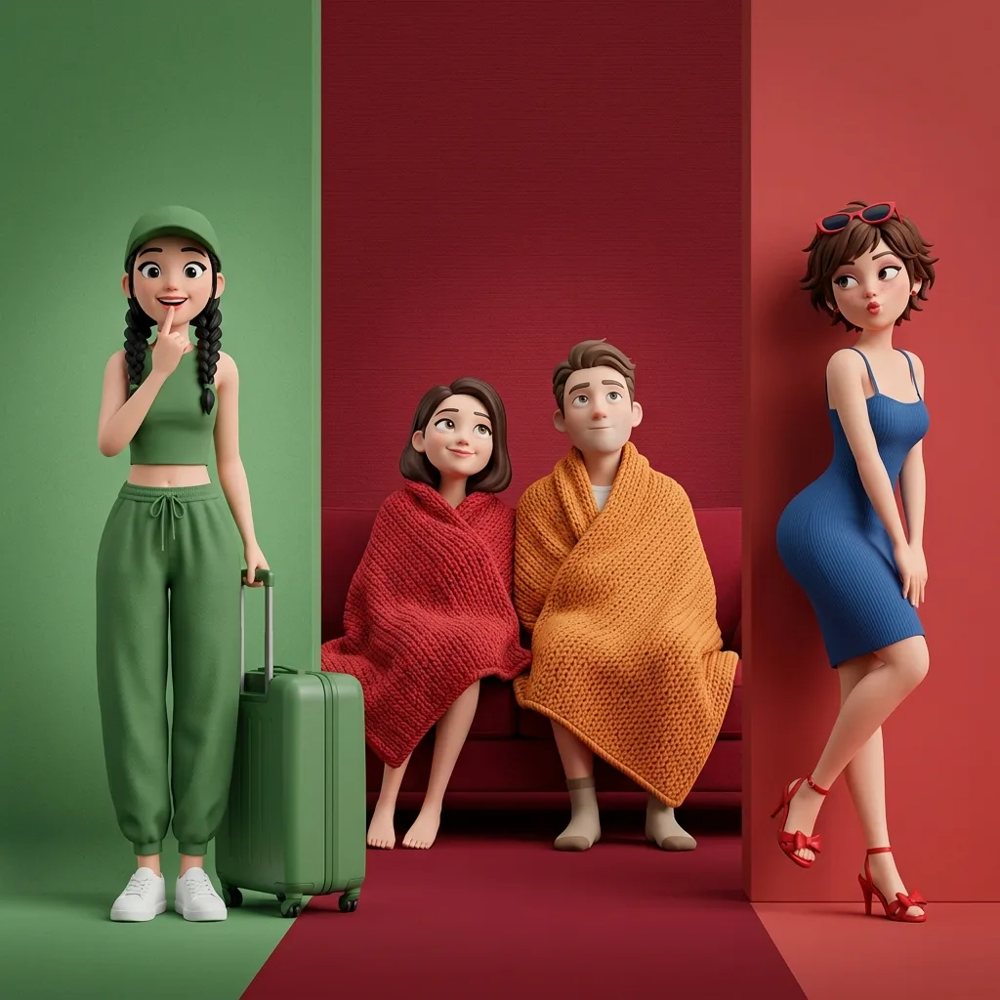

# Ultra-high definition , aspect ratio

[← Back to the collection](../../README.md) · Category: [Illustration & 3D](../../gallery/illustration-3d.md) · Model: `Vinano Image v2` · ID: `vn-01436`

<a href="https://vinano.ai?utm_source=github&utm_medium=readme&utm_campaign=awesome-image-video-prompts-updating&utm_content=prompt-page-image"></a>

<sub>Preview generated with <a href="https://vinano.ai?utm_source=github&utm_medium=readme&utm_campaign=awesome-image-video-prompts-updating&utm_content=prompt-page-caption">vinano.ai</a></sub>

## Prompt

```text
{
 "global_settings": {
 "resolution": "8K",
 "quality": "ultra-high definition",
 "aspect_ratio": "2:3",
 "render_style": "AI-edited, high-detail 3D render",
 "lighting_quality": "soft studio lighting realistic shadows",
 "sharpness": "extreme clarity, crisp edges",
 "noise": "none",
 "compression": "none"
 },

 "Module_1_Image_1_Style": {
 "subject": {
 "character_type": "stylized 3D cartoon female",
 "pose": "standing, body slightly angled, one hand raised index finger touching lips",
 "expression": "cheerful smile, wide eyes",
 "hair": {
 "color": "black",
 "style": "two braided pigtails",
 "accessories": "green cap"
 },
 "face": {
 "eyes": "large, rounded, dark pupils",
 "skin": "smooth, matte, stylized texture"
 }
 },
 "clothing": {
 "top": "sleeveless green crop top",
 "bottom": "loose green jogger-style pants drawstring",
 "footwear": "white sneakers"
 },
 "accessories": {
 "luggage": "green hard-shell suitcase extended handle"
 },
 "color_palette": ["multiple shades of green",
 "white accents"],
 "background": {
 "color": "solid green",
 "texture": "soft, slightly grainy studio backdrop"
 },
 "composition": {
 "framing": "full body",
 "camera_angle": "eye-level",
 "depth": "subject sharply separated from background"
 }
 },

 "Module_2_Image_2_Style": {
 "subject": {
 "character_type": "stylized 3D cartoon female",
 "pose": "leaning slightly backward against background",
 "expression": "playful, lips slightly pursed, eyes looking sideways",
 "hair": {
 "color": "brown",
 "style": "short, tousled",
 "accessories": "red sunglasses resting on head"
 }
 },
 "clothing": {
 "dress": "form-fitting blue ribbed dress thin straps",
 "footwear": "red high-heel sandals bow detail"
 },
 "color_palette": ["bold red",
 "deep blue"],
 "background": {
 "color": "solid red",
 "texture": "smooth matte surface"
 },
 "lighting": {
 "direction": "soft directional light from one side",
 "shadow": "defined shadow cast on red background"
 },
 "composition": {
 "framing": "full body",
 "pose_emphasis": "curved posture, crossed legs"
 }
 },

 "Module_3_Image_3_Style": {
 "subject": {
 "characters": [{
 "type": "stylized 3D cartoon female",
 "position": "left",
 "wrapped_in": "red textured blanket",
 "expression": "calm, slight smile, eyes looking upward"
 },
 {
 "type": "stylized 3D cartoon male",
 "position": "right",
 "wrapped_in": "orange textured blanket",
 "expression": "neutral, gentle gaze upward"
 }]
 },
 "environment": {
 "furniture": "red sofa",
 "floor": "red surface",
 "background": {
 "color": "deep red",
 "texture": "fabric-like horizontal texture"
 }
 },
 "details": {
 "feet": "female barefoot, male wearing socks",
 "blanket_texture": "thick, knitted fabric"
 },
 "composition": {
 "framing": "centered, medium-wide shot",
 "symmetry": "balanced left and right composition"
 }
 },

Aim for an editorial, design-driven look with deliberate negative space.
```

## Try it on vinano.ai

1. Copy the prompt above.
2. Open **[vinano.ai](https://vinano.ai?utm_source=github&utm_medium=readme&utm_campaign=awesome-image-video-prompts-updating&utm_content=prompt-page-try)**, paste it into the image generator and pick a model.
3. Swap any placeholders (brand, product, city, person…) for your own details, then generate.

More prompts like this: [Illustration & 3D gallery](../../gallery/illustration-3d.md) · [all categories](../../README.md#contents)
