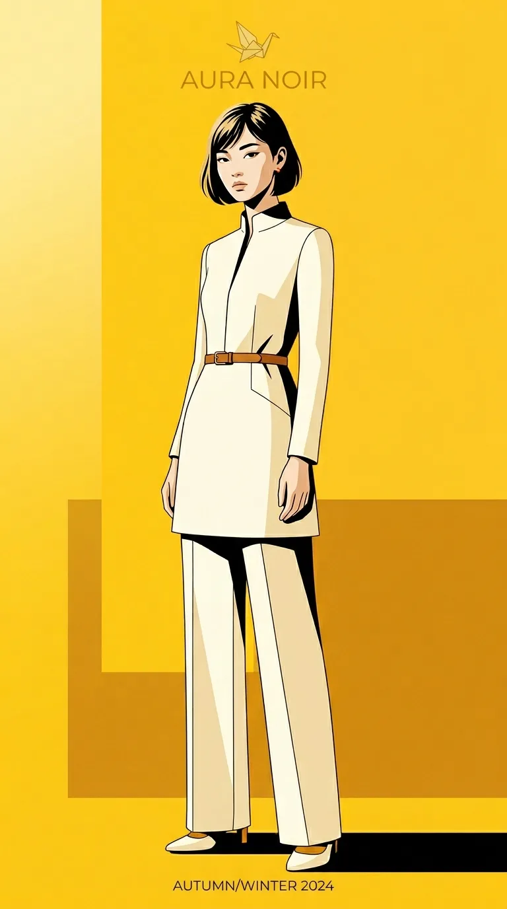

# 高端日系时装杂志封面感插画

[← Back to the collection](../../README.md) · Category: [Illustration & 3D](../../gallery/illustration-3d.md) · Model: `Vinano Image v2` · ID: `vn-01487`

<a href="https://vinano.ai?utm_source=github&utm_medium=readme&utm_campaign=awesome-image-video-prompts-updating&utm_content=prompt-page-image"></a>

<sub>Preview generated with <a href="https://vinano.ai?utm_source=github&utm_medium=readme&utm_campaign=awesome-image-video-prompts-updating&utm_content=prompt-page-caption">vinano.ai</a></sub>

## Prompt

```text
高端日系时装杂志封面感插画，主体为[Subject]，竖版 9:16，极简现代二次元时装插画风，精致赛璐璐上色，干净锐利的大色块塑形，几乎无线稿，边缘优雅清晰。整体改为黄黑色系配色，以明黄、金黄、琥珀黄作为主背景或主环境色，以米白、奶油白、浅肤色作为主体基础色，阴影与暗部使用纯黑、炭黑、深灰黑的硬边块面表现，形成强烈而高级的黄黑对比。可少量加入赭黄、焦糖色、灰褐色或极小面积橘红作为辅助点缀，但整体仍然简约、统一、不花哨。背景干净，保留大面积负空间。强烈光线从左上方照射，亮部通透，暗部利落，主体轮廓修长，姿态安静冷淡，整体像高级时尚杂志封面，醒目、极简、时尚、疏离。无文字，无水印，无复杂背景，无写实摄影，无 3D，无厚涂，无低幼卡通，无杂乱装饰。 在保证细节的同时保持版式克制、留白得当。
```

## Try it on vinano.ai

1. Copy the prompt above.
2. Open **[vinano.ai](https://vinano.ai?utm_source=github&utm_medium=readme&utm_campaign=awesome-image-video-prompts-updating&utm_content=prompt-page-try)**, paste it into the image generator and pick a model.
3. Swap any placeholders (brand, product, city, person…) for your own details, then generate.

More prompts like this: [Illustration & 3D gallery](../../gallery/illustration-3d.md) · [all categories](../../README.md#contents)
