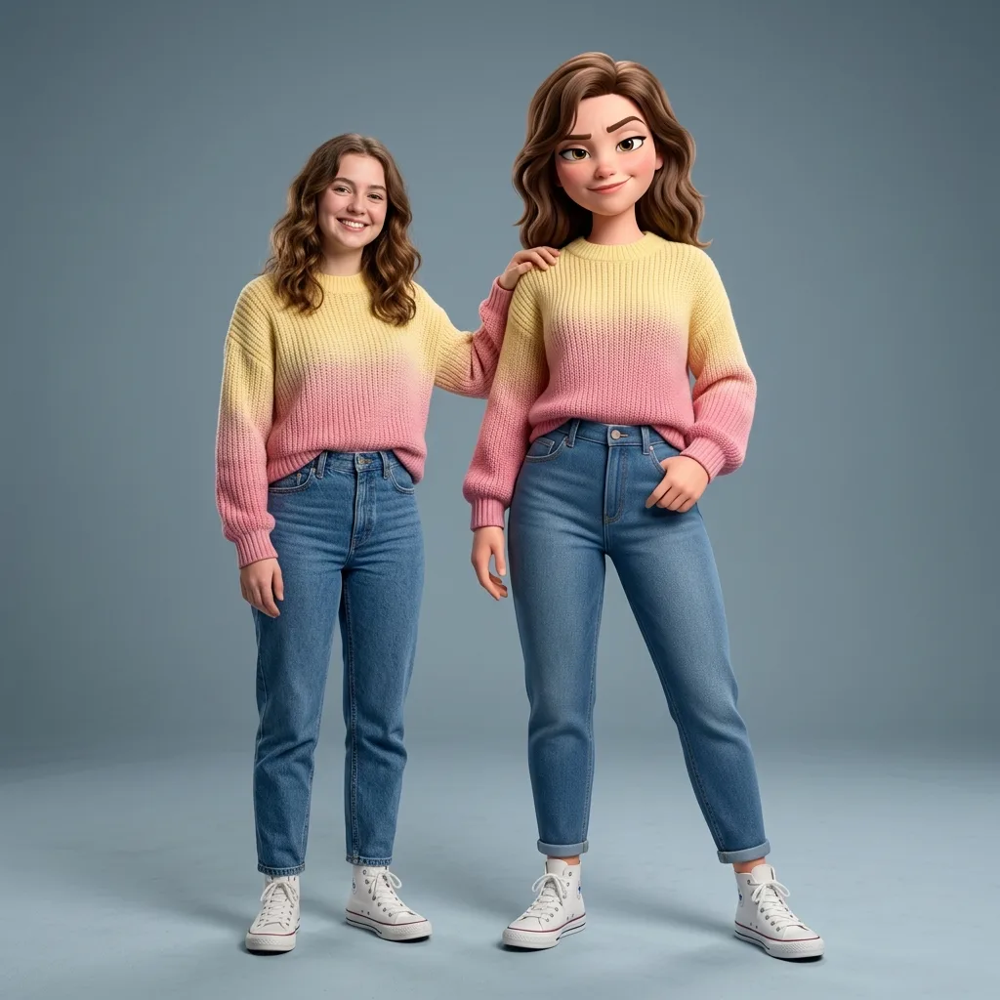

# Realistic, Character

[← Back to the collection](../../README.md) · Category: [Illustration & 3D](../../gallery/illustration-3d.md) · Model: `Vinano Image Pro` · ID: `vn-01514`

<a href="https://vinano.ai?utm_source=github&utm_medium=readme&utm_campaign=awesome-image-video-prompts-updating&utm_content=prompt-page-image"></a>

<sub>Preview generated with <a href="https://vinano.ai?utm_source=github&utm_medium=readme&utm_campaign=awesome-image-video-prompts-updating&utm_content=prompt-page-caption">vinano.ai</a></sub>

## Prompt

```text
Ultra-premium-quality hyper-realistic photo featuring a real human and a giant 3D Pixar-style version of THE SAME person — both strictly based on the uploaded reference image. The real person and the Pixar character must have identical facial structure, hairstyle, facial expression, body proportions, height, and clothing.
Both are wearing a knitted sweater a gradient from light yellow to pink, high-waisted blue jeans, and white high-top sneakers.
The pose must exactly match the reference: the real person stands relaxed a friendly smile, their hand naturally resting on the shoulder of the Pixar character. The Pixar version stands slightly wider, arms confidently positioned near the pockets, a playful sly smirk, one raised eyebrow, and expressive Pixar-style eyes.
The Pixar character should be proportionally larger, but anatomically identical to the real person. The facial expression, head tilt, posture, and body language must precisely replicate the reference image.
Clean gray-blue studio background, soft even studio lighting, realistic shadows, crisp fabric texture, smooth Pixar-style skin shading, cinematic sharpness.
DO NOT change the pose, reaction, clothing, or proportions. Strict adherence to the reference.

Keep edges clean and the overall composition balanced for a polished, gallery-ready result.
```

## Try it on vinano.ai

1. Copy the prompt above.
2. Open **[vinano.ai](https://vinano.ai?utm_source=github&utm_medium=readme&utm_campaign=awesome-image-video-prompts-updating&utm_content=prompt-page-try)**, paste it into the image generator and pick a model.
3. Swap any placeholders (brand, product, city, person…) for your own details, then generate.

More prompts like this: [Illustration & 3D gallery](../../gallery/illustration-3d.md) · [all categories](../../README.md#contents)
