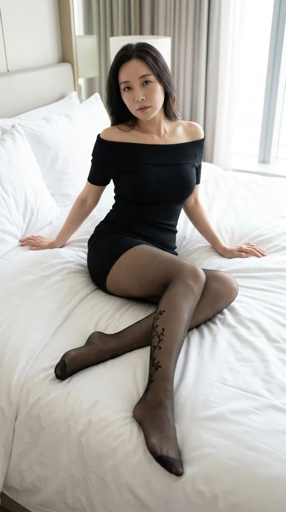

# Illustration & 3D prompt #1576

[← Back to the collection](../../README.md) · Category: [Illustration & 3D](../../gallery/illustration-3d.md) · Model: `Vinano Image v2` · ID: `vn-01576`

<a href="https://vinano.ai?utm_source=github&utm_medium=readme&utm_campaign=awesome-image-video-prompts-updating&utm_content=prompt-page-image"></a>

<sub>Preview generated with <a href="https://vinano.ai?utm_source=github&utm_medium=readme&utm_campaign=awesome-image-video-prompts-updating&utm_content=prompt-page-caption">vinano.ai</a></sub>

## Prompt

```text
竖版9:16，高分辨率真实商业摄影风格，一张高级酒店床上时尚人像写真。成年亚洲女性模特完整坐在柔软大床中央或靠近床头的位置，身体自然陷进床垫和白色床品里，周围有真实床单褶皱、压痕和下陷，明确是在床上放松休息，而不是坐在床边。人物穿【替换服装：黑色一字肩针织短裙 / 奶油白吊带睡裙 / 银灰缎面吊带裙 / 酒红丝绒短裙】，服装版型修身且有高级质感，能够自然体现胸部弧度、腰部收紧和成熟女性曲线。

人物身材必须是成熟成年女性的自然比例，胸围自然饱满但不过度夸张，胸型柔和立体，肩颈、锁骨、胸线、腰线、胯部比例协调，整体有健康、柔和、真实的女性魅力，不要平胸，不要男性化胸廓，不要少年感身材，不要纸片人，不要干瘪瘦弱。人物脸部要清晰精致，眼神看向镜头，表情有情绪和微表情，可以是温柔、慵懒、若有所思、轻微委屈、安静冷感或克制的心动感，不要面无表情，不要呆板，不要像证件照。

人物姿态要舒适自然，像真实摄影抓拍。身体可以微微后靠或侧靠，一只手自然撑在床面，另一只手轻放在腿侧或床单上。双腿都放在床面上，可以自然交叠、轻微弯曲、前后错落或向前延伸，动作柔和松弛，有生活感和呼吸感，不要僵硬摆拍，不要像坐在椅子上，不要紧绷用力。

丝袜为高端设计感连裤丝袜，材质轻薄、半透明、真实写实，有细腻尼龙纤维、自然拉伸、透明度变化、轻微丝光和真实压痕。丝袜款式选择【替换丝袜款式：稀疏法式藤蔓提花黑丝 / 珠光薄透白丝加侧边叶纹 / 复古后缝线黑丝加极简点缀 / 烟灰黑极简几何提花丝袜】。图案必须高级时尚、克制、留白充足，只在脚踝外侧、小腿外侧或大腿外侧做局部点缀，不要满版密集覆盖，不要厚重蕾丝感，不要密集恐惧感，不要廉价情趣感，不要哥特恐怖感。大部分腿部区域保持干净透薄，让肤色自然透出来，整体像高端时尚品牌丝袜 lookbook。

丝袜必须是真实穿着在脚上的完整一体式连裤丝袜结构，脚趾部分由同一层连续尼龙整体包裹，形成自然圆润的封闭脚尖区域，不允许每根脚趾独立分开，不允许像五指袜，不允许露出脚趾甲，不允许把丝袜花纹画在皮肤上。脚尖、脚背、脚踝到小腿之间要有真实丝袜拉伸后的透明度变化、纤维密度变化、微弱反光和自然压痕。

光线为酒店窗边柔和自然光，画面明亮干净，床品洁白蓬松，背景简洁高级，有真实摄影棚或酒店写真质感。整体审美偏高级、时尚、轻奢、杂志感，不要低俗姿势，不要裸露，不要色情感，不要畸形肢体，不要多余手指，不要塑料皮肤，不要过度磨皮，不要插画感，不要AI绘画感，不要浑浊，不要厚裤袜感。

保持配色统一、主体清晰，细节丰富但不杂乱。
```

## Try it on vinano.ai

1. Copy the prompt above.
2. Open **[vinano.ai](https://vinano.ai?utm_source=github&utm_medium=readme&utm_campaign=awesome-image-video-prompts-updating&utm_content=prompt-page-try)**, paste it into the image generator and pick a model.
3. Swap any placeholders (brand, product, city, person…) for your own details, then generate.

More prompts like this: [Illustration & 3D gallery](../../gallery/illustration-3d.md) · [all categories](../../README.md#contents)
