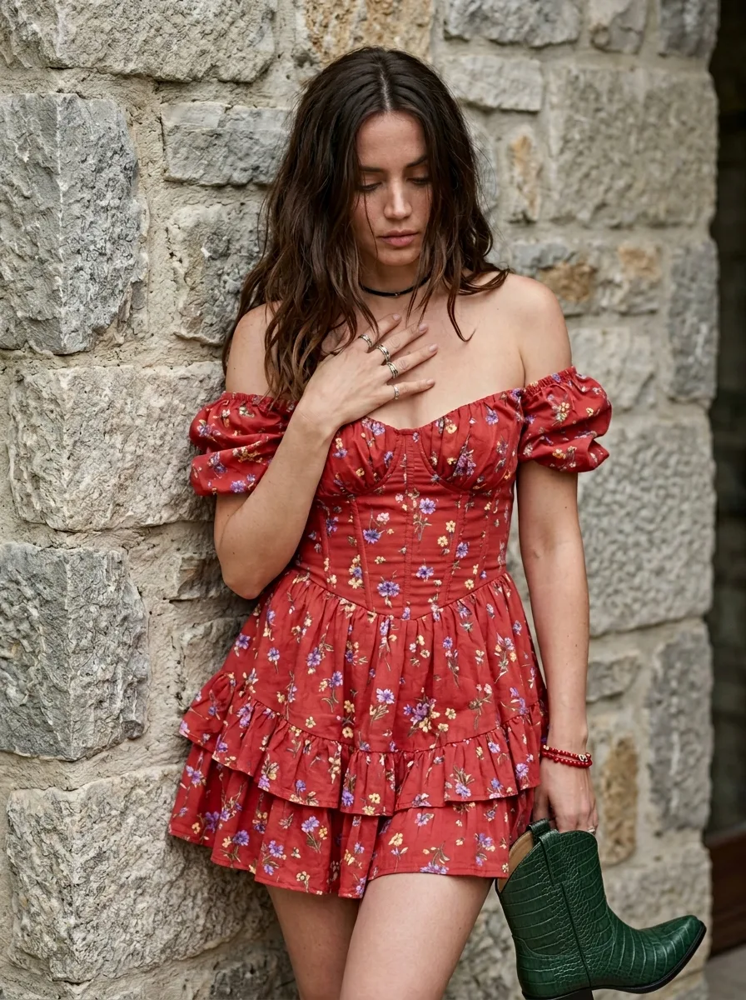

# Realistic, Portrait

[← Back to the collection](../../README.md) · Category: [Illustration & 3D](../../gallery/illustration-3d.md) · Model: `Vinano Image Pro` · ID: `vn-01578`

<a href="https://vinano.ai?utm_source=github&utm_medium=readme&utm_campaign=awesome-image-video-prompts-updating&utm_content=prompt-page-image"></a>

<sub>Preview generated with <a href="https://vinano.ai?utm_source=github&utm_medium=readme&utm_campaign=awesome-image-video-prompts-updating&utm_content=prompt-page-caption">vinano.ai</a></sub>

## Prompt

```text
{
  "prompt_details": {
    "subject": {
      "type": "Young woman Ana de Armas ",
      "appearance": {
        "hair": "Long, dark chestnut brown, loose waves, falling over face, messy aesthetic",
        "skin": "Fair complexion, smooth texture, natural finish",
        "face": "Looking downward, face partially obscured by hair, introspective expression",
        "body_type": "Slender, fit"
      },
      "pose": {
        "stance": "Leaning against a stone wall, body slightly angled",
        "hands": "Right hand resting gently on chest/neck fingers splayed, left hand holding a green object (boot) down by her side",
        "gaze": "Downward, avoiding eye contact"
      }
    },
    "clothing": {
      "dress": {
        "style": "Off-the-shoulder mini dress, cottagecore/boho style",
        "fabric": "Lightweight cotton or linen blend",
        "color": "Red/off-Red base",
        "pattern": "Small, delicate floral print purple and yellow wildflowers",
        "details": ["Ruffled tiered skirt", "Puffed short sleeves", "Sweetheart neckline", "Corset-style bodice structure"]
      },
      "accessories": ["Thin black choker necklace",
        "Multiple silver rings on fingers",
        "Red beaded bracelet on left wrist",
        "Holding a dark green, crocodile-texture cowboy boot"]
    },
    "environment": {
      "background": "Textured stone masonry wall",
      "details": "Large, irregular grey and beige stone blocks, rough texture, natural architectural backdrop",
      "setting": "Outdoor or semi-outdoor daylight setting"
    },
    "lighting": {
      "type": "Soft natural daylight",
      "quality": "Diffused, even illumination, soft shadows",
      "direction": "Front-lit but soft"
    },
    "styling": {
      "aesthetic": "Bohemian, chic, feminine, soft grunge undertones",
      "mood": "Casual, candid, slightly moody, artistic"
    },
    "camera_details": {
      "shot_type": "Medium shot (thigh-up)",
      "angle": "Eye-level",
      "lens": "85mm prime lens for flattering portrait compression",
      "aperture": "f/2.8 for slight depth of field separation from the wall",
      "focus": "Sharp focus on the subject and dress texture"
    },
    "technical_specifications": {
      "quality": "Ultra true-to-life photorealistic, 8k resolution, highly detailed",
      "texture_quality": "High fidelity fabric textures, realistic skin pores, detailed stone masonry",
      "engine": "Unreal Engine 5 render style or high-end photography" Ratio 3.4
    }
  }

Preserve realistic proportions and depth for a confident, professional finish.
```

## Try it on vinano.ai

1. Copy the prompt above.
2. Open **[vinano.ai](https://vinano.ai?utm_source=github&utm_medium=readme&utm_campaign=awesome-image-video-prompts-updating&utm_content=prompt-page-try)**, paste it into the image generator and pick a model.
3. Swap any placeholders (brand, product, city, person…) for your own details, then generate.

More prompts like this: [Illustration & 3D gallery](../../gallery/illustration-3d.md) · [all categories](../../README.md#contents)
