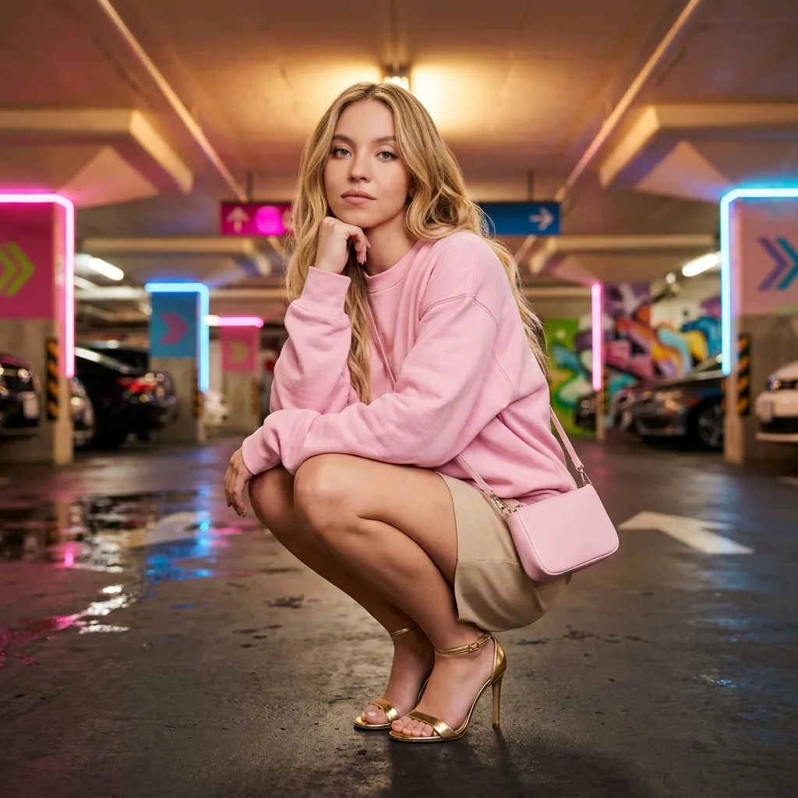

# Anime, Realistic

[← Back to the collection](../../README.md) · Category: [Illustration & 3D](../../gallery/illustration-3d.md) · Model: `Vinano Image Pro` · ID: `vn-01590`

<a href="https://vinano.ai?utm_source=github&utm_medium=readme&utm_campaign=awesome-image-video-prompts-updating&utm_content=prompt-page-image"></a>

<sub>Preview generated with <a href="https://vinano.ai?utm_source=github&utm_medium=readme&utm_campaign=awesome-image-video-prompts-updating&utm_content=prompt-page-caption">vinano.ai</a></sub>

## Prompt

```text
{
 "subject": {
 "name": "Sydney Sweeney",
 "gender": "female",
 "age": "young adult",
 "skin": "fair",
 "expression": "calm, confident"
 },

 "pose": {
 "body_position": "crouching low on the ground",
 "legs": "knees fully bent, heels on the ground",
 "arms": "one elbow resting on knee",
 "hands": "chin gently supported by hand",
 "camera_angle": "low angle",
 "framing": "full body visible"
 },

 "clothing": {
 "top": "oversized pastel pink sweatshirt, long sleeves",
 "bottom": "short beige skirt or shorts",
 "fit": "relaxed, oversized"
 },

 "shoes": {
 "type": "high-heeled sandals",
 "color": "metallic gold",
 "details": "thin straps, open toe"
 },

 "accessories": {
 "bag": "small pastel pink shoulder bag, crossbody",
 "style": "minimal, fashion editorial"
 },

 "hair": {
 "color": "blonde",
 "style": "long, wavy",
 "texture": "natural"
 },

 "gaze": {
 "direction": "looking at camera",
 "eye_expression": "soft, relaxed"
 },

 "environment": {
 "location": "underground parking area",
 "atmosphere": "vibrant, lively",
 "lighting": "warm lights neon accents",
 "background_style": "colorful reflections, slightly blurred"
 },

 "photography": {
 "style": "urban fashion editorial",
 "realism": "true-to-life photorealistic",
 "quality": "high detail",
 "lens": "35mm",
 "depth_of_field": "shallow",
 "shadows": "soft"
 },

 "negative_prompt": ["distorted body",
 "extra limbs",
 "unrealistic anatomy",
 "deformed face",
 "blurry",
 "low quality",
 "cartoon",
 "anime",
 "exaggerated proportions"],

 "output": {
 "width": 1024,
 "height": 1280,
 "aspect_ratio": "4:5"
 }
}

Keep edges clean and the overall composition balanced for a polished, gallery-ready result.
```

## Try it on vinano.ai

1. Copy the prompt above.
2. Open **[vinano.ai](https://vinano.ai?utm_source=github&utm_medium=readme&utm_campaign=awesome-image-video-prompts-updating&utm_content=prompt-page-try)**, paste it into the image generator and pick a model.
3. Swap any placeholders (brand, product, city, person…) for your own details, then generate.

More prompts like this: [Illustration & 3D gallery](../../gallery/illustration-3d.md) · [all categories](../../README.md#contents)
