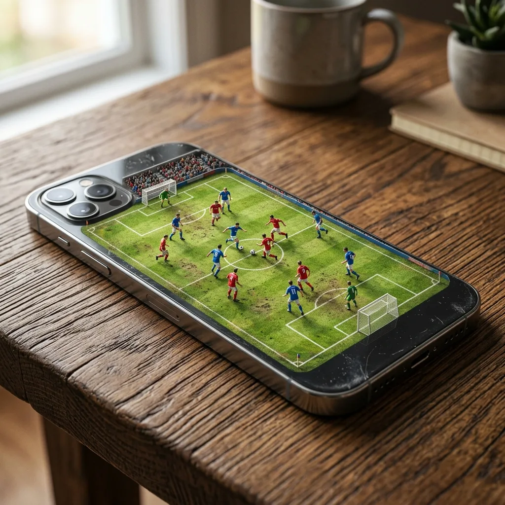

# Realistic, Cinematic

[← Back to the collection](../../README.md) · Category: [Illustration & 3D](../../gallery/illustration-3d.md) · Model: `Vinano Image v2` · ID: `vn-01606`

<a href="https://vinano.ai?utm_source=github&utm_medium=readme&utm_campaign=awesome-image-video-prompts-updating&utm_content=prompt-page-image"></a>

<sub>Preview generated with <a href="https://vinano.ai?utm_source=github&utm_medium=readme&utm_campaign=awesome-image-video-prompts-updating&utm_content=prompt-page-caption">vinano.ai</a></sub>

## Prompt

```text
{
 "type": "image_generation",
 "style": "hyper_realistic",
 "quality": "8K DSLR",
 "aspect_ratio": "4:5",
 "camera": {
 "angle": "slightly tilted cinematic perspective",
 "lens": "50mm DSLR",
 "depth_of_field": "shallow",
 "focus": "smartphone and football action"
 },
 "scene": {
 "setting": "smartphone placed on a wooden table",
 "concept": "phone screen transformed into a miniature football stadium",
 "environment": "indoor, soft daylight coming from the side",
 "atmosphere": "cinematic, immersive, realistic"
 },
 "details": {
 "screen": "weathered green football pitch visible wear, dirt patches, and grass texture",
 "players": "miniature football players actively playing a match dynamic poses",
 "lighting": "soft diffused daylight subtle lens flares and realistic reflections",
 "realism_effects": ["fingerprints on screen",
 "light scratches on phone body",
 "natural smudges",
 "micro dust particles"]
 },
 "materials": {
 "phone": "metallic frame realistic reflections",
 "table": "textured wooden surface warm tones"
 },
 "mood": "high-end cinematic, dramatic, premium advertising look",
 "rendering": {
 "sharpness": "ultra sharp",
 "texture_detail": "extreme",
 "lighting_quality": "studio grade",
 "photorealism": true
 }
}

Maintain consistent colour harmony and crisp focus across the whole frame.
```

## Try it on vinano.ai

1. Copy the prompt above.
2. Open **[vinano.ai](https://vinano.ai?utm_source=github&utm_medium=readme&utm_campaign=awesome-image-video-prompts-updating&utm_content=prompt-page-try)**, paste it into the image generator and pick a model.
3. Swap any placeholders (brand, product, city, person…) for your own details, then generate.

More prompts like this: [Illustration & 3D gallery](../../gallery/illustration-3d.md) · [all categories](../../README.md#contents)
