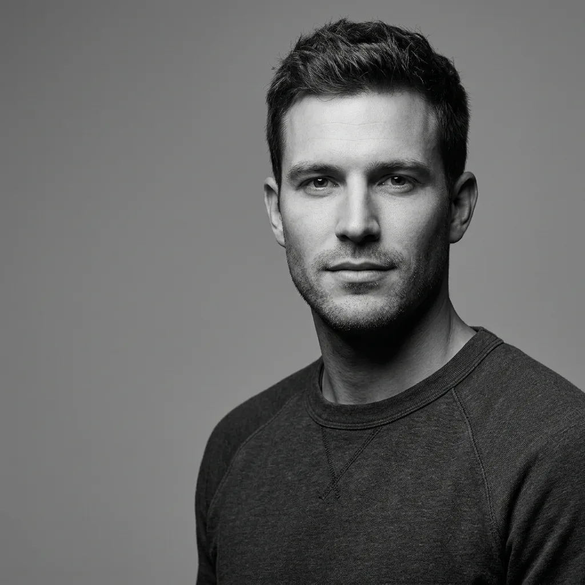

# Portrait, Cinematic

[← Back to the collection](../../README.md) · Category: [Illustration & 3D](../../gallery/illustration-3d.md) · Model: `Vinano Image Pro` · ID: `vn-01637`

<a href="https://vinano.ai?utm_source=github&utm_medium=readme&utm_campaign=awesome-image-video-prompts-updating&utm_content=prompt-page-image"></a>

<sub>Preview generated with <a href="https://vinano.ai?utm_source=github&utm_medium=readme&utm_campaign=awesome-image-video-prompts-updating&utm_content=prompt-page-caption">vinano.ai</a></sub>

## Prompt

```text
{
 "style": "monochrome studio portrait",
 "subject": {
 "identity": "same man as reference",
 "expression": "calm, confident",
 "shot_type": "tight-medium"
 },
 "lighting": {
 "setup": "minimal",
 "falloff": "soft",
 "mood": "focused on subject",
 "notes": "deep shadows and subtle gradients shape the face"
 },
 "wardrobe": {
 "type": "casual stylish",
 "examples": ["simple tee", "light-textured sweatshirt"],
 "compatibility": "designed to look good in black and white"
 },
 "background": {
 "style": "clean",
 "distractions": "none",
 "tone": "neutral"
 },
 "render": {
 "palette": "high-contrast black and white",
 "detail": "crisp",
 "tone": "smooth",
 "depth": "subtle cinematic depth"
 },
 "overall_vibe": "balanced, calm, confident"
}

Aim for an editorial, design-driven look with deliberate negative space.
```

## Try it on vinano.ai

1. Copy the prompt above.
2. Open **[vinano.ai](https://vinano.ai?utm_source=github&utm_medium=readme&utm_campaign=awesome-image-video-prompts-updating&utm_content=prompt-page-try)**, paste it into the image generator and pick a model.
3. Swap any placeholders (brand, product, city, person…) for your own details, then generate.

More prompts like this: [Illustration & 3D gallery](../../gallery/illustration-3d.md) · [all categories](../../README.md#contents)
