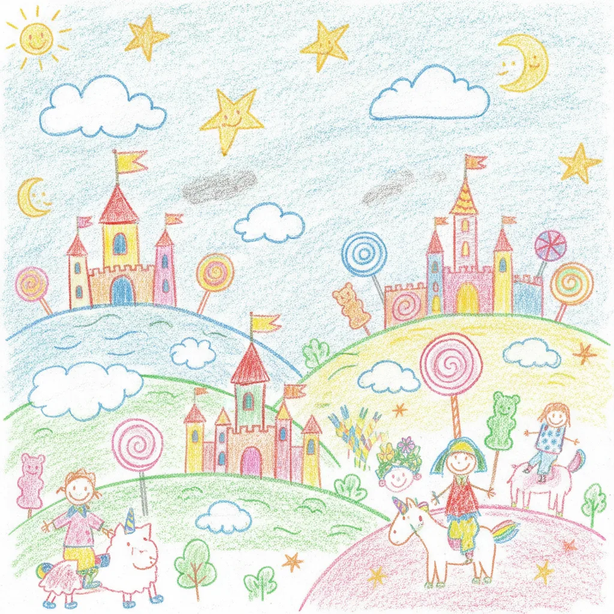

# Rework the given image into a crayon-style illustration, transforming

[← Back to the collection](../../README.md) · Category: [Illustration & 3D](../../gallery/illustration-3d.md) · Model: `Vinano Image` · ID: `vn-01648`

<a href="https://vinano.ai?utm_source=github&utm_medium=readme&utm_campaign=awesome-image-video-prompts-updating&utm_content=prompt-page-image"></a>

<sub>Preview generated with <a href="https://vinano.ai?utm_source=github&utm_medium=readme&utm_campaign=awesome-image-video-prompts-updating&utm_content=prompt-page-caption">vinano.ai</a></sub>

## Prompt

```text
Rework the given image into a crayon-style illustration, transforming the entire scene into something that feels hand-drawn by a 10-year-old. Keep the forms simple and slightly imperfect, like a child’s drawing.

Avoid the original color palette—replace it bright, playful crayon colors on a clean white paper background. Aim for a soft, cute, and innocent aesthetic.

Incorporate fun, childlike details such as castles or towers, candy, stars, clouds, and other whimsical decorations to amplify the playful vibe.

The final result should feel charming, colorful, and full of childlike imagination.

Render with rich micro-detail while keeping the layout uncluttered and intentional.
```

## Try it on vinano.ai

1. Copy the prompt above.
2. Open **[vinano.ai](https://vinano.ai?utm_source=github&utm_medium=readme&utm_campaign=awesome-image-video-prompts-updating&utm_content=prompt-page-try)**, paste it into the image generator and pick a model.
3. Swap any placeholders (brand, product, city, person…) for your own details, then generate.

More prompts like this: [Illustration & 3D gallery](../../gallery/illustration-3d.md) · [all categories](../../README.md#contents)
