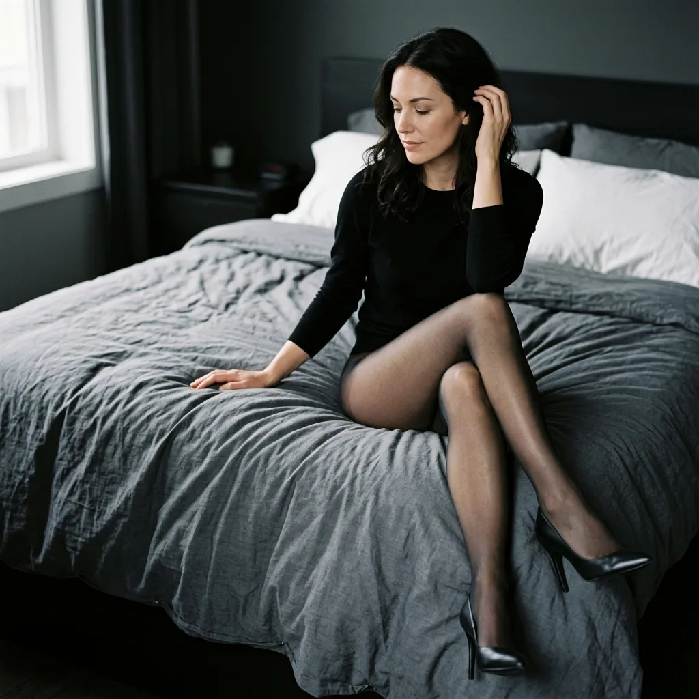

# Realistic, Portrait

[← Back to the collection](../../README.md) · Category: [Illustration & 3D](../../gallery/illustration-3d.md) · Model: `Vinano Image v2` · ID: `vn-01655`

<a href="https://vinano.ai?utm_source=github&utm_medium=readme&utm_campaign=awesome-image-video-prompts-updating&utm_content=prompt-page-image"></a>

<sub>Preview generated with <a href="https://vinano.ai?utm_source=github&utm_medium=readme&utm_campaign=awesome-image-video-prompts-updating&utm_content=prompt-page-caption">vinano.ai</a></sub>

## Prompt

```text
Dark Bedroom Hosiery Editorial, vertical 9:16.

Create a realistic fashion editorial portrait of an adult female model seated on the bed, not on the bed edge. Grey bedding, white pillows, soft wrinkled sheets, low-saturation cool grey tones, soft window light.

Consistent composition: model placed slightly to the right, body forming a natural diagonal line, legs as the main visual focus, clean bedding space on the left. She looks slightly downward, one hand gently adjusting her hair, the other hand resting naturally. Calm, elegant, unforced pose, no direct eye contact.

All-black styling: black top, black hosiery, black closed-toe heels.
Hosiery direction: [Hosiery Style].
The hosiery should look realistic: medium-black tone, subtle transparency, smooth texture, soft light reflection, natural stretch and elegant leg shaping.

Shoes must fully cover the toes. Feet and ankles should look natural, elongated and relaxed. Avoid twisted ankles, floating feet, exposed toes or broken shoe structure.

High clarity, realistic skin texture, clear facial features, clear hands, clear hosiery details, clear shoe structure, detailed bedding folds.

Avoid low resolution, blurry subject, plastic skin, distorted hands, twisted feet, messy hosiery pattern, unrealistic body proportions, cartoon or illustration style.

Preserve realistic proportions and depth for a confident, professional finish.
```

## Try it on vinano.ai

1. Copy the prompt above.
2. Open **[vinano.ai](https://vinano.ai?utm_source=github&utm_medium=readme&utm_campaign=awesome-image-video-prompts-updating&utm_content=prompt-page-try)**, paste it into the image generator and pick a model.
3. Swap any placeholders (brand, product, city, person…) for your own details, then generate.

More prompts like this: [Illustration & 3D gallery](../../gallery/illustration-3d.md) · [all categories](../../README.md#contents)
