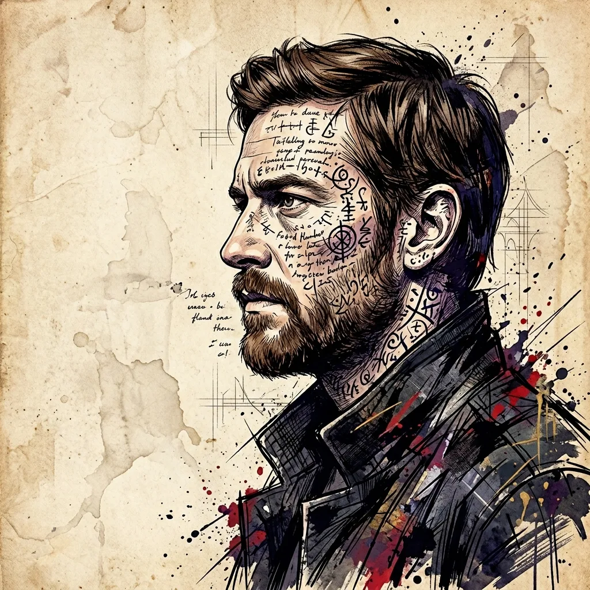

# Portrait, Ai Art

[← Back to the collection](../../README.md) · Category: [Illustration & 3D](../../gallery/illustration-3d.md) · Model: `Vinano Image Pro` · ID: `vn-01709`

<a href="https://vinano.ai?utm_source=github&utm_medium=readme&utm_campaign=awesome-image-video-prompts-updating&utm_content=prompt-page-image"></a>

<sub>Preview generated with <a href="https://vinano.ai?utm_source=github&utm_medium=readme&utm_campaign=awesome-image-video-prompts-updating&utm_content=prompt-page-caption">vinano.ai</a></sub>

## Prompt

```text
Use the uploaded photo as the main face referenc. Preserve the exact facial structure, skin tone, beard shape, nose, eyes and expression from the reference image. A dramatic, high-impact portrait rendered in an expressive ink sketch and mixed-media illustration style, the uploaded image for exact facial likeness and proportions. The man is shown in side profile, his presence intense and chaotic. His face and upper body are layered cryptic handwritten text, symbols, and abstract glyphs, partially wrapping around facial contours, suggesting inner turmoil and hidden meaning He wears a dark, abstract jacket, heavily texture strokes, sharp angular linework, and vibrant ink creating a raw, rebellious visual energy. The illu bold and experimental, blending fine pen detaili aggressive brush marks, splashes, and controll The background is a pale, aged parchment ton grain, faded paper texture, delicate linework, in! stains-evoking an old manuscript Or forgotten High contrast, expressive composition, artistic precision, editorial art meets conceptual il intense, and emotionally charged. Aim for an editorial, design-driven look with deliberate negative space.
```

## Try it on vinano.ai

1. Copy the prompt above.
2. Open **[vinano.ai](https://vinano.ai?utm_source=github&utm_medium=readme&utm_campaign=awesome-image-video-prompts-updating&utm_content=prompt-page-try)**, paste it into the image generator and pick a model.
3. Swap any placeholders (brand, product, city, person…) for your own details, then generate.

More prompts like this: [Illustration & 3D gallery](../../gallery/illustration-3d.md) · [all categories](../../README.md#contents)
