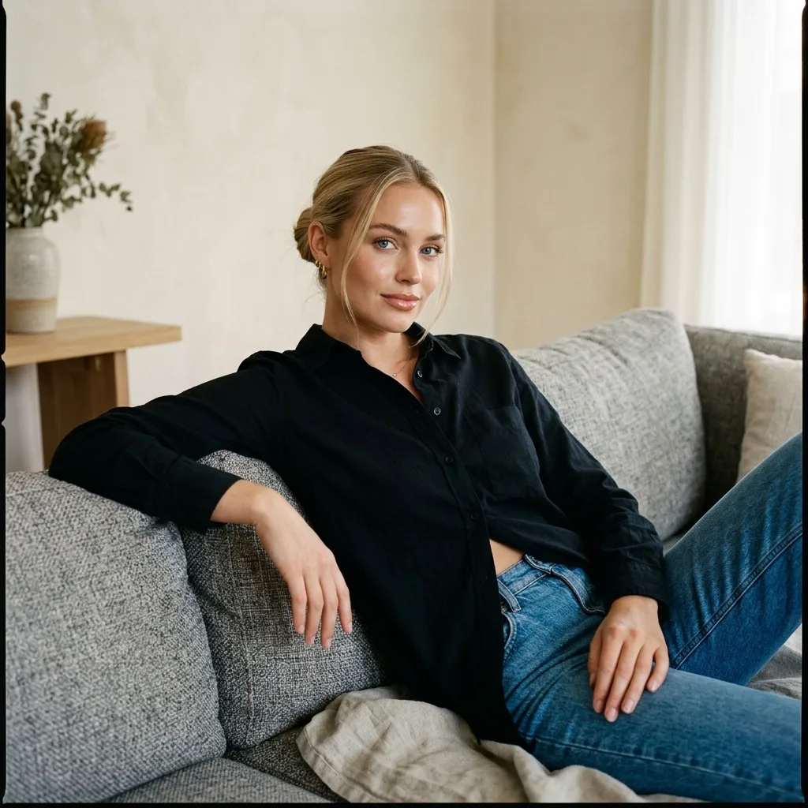

# Realistic, Minimalist

[← Back to the collection](../../README.md) · Category: [Illustration & 3D](../../gallery/illustration-3d.md) · Model: `Vinano Image Pro` · ID: `vn-01725`

<a href="https://vinano.ai?utm_source=github&utm_medium=readme&utm_campaign=awesome-image-video-prompts-updating&utm_content=prompt-page-image"></a>

<sub>Preview generated with <a href="https://vinano.ai?utm_source=github&utm_medium=readme&utm_campaign=awesome-image-video-prompts-updating&utm_content=prompt-page-caption">vinano.ai</a></sub>

## Prompt

```text
{
 "subject_and_scene": {
 "main_subject": "A beautiful young woman blonde hair tied back, striking blue eyes, and natural makeup glossy lips. She is wearing a black long-sleeve button-down shirt unbuttoned at the waist and classic blue denim jeans.",
 "action": "Reclining casually on a grey fabric sofa, looking directly into the camera a soft, confident expression.",
 "environment": "refined minimalist indoor living space neutral cream-colored walls and a textured grey sectional sofa, creating a clean and intimate atmosphere."
 },
 "cinematography": {
 "camera_model": "Sony Venice 2",
 "sensor_type": "Full Frame",
 "shot_type": "Medium Close-Up",
 "camera_angle": "High Angle (slightly looking down)",
 "movement": "Static"
 },
 "optics": {
 "lens_type": "Spherical",
 "focal_length": "35mm (Standard)",
 "aperture": "f/2.8 (Moderate depth of field to maintain detail on subject and sofa texture)",
 "shutter_effects": "High Shutter Speed (Freeze frame for maximum clarity)"
 },
 "lighting_design": {
 "setup": "Butterfly Lighting soft side fill",
 "style": "Naturalistic High-Key",
 "atmospheric_light": "Soft diffused window light creating gentle shadows and natural highlights on the skin",
 "color_temperature": "Natural Daylight (5500K)"
 },
 "color_and_post": {
 "film_stock": "Kodak Portra 400",
 "color_grading": "Muted Log-C emphasis on natural skin tones and deep blacks",
 "analog_artifacts": "Fine Film Grain and subtle Halation on skin highlights"
 },
 "rendering_and_tech": {
 "engine": "Octane Render",
 "advanced_tech": "Subsurface Scattering for hyper-realistic skin texture, Global Illumination, Ray Tracing",
 "specs": {
 "aspect_ratio": "1.85:1 (Standard)",
 "resolution": "8K, true-to-life photorealistic, Hyper-detailed"
 }
 },
 "directorial_style": "Denis Villeneuve"
}

Emphasise material texture and natural light so the final frame feels tactile and premium.
```

## Try it on vinano.ai

1. Copy the prompt above.
2. Open **[vinano.ai](https://vinano.ai?utm_source=github&utm_medium=readme&utm_campaign=awesome-image-video-prompts-updating&utm_content=prompt-page-try)**, paste it into the image generator and pick a model.
3. Swap any placeholders (brand, product, city, person…) for your own details, then generate.

More prompts like this: [Illustration & 3D gallery](../../gallery/illustration-3d.md) · [all categories](../../README.md#contents)
