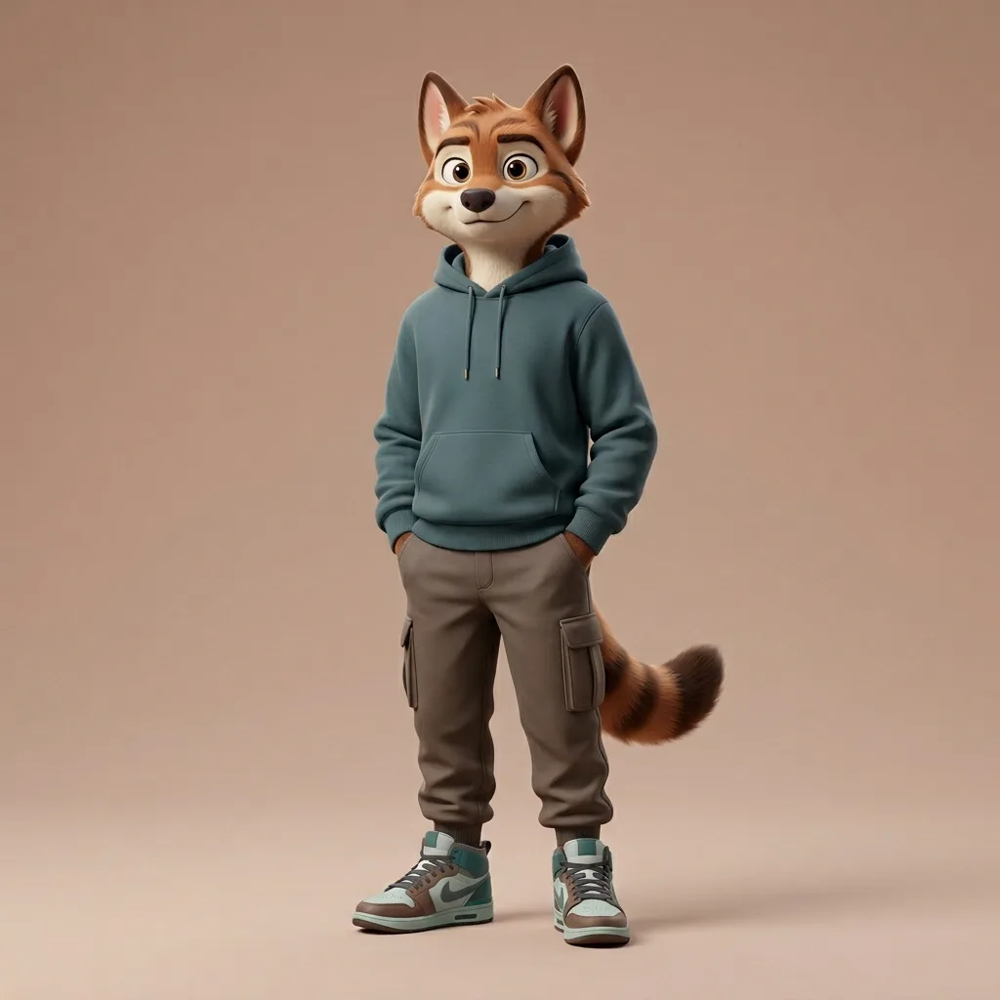

# Character, Ai Art

[← Back to the collection](../../README.md) · Category: [Illustration & 3D](../../gallery/illustration-3d.md) · Model: `Vinano Image Pro` · ID: `vn-01738`

<a href="https://vinano.ai?utm_source=github&utm_medium=readme&utm_campaign=awesome-image-video-prompts-updating&utm_content=prompt-page-image"></a>

<sub>Preview generated with <a href="https://vinano.ai?utm_source=github&utm_medium=readme&utm_campaign=awesome-image-video-prompts-updating&utm_content=prompt-page-caption">vinano.ai</a></sub>

## Prompt

```text
the provided reference_image as the primary source for identity, clothing colors, and visual attributes, create a full-body 3D stylized anthropomorphic cartoon version of the character. Preserve facial structure, body proportions, silhouette, and distinctive traits exactly as in the reference_image.
The outfit must match the clothing colors from the reference_image. Extract and apply the exact dominant and secondary colors from the reference_image to the hoodie, cargo pants, and sneakers. Do not introduce new colors. Do not default to orange or neon green unless they exist in the reference_image.
Modern streetwear styling is allowed, but color palette must strictly follow the reference_image.
Confident relaxed pose hands in pockets.
Minimal studio background the dominant background color sampled from the reference_image, or a harmonized tone derived from it. Soft studio lighting, smooth shadows, high-detail fabric texture, Pixar-quality 3D render, ultra-crisp composition, centered framing, 8K resolution.
Add enforcement: “Strict color adherence to reference_image. No automatic color substitution.

Aim for an editorial, design-driven look with deliberate negative space.
```

## Try it on vinano.ai

1. Copy the prompt above.
2. Open **[vinano.ai](https://vinano.ai?utm_source=github&utm_medium=readme&utm_campaign=awesome-image-video-prompts-updating&utm_content=prompt-page-try)**, paste it into the image generator and pick a model.
3. Swap any placeholders (brand, product, city, person…) for your own details, then generate.

More prompts like this: [Illustration & 3D gallery](../../gallery/illustration-3d.md) · [all categories](../../README.md#contents)
