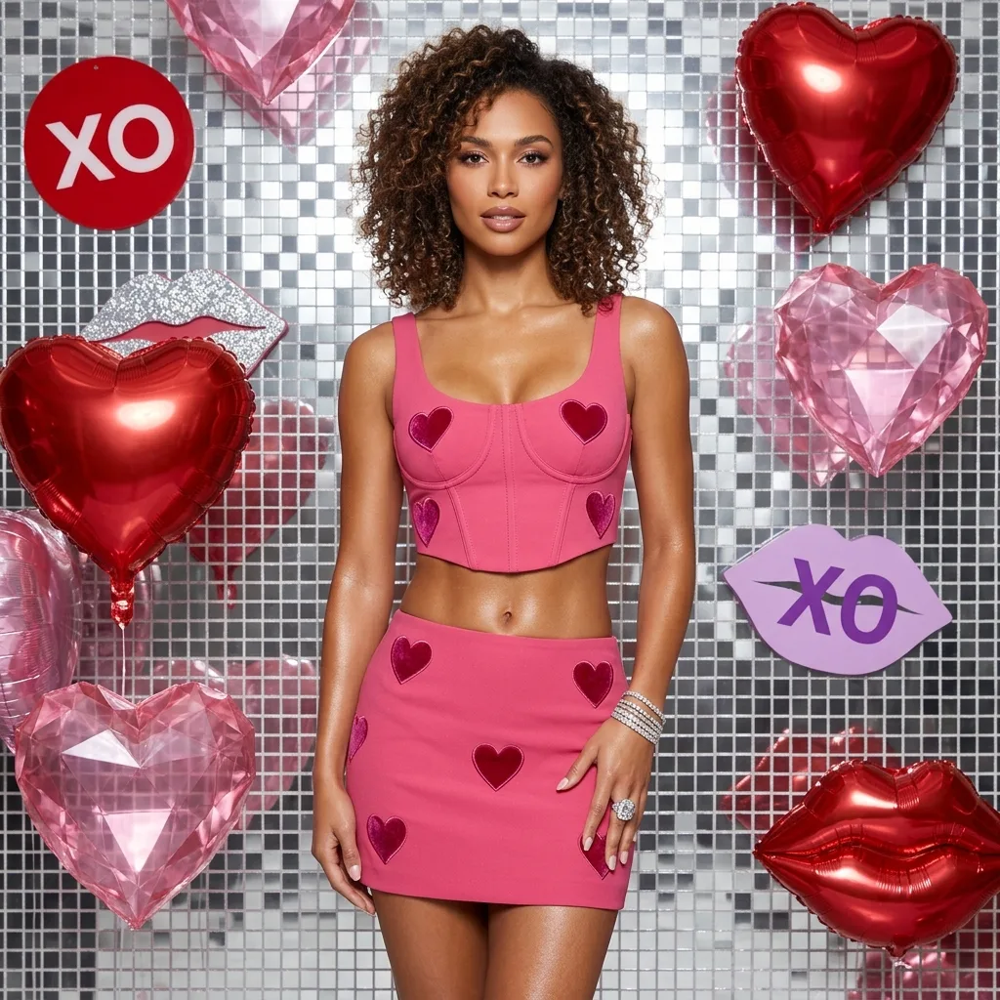

# Realistic, Ai Art

[← Back to the collection](../../README.md) · Category: [Illustration & 3D](../../gallery/illustration-3d.md) · Model: `Vinano Image Pro` · ID: `vn-01825`

<a href="https://vinano.ai?utm_source=github&utm_medium=readme&utm_campaign=awesome-image-video-prompts-updating&utm_content=prompt-page-image"></a>

<sub>Preview generated with <a href="https://vinano.ai?utm_source=github&utm_medium=readme&utm_campaign=awesome-image-video-prompts-updating&utm_content=prompt-page-caption">vinano.ai</a></sub>

## Prompt

```text
{
 "image_metadata": {
 "theme": "Glamorous Valentine's Day / Love Aesthetic",
 "aspect_ratio": "3:4",
 "shot_type": "Medium-long shot, eye-level angle"
 },
 "subject_details": {
 "use_reference_image": true,
 "override": false,
 "physique": "Slender, fit, toned midriff"
 },
 "attire_and_styling": {
 "outfit": {
 "type": "Two-piece matching set",
 "top": "Vibrant rose-pink crop top, scoop neckline, corset-style stitching, dark pink velvet heart appliqués",
 "bottom": "Matching high-waisted mini skirt, dark pink velvet heart appliqués",
 "color_profile": "Hot pink / Magenta base crimson heart details"
 },
 "jewelry": ["Stack of silver diamond-encrusted tennis bracelets on right wrist",
 "Large silver statement ring a clear gemstone on left hand"]
 },
 "environment_details": {
 "background": {
 "texture": "Silver mosaic mirrored tile wall, shimmering disco-ball effect",
 "lighting": "Bright, direct studio lighting, high-key, creating sharp specular highlights on the tiles and skin"
 },
 "floating_props": [{
 "object": "Heart balloons",
 "details": "Large 3D metallic red foil hearts, faceted translucent pink crystal hearts"
 },
 {
 "object": "Lip decorations",
 "details": "Oversized pink lips, some silver glitter, some purple 'XO' text, others in red metallic foil"
 },
 {
 "object": "Text elements",
 "details": "Red 'XO' circular sign on the left"
 }]
 },
 "technical_parameters": {
 "color_palette": ["Vibrant Pink",
 "Silver Chrome",
 "Crimson Red",
 "Platinum White"],
 "quality_tags": ["true-to-life photorealistic",
 "8k resolution",
 "highly detailed skin pores",
 "sharp focus",
 "commercial fashion photography style",
 "soft bokeh on background depth"]
 }
}

Render with rich micro-detail while keeping the layout uncluttered and intentional.
```

## Try it on vinano.ai

1. Copy the prompt above.
2. Open **[vinano.ai](https://vinano.ai?utm_source=github&utm_medium=readme&utm_campaign=awesome-image-video-prompts-updating&utm_content=prompt-page-try)**, paste it into the image generator and pick a model.
3. Swap any placeholders (brand, product, city, person…) for your own details, then generate.

More prompts like this: [Illustration & 3D gallery](../../gallery/illustration-3d.md) · [all categories](../../README.md#contents)
