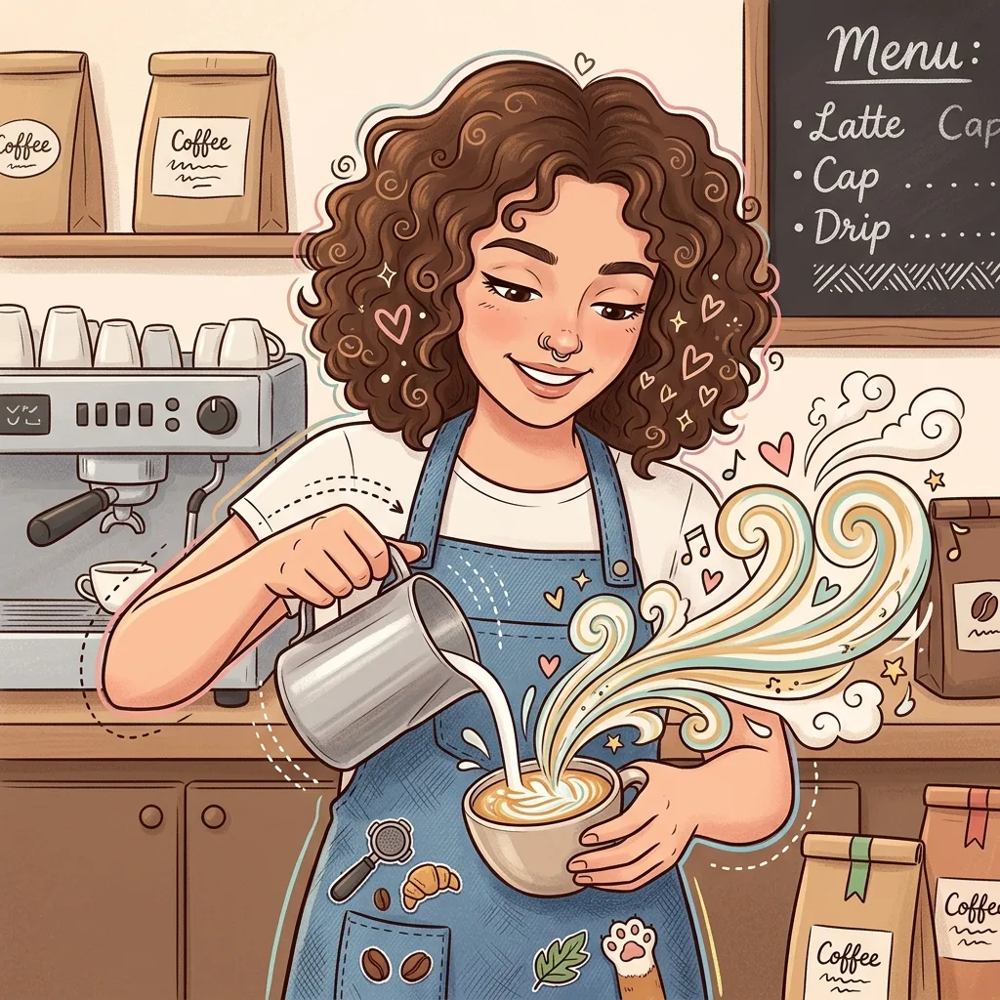

# Character, Ai Art

[← Back to the collection](../../README.md) · Category: [Illustration & 3D](../../gallery/illustration-3d.md) · Model: `Vinano Image v2` · ID: `vn-01835`

<a href="https://vinano.ai?utm_source=github&utm_medium=readme&utm_campaign=awesome-image-video-prompts-updating&utm_content=prompt-page-image"></a>

<sub>Preview generated with <a href="https://vinano.ai?utm_source=github&utm_medium=readme&utm_campaign=awesome-image-video-prompts-updating&utm_content=prompt-page-caption">vinano.ai</a></sub>

## Prompt

```text
Analyze the uploaded image and preserve the original subject, composition, and lighting. Do not alter the identity or facial structure of the main character. Add playful hand-drawn doodle elements that interact directly the subject in the photo. The doodles should mimic, follow, or exaggerate the existing shapes, gestures, or movements — such as outlining the pose, extending arms or legs, adding motion lines, or creating imaginative elements that “react” to the subject.
Step 2:
Transform the entire image into a cute cartoon-style illustration adorable doodle aesthetics. Maintain the original scene and character details while applying a vibrant, soft, and playful cartoon look.

Render with rich micro-detail while keeping the layout uncluttered and intentional.
```

## Try it on vinano.ai

1. Copy the prompt above.
2. Open **[vinano.ai](https://vinano.ai?utm_source=github&utm_medium=readme&utm_campaign=awesome-image-video-prompts-updating&utm_content=prompt-page-try)**, paste it into the image generator and pick a model.
3. Swap any placeholders (brand, product, city, person…) for your own details, then generate.

More prompts like this: [Illustration & 3D gallery](../../gallery/illustration-3d.md) · [all categories](../../README.md#contents)
