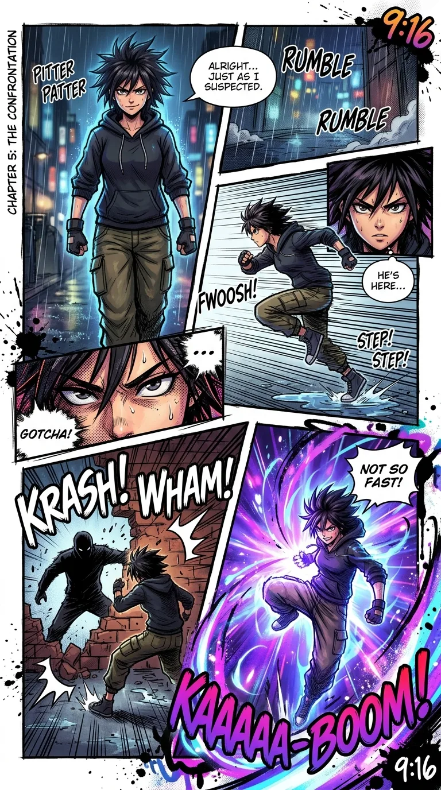

# Character, Cinematic

[← Back to the collection](../../README.md) · Category: [Illustration & 3D](../../gallery/illustration-3d.md) · Model: `Vinano Image Pro` · ID: `vn-01875`

<a href="https://vinano.ai?utm_source=github&utm_medium=readme&utm_campaign=awesome-image-video-prompts-updating&utm_content=prompt-page-image"></a>

<sub>Preview generated with <a href="https://vinano.ai?utm_source=github&utm_medium=readme&utm_campaign=awesome-image-video-prompts-updating&utm_content=prompt-page-caption">vinano.ai</a></sub>

## Prompt

```text
Create a full-page colored manga illustration based on the person in the reference photo. Use authentic manga page composition 5–7 dynamic connected panels on a single page. Include cinematic storytelling, dramatic perspective, expressive emotions, dynamic poses, speed lines, impact frames, close-up shots, and intense visual flow.Add English comic-style sound effects, handwritten dialogue bubbles, ink splatter strokes, halftone textures, rough comic sketch lines, and graffiti-inspired brushwork. Blend vibrant colors manga-style shading and strong contrast. Emphasize the character’s personality and aura symbolic visual elements and atmospheric energy effects. Highly detailed, emotional, stylish, energetic, professional manga aesthetic clean white negative space mixed chaotic ink textures.Hand-drawn look, free-flowing lines, immersive composition, premium quality. Aspect ratio 9:16 HD. Aim for an editorial, design-driven look with deliberate negative space.
```

## Try it on vinano.ai

1. Copy the prompt above.
2. Open **[vinano.ai](https://vinano.ai?utm_source=github&utm_medium=readme&utm_campaign=awesome-image-video-prompts-updating&utm_content=prompt-page-try)**, paste it into the image generator and pick a model.
3. Swap any placeholders (brand, product, city, person…) for your own details, then generate.

More prompts like this: [Illustration & 3D gallery](../../gallery/illustration-3d.md) · [all categories](../../README.md#contents)
