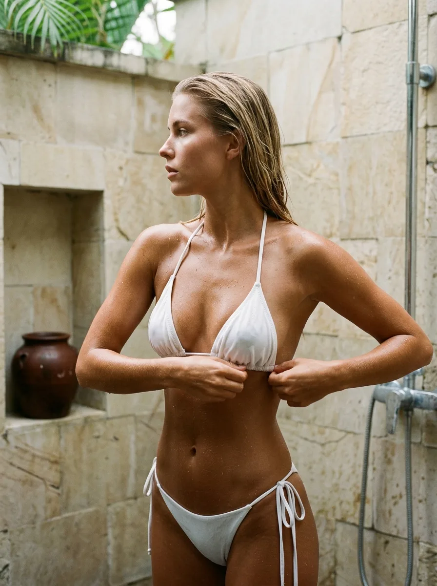

# Anime, Realistic

[← Back to the collection](../../README.md) · Category: [Illustration & 3D](../../gallery/illustration-3d.md) · Model: `Vinano Image Pro` · ID: `vn-01894`

<a href="https://vinano.ai?utm_source=github&utm_medium=readme&utm_campaign=awesome-image-video-prompts-updating&utm_content=prompt-page-image"></a>

<sub>Preview generated with <a href="https://vinano.ai?utm_source=github&utm_medium=readme&utm_campaign=awesome-image-video-prompts-updating&utm_content=prompt-page-caption">vinano.ai</a></sub>

## Prompt

```text
{
"subject": {
"description": "Young woman wet, blonde, shoulder-length hair standing in a shower setting. She has a deep tan and very glistening, wet skin covered in water droplets. Her physique is fit and toned visible abdominal muscle definition and an hourglass shape.",
"attire": {
"garment": "White string bikini.",
"top": "Halter-neck style gathered triangular cups that are very small relative to the bust, creating deep cleavage and sideboob exposure. The fabric is bunched and pulled taut by the strings.",
"bottom": "Matching white bikini bottoms side string ties, sitting low on the hips."
},
"anatomy_constraints": {
"bust": "Extremely prominent, full, and heavy bust volume. The breasts show natural gravity and weight, a teardrop shape rather than high-profile spheres. Significant forward projection and side volume. The bikini top barely contains the mass, creating tension in the fabric.",
"torso": "Slim, tapered waist distinct abdominal etching (abs) visible under the wet skin. Ribcage is narrower than the bust depth.",
"skin": "High-resolution texture visible pores, water droplets, and wet sheen. No plastic smoothing."
}
},
"pose": {
"orientation": "Body angled slightly to the viewer's right, hips facing forward.",
"head": "Turned sharply to the viewer's left in profile, looking away from the camera.",
"arms": "Both arms bent at the elbows, brought centrally towards the torso.",
"hands": "Both hands are gripping and adjusting the strings of the bikini top at the center of the underbust/ribcage area, pulling the fabric slightly.",
"spine": "Slight arch, accentuating the posture and chest projection."
},
"environment": {
"setting": "Semi-outdoor or tropical bathroom/shower area.",
"background_elements": ["Beige/tan large rectangular stone tiles on the wall behind.",
"A recessed wall niche on the left containing a brown earthenware pot/vase.",
"A chrome shower fixture (vertical pipe and mixer) visible on the right side.",
"Hint of green tropical foliage at the top left edge."],
"surfaces": "Wet, reflective stone and chrome."
},
"camera": {
"shot_type": "Medium shot, framing from the top of the head to the upper thighs.",
"angle": "Eye-level to slightly low angle, emphasizing the upper body stature.",
"focus": "Sharp focus on the subject, particularly the torso and face, reasonable depth of field keeping the back wall distinct but secondary.",
"lens": "50mm to 85mm portrait focal length to avoid distortion while maintaining volume."
},
"lighting": {
"source": "Natural, diffused daylight coming from above and slightly front-left.",
"quality": "Soft but directional, creating distinct highlights on the wet upper slopes of the breasts, shoulders, and clavicles.",
"shadows": "Natural occlusion shadows under the bust, defining the abdominal muscles, and along the neck/jawline.",
"atmosphere": "Humid, wet, fresh."
},
"mood_and_expression": {
"vibe": "Candid, sensual, unposed snapshot quality.",
"expression": "Neutral, relaxed, unaware of the camera (looking away).",
"action": "Mid-adjustment of clothing."
},
"style_and_realism": {
"aesthetic": "true-to-life photorealistic, raw, high-fidelity texture.",
"texture_focus": "Wet skin, clinging wet fabric, water droplets, stone texture.",
"details": "Preserve the tangible wetness of the hair and the specific tension wrinkles in the bikini fabric."
},
"colors_and_tone": {
"palette": "Neutral earth tones (beige, tan, brown background), stark white (bikini), warm golden skin tone.",
"contrast": "Medium-high contrast to accentuate the wet skin highlights and muscle definition.",
"white_balance": "Natural daylight, slightly warm."
},
"quality_and_technical_details": {
"resolution": "8k, masterwork.",
"noise": "Low ISO, fine grain for realism."
},
"aspect_ratio_and_output": {
"ratio": "3:4",
"framing": "Vertical orientation."
},
"controlnet": {
"pose_control": {
"model_type": "DWPose",
"purpose": "Exact skeletal and pose lock",
"constraints": ["preserve head profile turn to left",
"preserve hand interaction bikini strings",
"preserve shoulder width",
"preserve hip angle"],
"recommended_weight": 1.0
},
"depth_control": {
"model_type": "ZoeDepth",
"purpose": "Depth, volume, and camera-to-body spatial lock",
"constraints": ["preserve significant bust projection relative to ribcage",
"maintain separation between subject and tiled wall"],
"recommended_weight": 0.8
}
},
"negative_prompt": {
"forbidden_concepts": ["looking at camera",
"mirror selfie",
"holding phone",
"dry skin",
"dry hair",
"small bust",
"reduced volume",
"flattened chest",
"average proportions",
"anime",
"cartoon",
"3d render",
"plastic skin",
"airbrushed",
"skin smoothing",
"symmetry",
"implants (round/high profile)",
"normalized anatomy",
"slender body type without muscle definition"]
}
}

Maintain consistent colour harmony and crisp focus across the whole frame.
```

## Try it on vinano.ai

1. Copy the prompt above.
2. Open **[vinano.ai](https://vinano.ai?utm_source=github&utm_medium=readme&utm_campaign=awesome-image-video-prompts-updating&utm_content=prompt-page-try)**, paste it into the image generator and pick a model.
3. Swap any placeholders (brand, product, city, person…) for your own details, then generate.

More prompts like this: [Illustration & 3D gallery](../../gallery/illustration-3d.md) · [all categories](../../README.md#contents)
