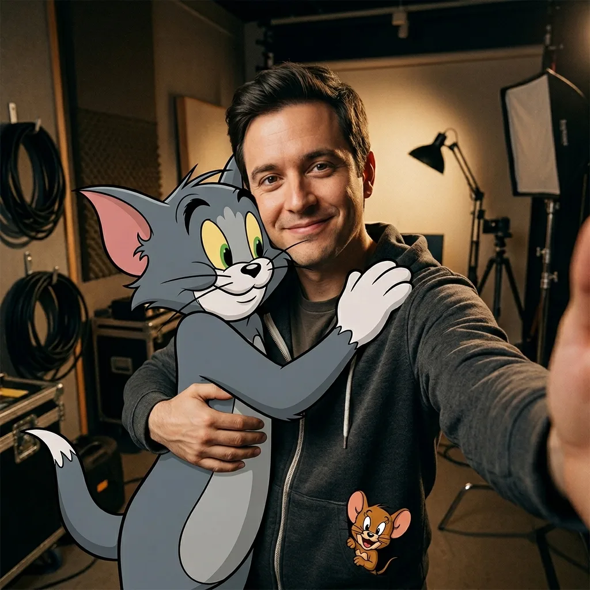

# Realistic, Ai Art

[← Back to the collection](../../README.md) · Category: [Illustration & 3D](../../gallery/illustration-3d.md) · Model: `Vinano Image Pro` · ID: `vn-01939`

<a href="https://vinano.ai?utm_source=github&utm_medium=readme&utm_campaign=awesome-image-video-prompts-updating&utm_content=prompt-page-image"></a>

<sub>Preview generated with <a href="https://vinano.ai?utm_source=github&utm_medium=readme&utm_campaign=awesome-image-video-prompts-updating&utm_content=prompt-page-caption">vinano.ai</a></sub>

## Prompt

```text
A Realistic First Person (Pov) Selfie Taken An Outside Arm, In The Same Clothes As In The Uploaded Photo.
Close-up Of Me Hugging Tom, The Cartoon Gray Cat From Tom And Jerry, A Small Smile (Jerry Can Be Looking Out Of My Shoulder Or My Pocket).
true-to-life photorealistic Environment: Studio Set, Office Interior, Warm Light, Props, Spotlights And Cables In The Background.
Tom Is A Strongly Stylized Toon 3d: Cel-shading, Multi-proportions, Clear Contour, No Realistic Fur, Not Live-action.
Organic: Zoom To The Chest, Contact Of Hugs, Single Light, Natural Shadows. 4k.natural shadows. 4k.

Emphasise material texture and natural light so the final frame feels tactile and premium.
```

## Try it on vinano.ai

1. Copy the prompt above.
2. Open **[vinano.ai](https://vinano.ai?utm_source=github&utm_medium=readme&utm_campaign=awesome-image-video-prompts-updating&utm_content=prompt-page-try)**, paste it into the image generator and pick a model.
3. Swap any placeholders (brand, product, city, person…) for your own details, then generate.

More prompts like this: [Illustration & 3D gallery](../../gallery/illustration-3d.md) · [all categories](../../README.md#contents)
