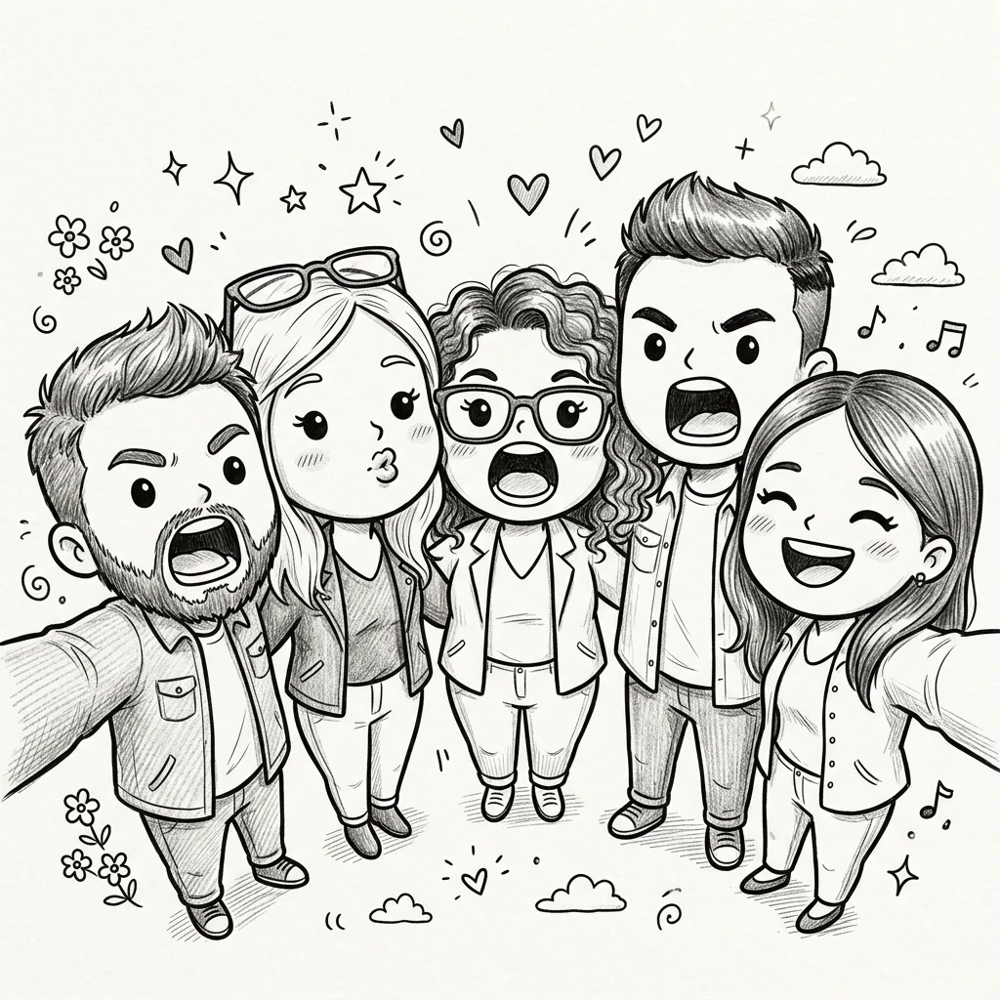

# Character, Minimalist

[← Back to the collection](../../README.md) · Category: [Illustration & 3D](../../gallery/illustration-3d.md) · Model: `Vinano Image v2` · ID: `vn-01983`

<a href="https://vinano.ai?utm_source=github&utm_medium=readme&utm_campaign=awesome-image-video-prompts-updating&utm_content=prompt-page-image"></a>

<sub>Preview generated with <a href="https://vinano.ai?utm_source=github&utm_medium=readme&utm_campaign=awesome-image-video-prompts-updating&utm_content=prompt-page-caption">vinano.ai</a></sub>

## Prompt

```text
Turn the uploaded photo into a cute black-and-white hand-drawn doodle illustration. Preserve the exact people, poses, expressions, clothing, and composition while transforming everyone into adorable chibi cartoon characters oversized heads, tiny bodies, round eyes, simple facial features, and playful proportions. Use clean black ink sketch lines on a plain white background, subtle pencil-style hatching, whimsical doodle details, tiny hearts, sparkles, and cute decorative elements floating around the characters. Maintain the family/group interaction and joyful mood. refined minimalist manga-inspired line art, cozy scrapbook aesthetic, kawaii character design, children's storybook illustration, charming hand-sketched texture, expressive faces, simple monochrome palette, highly detailed ink drawing, cute sticker-pack style, adorable and heartwarming atmosphere, top-down selfie perspective, masterpiece quality. Emphasise material texture and natural light so the final frame feels tactile and premium.
```

## Try it on vinano.ai

1. Copy the prompt above.
2. Open **[vinano.ai](https://vinano.ai?utm_source=github&utm_medium=readme&utm_campaign=awesome-image-video-prompts-updating&utm_content=prompt-page-try)**, paste it into the image generator and pick a model.
3. Swap any placeholders (brand, product, city, person…) for your own details, then generate.

More prompts like this: [Illustration & 3D gallery](../../gallery/illustration-3d.md) · [all categories](../../README.md#contents)
