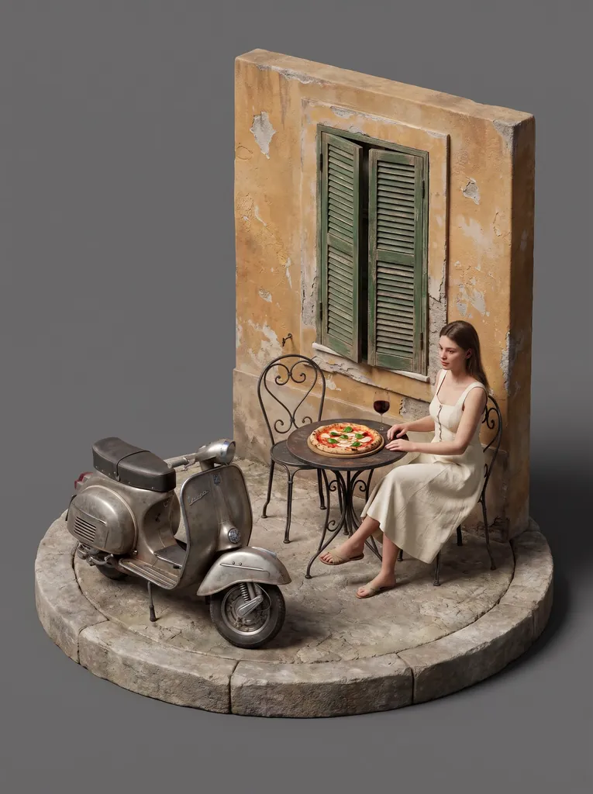

# Isometric Roman street café diorama

[← Back to the collection](../../README.md) · Category: [Illustration & 3D](../../gallery/illustration-3d.md) · Model: `Nano Banana Pro` · ID: `vn-02073`

<a href="https://vinano.ai?utm_source=github&utm_medium=readme&utm_campaign=awesome-image-video-prompts-updating&utm_content=prompt-page-image"></a>

<sub>Preview generated with <a href="https://vinano.ai?utm_source=github&utm_medium=readme&utm_campaign=awesome-image-video-prompts-updating&utm_content=prompt-page-caption">vinano.ai</a> · added 2026-11-18</sub>

## Prompt

```text
Concept: A hyper-realistic 3D isometric view of a Roman street café scene on a circular base.
Subject (Visuals): A full-body, realistic human young woman in a linen dress.
* Texture Rule: The subject must have "Living Human Skin" texture (subsurface scattering, pores, natural imperfections).
* Important: He is NOT a toy/doll. He looks like a real person inserted into the scene.
* Pose: Sitting naturally.

Composition & Scale (Crucial):
* Camera: Isometric wide shot (Full view). ensure the entire circular base, the subject, and all props are visible within the frame.
* Proportions: PERFECT RELATIVE SCALE. The props (e.g., scooter, table etc.) must be the correct size relative to the human. Do not make the human giant or the props tiny.

Environment: A realistic section of a a weathered ochre stucco wall with green shutters behind the subject.
* Material: Real weathered textures (brick, cement, wood), not painted model textures.

Props:
* Vintage scooter (Real metal and chrome texture).
* Pizza and wine (Real food texture).
* *Note:* Ensure all props are present and grounded on the base.

Technical Specs: Unreal Engine 5 render style, 8k resolution, global illumination, raytracing, sharp focus on the entire scene (deep depth of field), solid neutral grey background.

Negative Prompt: Toy, plastic, doll, action figure, clay, resin, shallow depth of field (blur), close-up, cropped, distorted proportions, giant head, cartoonish, missing limbs, unfinished.
```

## Try it on vinano.ai

1. Copy the prompt above.
2. Open **[vinano.ai](https://vinano.ai?utm_source=github&utm_medium=readme&utm_campaign=awesome-image-video-prompts-updating&utm_content=prompt-page-try)**, paste it into the image generator and pick a model.
3. Swap any placeholders (brand, product, city, person…) for your own details, then generate.

More prompts like this: [Illustration & 3D gallery](../../gallery/illustration-3d.md) · [all categories](../../README.md#contents)
