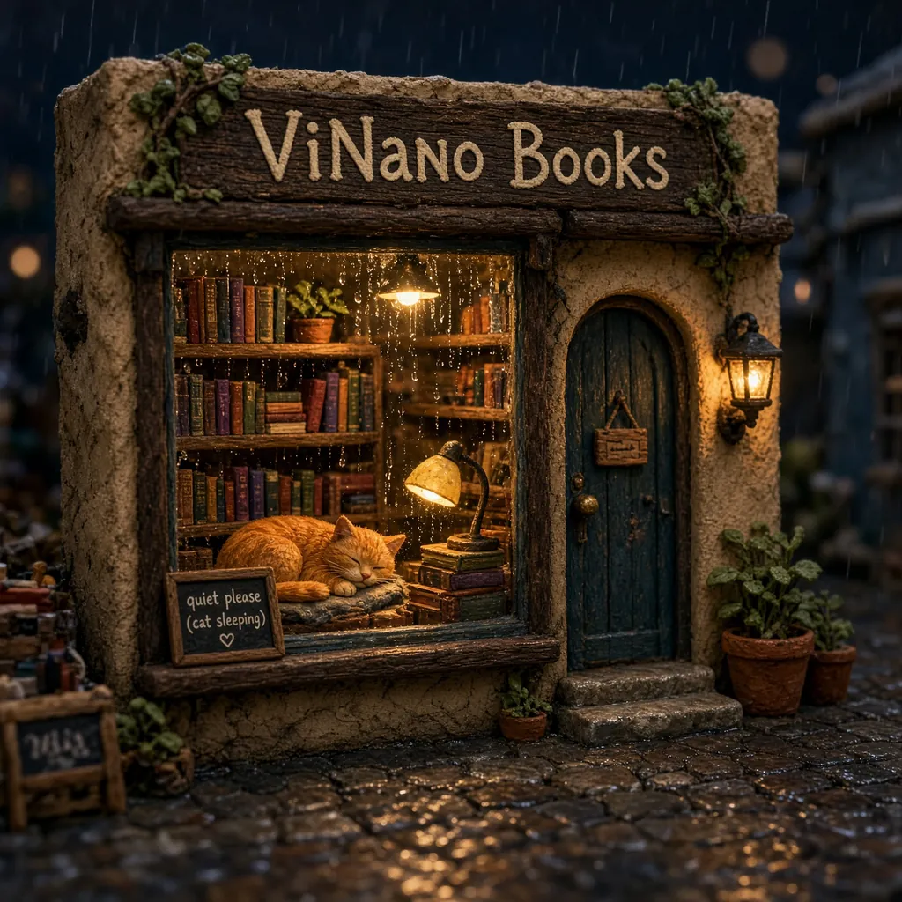

# Cozy Clay Bookshop

[← Back to the collection](../../README.md) · Category: [Illustration & 3D](../../gallery/illustration-3d.md) · Model: `Grok Imagine Image` · ID: `vn-02144`

<a href="https://vinano.ai?utm_source=github&utm_medium=readme&utm_campaign=awesome-image-video-prompts-updating&utm_content=prompt-page-image"></a>

<sub>Preview generated with <a href="https://vinano.ai?utm_source=github&utm_medium=readme&utm_campaign=awesome-image-video-prompts-updating&utm_content=prompt-page-caption">vinano.ai</a> · added 2026-11-19</sub>

## Prompt

```text
A tiny claymation-style corner bookshop at night, built like a diorama: crooked wooden shelves packed with colorful books, a sleeping orange cat on the counter, a warm desk lamp, rain streaking the front window, a hand-painted sign above the door reading "ViNano Books". Soft plasticine textures with visible fingerprints, miniature tilt-shift depth of field, cozy warm lighting.
```

## Try it on vinano.ai

1. Copy the prompt above.
2. Open **[vinano.ai](https://vinano.ai?utm_source=github&utm_medium=readme&utm_campaign=awesome-image-video-prompts-updating&utm_content=prompt-page-try)**, paste it into the image generator and pick a model.
3. Swap any placeholders (brand, product, city, person…) for your own details, then generate.

More prompts like this: [Illustration & 3D gallery](../../gallery/illustration-3d.md) · [all categories](../../README.md#contents)
