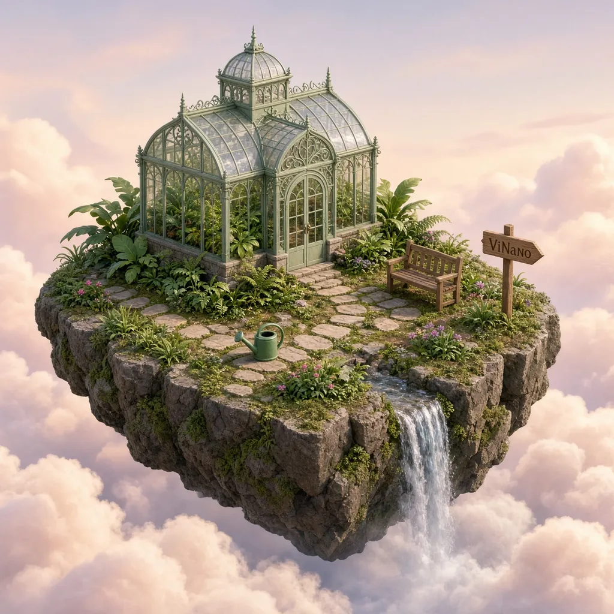

# Floating Island Greenhouse

[← Back to the collection](../../README.md) · Category: [Illustration & 3D](../../gallery/illustration-3d.md) · Model: `Grok Imagine Image` · ID: `vn-02156`

<a href="https://vinano.ai?utm_source=github&utm_medium=readme&utm_campaign=awesome-image-video-prompts-updating&utm_content=prompt-page-image"></a>

<sub>Preview generated with <a href="https://vinano.ai?utm_source=github&utm_medium=readme&utm_campaign=awesome-image-video-prompts-updating&utm_content=prompt-page-caption">vinano.ai</a> · added 2026-11-23</sub>

## Prompt

```text
An isometric 3D render of a small floating rock island carrying a Victorian glass greenhouse full of lush tropical plants, a tiny waterfall spilling off one edge into clouds, a winding stone path, a wooden bench and a little watering can. Soft pastel sky, gentle global illumination, clay-like matte materials, crisp miniature details, a small wooden signpost reading "ViNano".
```

## Try it on vinano.ai

1. Copy the prompt above.
2. Open **[vinano.ai](https://vinano.ai?utm_source=github&utm_medium=readme&utm_campaign=awesome-image-video-prompts-updating&utm_content=prompt-page-try)**, paste it into the image generator and pick a model.
3. Swap any placeholders (brand, product, city, person…) for your own details, then generate.

More prompts like this: [Illustration & 3D gallery](../../gallery/illustration-3d.md) · [all categories](../../README.md#contents)
