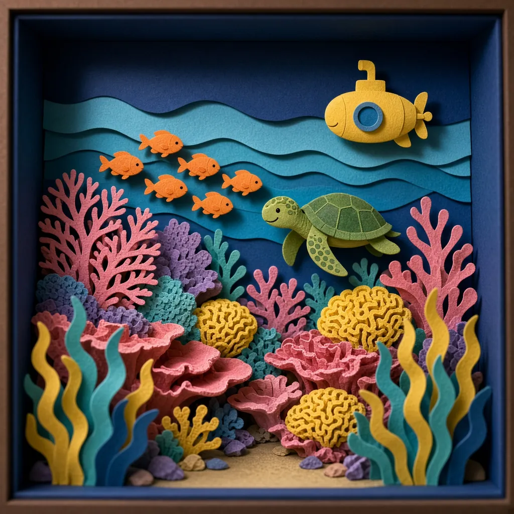

# Papercraft Coral Reef Diorama

[← Back to the collection](../../README.md) · Category: [Illustration & 3D](../../gallery/illustration-3d.md) · Model: `Grok Imagine Image` · ID: `vn-02176`

<a href="https://vinano.ai?utm_source=github&utm_medium=readme&utm_campaign=awesome-image-video-prompts-updating&utm_content=prompt-page-image"></a>

<sub>Preview generated with <a href="https://vinano.ai?utm_source=github&utm_medium=readme&utm_campaign=awesome-image-video-prompts-updating&utm_content=prompt-page-caption">vinano.ai</a> · added 2026-11-25</sub>

## Prompt

```text
A layered papercraft diorama of a coral reef inside a deep shadow box. Cut-paper layers in turquoise, coral pink, sunny yellow and deep blue create depth: wavy seaweed strips in front, fan corals and brain corals in the middle, a small school of orange paper fish, a smiling sea turtle and a tiny yellow submarine with a round window in the back. Each paper edge casts a soft shadow on the layer behind, with visible paper grain and neat scissor cuts. Warm light from the top left, slight tilt-shift blur at the edges, handcrafted, charming and tidy composition.
```

## Try it on vinano.ai

1. Copy the prompt above.
2. Open **[vinano.ai](https://vinano.ai?utm_source=github&utm_medium=readme&utm_campaign=awesome-image-video-prompts-updating&utm_content=prompt-page-try)**, paste it into the image generator and pick a model.
3. Swap any placeholders (brand, product, city, person…) for your own details, then generate.

More prompts like this: [Illustration & 3D gallery](../../gallery/illustration-3d.md) · [all categories](../../README.md#contents)
