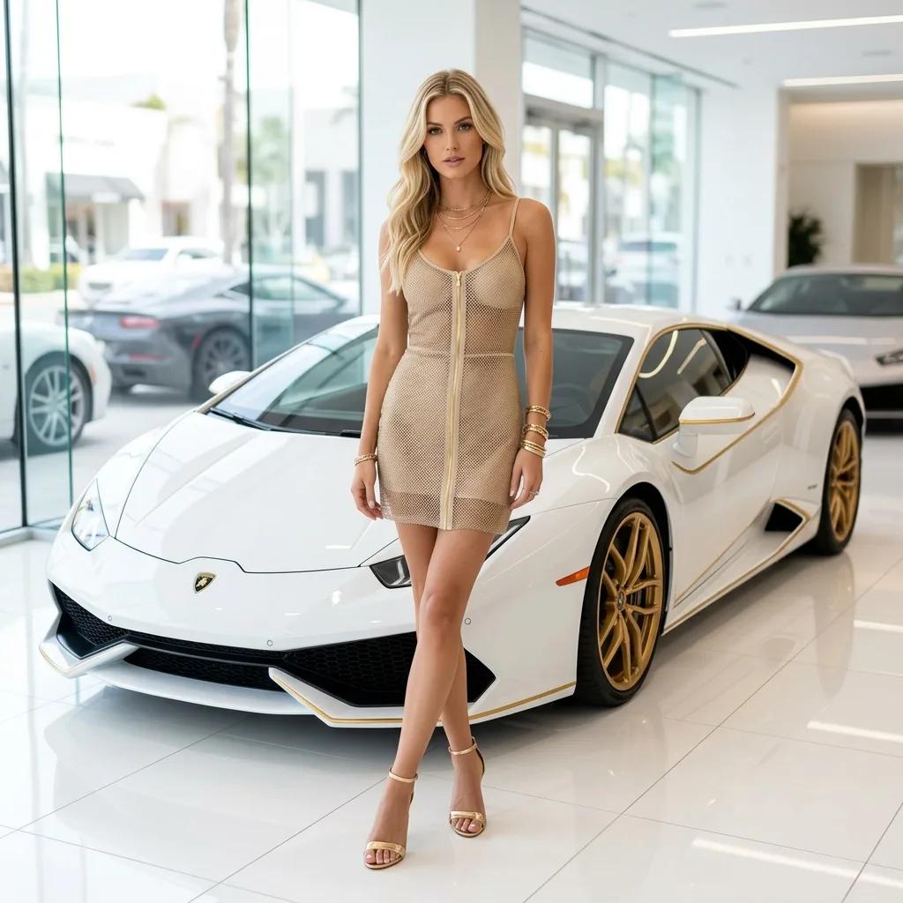

# Slender blonde woman long hair

[← Back to the collection](../../README.md) · Category: [Photography](../../gallery/photography.md) · Model: `Vinano Image v2` · ID: `vn-00023`

<a href="https://vinano.ai?utm_source=github&utm_medium=readme&utm_campaign=awesome-image-video-prompts-updating&utm_content=prompt-page-image"></a>

<sub>Preview generated with <a href="https://vinano.ai?utm_source=github&utm_medium=readme&utm_campaign=awesome-image-video-prompts-updating&utm_content=prompt-page-caption">vinano.ai</a></sub>

## Prompt

```text
Gemini 3.0 🍌

Prompt:

{
 "image_description": {
 "subject": {
 "person": "A slender blonde woman long hair, wearing a sheer, shimmering gold mesh mini dress thin spaghetti straps and a vertical gold zipper detail.",
 "accessories": "Layered gold necklaces, gold bracelets, and metallic gold high-heeled sandals.",
 "pose": "Standing elegantly in front of a luxury car, legs crossed at the ankles, looking directly at the camera."
 },
 "vehicle": {
 "type": "A sleek, modern white supercar gold accents.",
 "details": "High-gloss white paint, metallic gold rims, gold trim around the windows, and low-profile body styling."
 },
 "environment": {
 "location": "A bright, high-end luxury car showroom.",
 "lighting": "Clean, architectural indoor lighting soft reflections on the polished white floor.",
 "background": "Large floor-to-ceiling glass windows showing other vehicles in a blurred outdoor setting."
 },
 "technical_style": {
 "composition": "Full-body shot, eye-level angle, centered subject.",
 "aesthetic": "High-fashion photography, true-to-life photorealistic, sharp focus on the subject a shallow depth of field (bokeh) in the background.",
 "color_palette": "Dominant white and gold, neutral grey and black architectural tones."
 }
 }
}

Keep edges clean and the overall composition balanced for a polished, gallery-ready result.
```

## Try it on vinano.ai

1. Copy the prompt above.
2. Open **[vinano.ai](https://vinano.ai?utm_source=github&utm_medium=readme&utm_campaign=awesome-image-video-prompts-updating&utm_content=prompt-page-try)**, paste it into the image generator and pick a model.
3. Swap any placeholders (brand, product, city, person…) for your own details, then generate.

More prompts like this: [Photography gallery](../../gallery/photography.md) · [all categories](../../README.md#contents)
