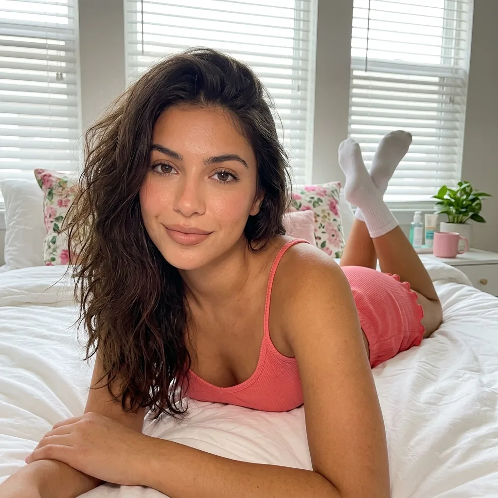

# Voluminous dark brown hair, soft waves, slightly tousled over

[← Back to the collection](../../README.md) · Category: [Photography](../../gallery/photography.md) · Model: `Vinano Image v2` · ID: `vn-00024`

<a href="https://vinano.ai?utm_source=github&utm_medium=readme&utm_campaign=awesome-image-video-prompts-updating&utm_content=prompt-page-image"></a>

<sub>Preview generated with <a href="https://vinano.ai?utm_source=github&utm_medium=readme&utm_campaign=awesome-image-video-prompts-updating&utm_content=prompt-page-caption">vinano.ai</a></sub>

## Prompt

```text
Good Night X Fam ♥️

☆ Sexy & Hot Virgin Young Lady in own luxury bedroom.

☆ The one who takes it in the arms will be golden tonight.

☆ Gemini Presenting this beautiful images.

☆ I love you all X creators

☆ Genuine Prompt here:-

{
 "scene": {
 "type": "bedroom_interior",
 "lighting": "soft natural morning daylight, diffused through blinds",
 "atmosphere": "cozy, intimate, serene domestic"
 },
 "subject": {
 "appearance": {
 "hair": "voluminous dark brown hair, soft waves, slightly tousled over one shoulder",
 "face": "warm olive complexion, high cheekbones, full natural lips, expressive brown eyes",
 "expression": "gentle, confident smile, soft direct eye contact",
 "makeup": "dewy natural glow, subtle rosy blush, nude matte lips"
 },
 "pose": {
 "position": "lying prone (on stomach) on a bed",
 "orientation": "facing the camera",
 "arms": "resting on forearms, right hand gently touching hair near the temple",
 "legs": "knees bent feet raised and ankles casually crossed",
 "perspective": "high-angle selfie point of view"
 },
 "attire": {
 "top": "coral pink ribbed tank top thin straps",
 "bottom": "matching coral pink lounge shorts ruffled edges",
 "accessories": "white crew socks pulled up"
 }
 },
 "environment": {
 "bedding": "crisp white rumpled sheets and fluffy white duvet",
 "background": {
 "elements": ["two large windows white horizontal blinds",
 "floral accent pillows pink and green patterns",
 "small side table a pink mug and various skincare bottles",
 "potted green plant providing a touch of color"],
 "focus": "soft bokeh background for depth of field"
 }
 },
 "photography": {
 "style": "hyperrealistic instagram-style selfie",
 "technical": {
 "detail": "ultra-sharp skin texture, visible pores, natural lighting highlights",
 "framing": "medium close-up, 4:5 aspect ratio",
 "quality": "8k resolution, true-to-life photorealistic"
 }
 }
}

Thanku so much🙏

Maintain consistent colour harmony and crisp focus across the whole frame.
```

## Try it on vinano.ai

1. Copy the prompt above.
2. Open **[vinano.ai](https://vinano.ai?utm_source=github&utm_medium=readme&utm_campaign=awesome-image-video-prompts-updating&utm_content=prompt-page-try)**, paste it into the image generator and pick a model.
3. Swap any placeholders (brand, product, city, person…) for your own details, then generate.

More prompts like this: [Photography gallery](../../gallery/photography.md) · [all categories](../../README.md#contents)
