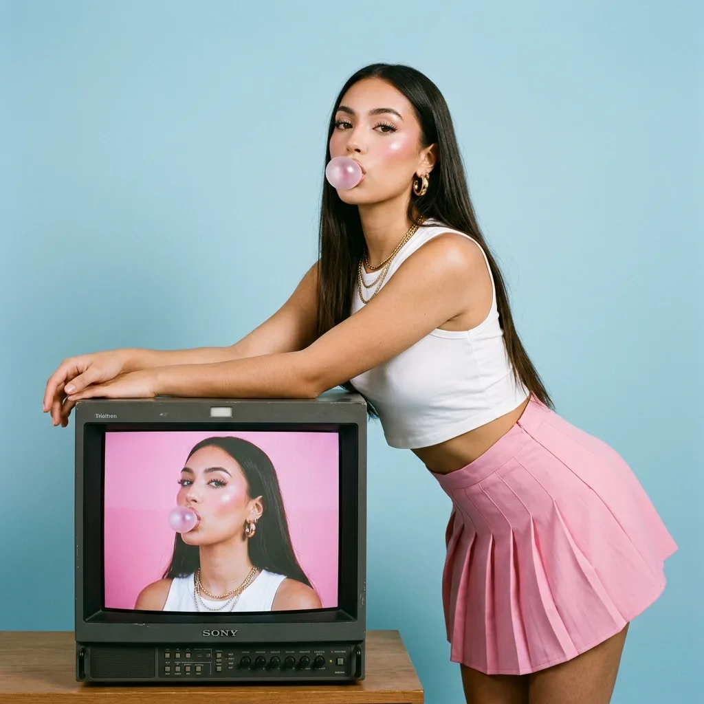

# Long straight dark hair

[← Back to the collection](../../README.md) · Category: [Photography](../../gallery/photography.md) · Model: `Vinano Image v2` · ID: `vn-00025`

<a href="https://vinano.ai?utm_source=github&utm_medium=readme&utm_campaign=awesome-image-video-prompts-updating&utm_content=prompt-page-image"></a>

<sub>Preview generated with <a href="https://vinano.ai?utm_source=github&utm_medium=readme&utm_campaign=awesome-image-video-prompts-updating&utm_content=prompt-page-caption">vinano.ai</a></sub>

## Prompt

```text
When pop aesthetics meet confidence… this is the vibe 💗📺

Would you dare to pull off this look? 💭✨

Gemini 🍌

{
 "type": "image_generation_prompt",
 "style": "ultra_realistic_fashion_editorial",
 "composition": {
 "camera": "studio photograph",
 "lighting": "clean studio lighting",
 "focus": "sharp focus",
 "resolution": "high resolution",
 "aesthetic": "modern pop",
 "color_palette": "vibrant pastels",
 "mood": "cinematic"
 },
 "background": {
 "type": "solid",
 "color": "pastel blue"
 },
 "subject": {
 "gender": "female",
 "appearance": {
 "hair": "long straight dark hair",
 "makeup": "glossy makeup soft pink blush highlighted cheekbones bold eye makeup"
 },
 "attire": {
 "top": "fitted white sleeveless crop top",
 "bottom": "high waisted pink pleated mini skirt",
 "accessories": ["gold hoop earrings",
 "layered gold chain necklace"]
 },
 "pose": {
 "position": "leaning forward",
 "interaction": "resting arms casually on a retro CRT television",
 "expression": "confident",
 "action": "blowing a translucent pink bubblegum bubble"
 }
 },
 "props": {
 "television": {
 "type": "retro CRT TV",
 "screen_content": "mirrored image of the same woman posing against a pink background",
 "effect": "dual reality visual concept"
 }
 },
 "style_tags": ["true-to-life photorealistic",
 "fashion editorial",
 "cinematic composition",
 "creative concept",
 "pastel aesthetic"]
}

Keep edges clean and the overall composition balanced for a polished, gallery-ready result.
```

## Try it on vinano.ai

1. Copy the prompt above.
2. Open **[vinano.ai](https://vinano.ai?utm_source=github&utm_medium=readme&utm_campaign=awesome-image-video-prompts-updating&utm_content=prompt-page-try)**, paste it into the image generator and pick a model.
3. Swap any placeholders (brand, product, city, person…) for your own details, then generate.

More prompts like this: [Photography gallery](../../gallery/photography.md) · [all categories](../../README.md#contents)
