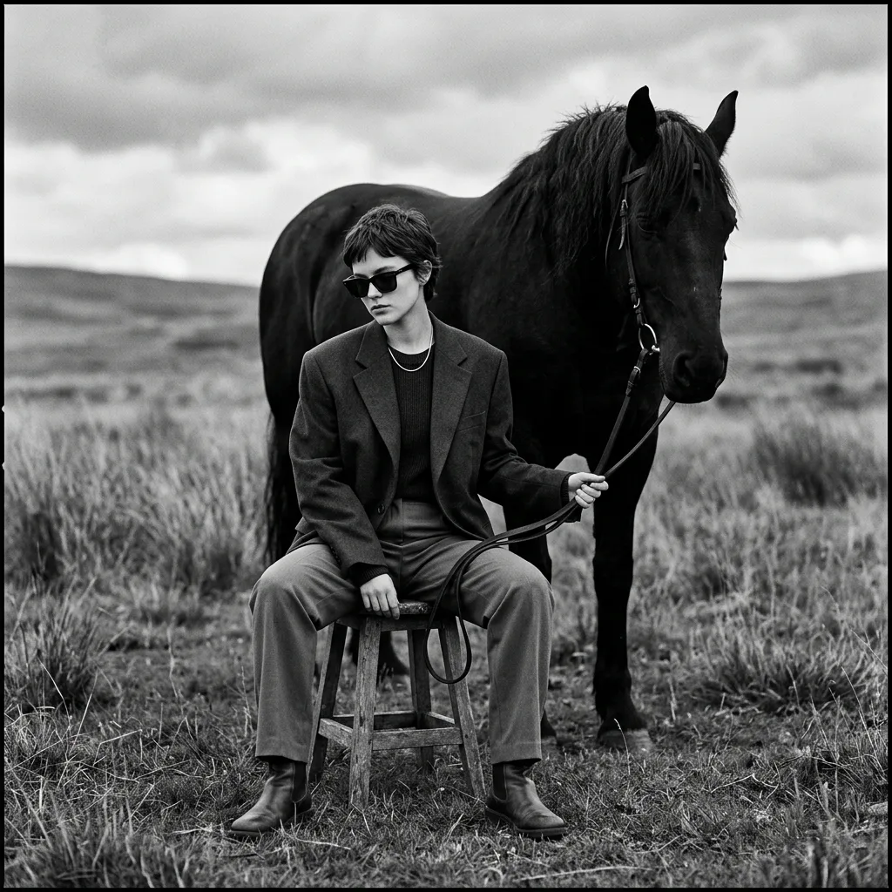

# Don’t watch the clock

[← Back to the collection](../../README.md) · Category: [Photography](../../gallery/photography.md) · Model: `Vinano Image v2` · ID: `vn-00031`

<a href="https://vinano.ai?utm_source=github&utm_medium=readme&utm_campaign=awesome-image-video-prompts-updating&utm_content=prompt-page-image"></a>

<sub>Preview generated with <a href="https://vinano.ai?utm_source=github&utm_medium=readme&utm_campaign=awesome-image-video-prompts-updating&utm_content=prompt-page-caption">vinano.ai</a></sub>

## Prompt

```text
Don’t watch the clock; do what it does. Keep going.

Gemini + imagine.

Prompt ⤵️

Create a cinematic black‑and‑white editorial fashion photograph featuring a young woman sitting confidently on a simple wooden stool in an open, slightly wild grassy field, a powerful black horse standing closely behind her. She holds the horse’s reins loosely in one hand, exuding quiet control. The woman wears a dark oversized luxury blazer, straight‑cut trousers, leather boots, minimal jewelry, sunglasses, and has her head slightly tilted down a calm, introspective, dominant yet relaxed expression.

Use a refined minimalist composition strong negative space, high‑contrast monochrome tones, and soft natural daylight. Apply a shallow depth of field to blur the empty rural landscape (no buildings, only textured grass distant blur). Capture an editorial luxury fashion vibe a moody, poetic atmosphere, sharp details, subtle film grain texture, and dramatic shadows in a Vogue‑style photography style. Shoot an 85mm lens for cinematic realism.

Keep edges clean and the overall composition balanced for a polished, gallery-ready result.
```

## Try it on vinano.ai

1. Copy the prompt above.
2. Open **[vinano.ai](https://vinano.ai?utm_source=github&utm_medium=readme&utm_campaign=awesome-image-video-prompts-updating&utm_content=prompt-page-try)**, paste it into the image generator and pick a model.
3. Swap any placeholders (brand, product, city, person…) for your own details, then generate.

More prompts like this: [Photography gallery](../../gallery/photography.md) · [all categories](../../README.md#contents)
