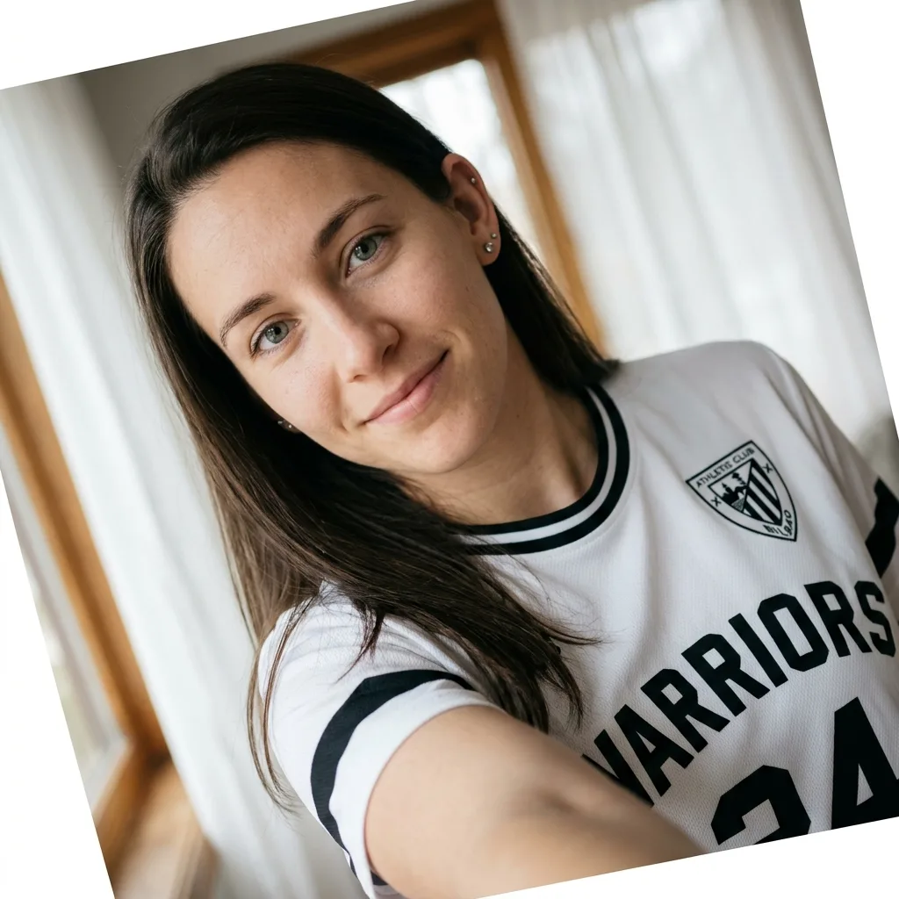

# Clear, smooth natural texture

[← Back to the collection](../../README.md) · Category: [Photography](../../gallery/photography.md) · Model: `Vinano Image Pro` · ID: `vn-00033`

<a href="https://vinano.ai?utm_source=github&utm_medium=readme&utm_campaign=awesome-image-video-prompts-updating&utm_content=prompt-page-image"></a>

<sub>Preview generated with <a href="https://vinano.ai?utm_source=github&utm_medium=readme&utm_campaign=awesome-image-video-prompts-updating&utm_content=prompt-page-caption">vinano.ai</a></sub>

## Prompt

```text
Gemini

Prompt:

{ "image_type": "photograph", "genre": "casual portrait", "composition": { "framing": "close-up, chest-up portrait", "angle": "slightly tilted, camera held above eye level and angled downward", "orientation": "portrait diagonal tilt", "subject_placement": "subject positioned slightly off-center, face occupying left-middle area", "crop": "tight crop partial arm visible in foreground" }, "subject": { "count": 1, "gender_presentation": "female-presenting", "age_range": "young adult", "facial_features": { "skin_tone": "light, neutral-warm", "complexion": "clear, smooth natural texture", "eyes": "light green/gray, almond-shaped", "eyebrows": "medium thickness, natural shape", "nose": "straight, small to medium", "lips": "natural pink, closed-mouth slight smile" }, "hair": { "color": "dark brown", "length": "long", "style": "straight, tucked behind ear on one side", "part": "slight side part" }, "expression": "soft, relaxed, friendly", "gaze": "looking directly into camera", "accessories": ["small silver stud earrings"], "clothing": { "type": "sports jersey", "fit": "loose athletic fit", "color": "white black accents", "details": ["black collar trim", "black logos and text", "shield-style emblem on chest", "large curved black graphic text"] } }, "lighting": { "type": "natural light", "direction": "side/front light from window", "quality": "soft, diffused", "shadows": "minimal, gentle", "highlights": "subtle skin highlights on cheek and forehead" }, "color_palette": { "dominant_colors": ["white", "soft gray", "black"], "accent_colors": ["natural skin tones", "brown hair"], "overall_tone": "neutral, clean, airy" }, "background": { "setting": "indoor", "elements": ["sheer white curtains", "window frame partially visible"], "depth_of_field": "moderate, background slightly soft but recognizable", "style": "refined minimalist, uncluttered" }, "technical_details": { "camera_type": "DSLR", "focal_length_equivalent": "wide-angle selfie lens", "resolution": "high", "sharpness": "sharp focus on face", "noise": "minimal", "white_balance": "neutral" }, "artistic_style": { "aesthetic": "clean, natural, lifestyle", "retouching": "very minimal, natural skin texture preserved", "mood": "calm, approachable, casual" }, "typography": { "presence": true, "location": "on jersey", "style": "bold sans-serif sports branding", "color": "black", "readability": "partially visible due to crop" } }

Maintain consistent colour harmony and crisp focus across the whole frame.
```

## Try it on vinano.ai

1. Copy the prompt above.
2. Open **[vinano.ai](https://vinano.ai?utm_source=github&utm_medium=readme&utm_campaign=awesome-image-video-prompts-updating&utm_content=prompt-page-try)**, paste it into the image generator and pick a model.
3. Swap any placeholders (brand, product, city, person…) for your own details, then generate.

More prompts like this: [Photography gallery](../../gallery/photography.md) · [all categories](../../README.md#contents)
