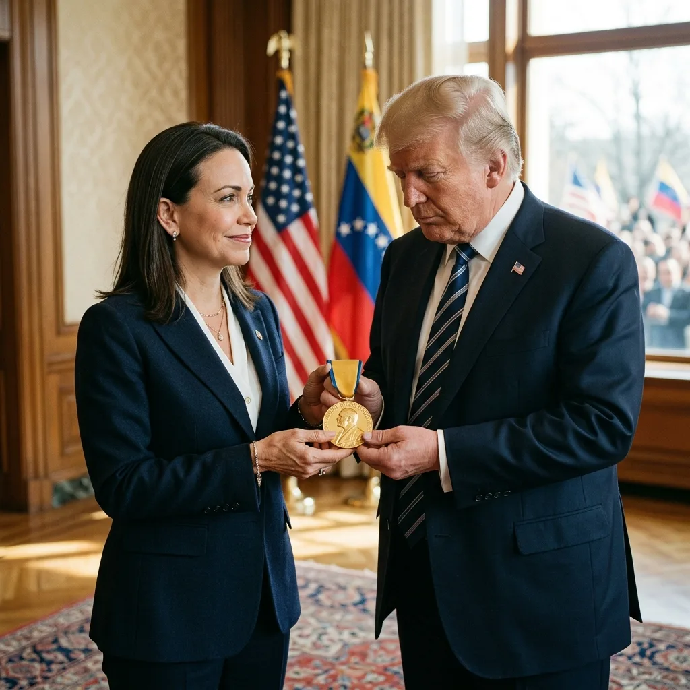

# Scene depicting Venezuelan opposition leader María Corina Machado presenting

[← Back to the collection](../../README.md) · Category: [Photography](../../gallery/photography.md) · Model: `Vinano Image v2` · ID: `vn-00034`

<a href="https://vinano.ai?utm_source=github&utm_medium=readme&utm_campaign=awesome-image-video-prompts-updating&utm_content=prompt-page-image"></a>

<sub>Preview generated with <a href="https://vinano.ai?utm_source=github&utm_medium=readme&utm_campaign=awesome-image-video-prompts-updating&utm_content=prompt-page-caption">vinano.ai</a></sub>

## Prompt

```text
Cinematic, ultra-realistic scene depicting Venezuelan opposition leader María Corina Machado presenting her Nobel Peace Prize medal to Donald Trump. Machado stands a calm yet determined expression, holding the Nobel medal as a symbol of hope and democracy. Trump receives it thoughtfully, set against a dignified indoor setting. In the background, subtle symbolism appears: softly blurred US and Venezuelan flags, a faint glow of light symbolizing freedom, and a distant crowd suggesting democratic aspirations. Mood is serious, historic, and hopeful. Professional lighting, shallow depth of field, high detail, photo-journalistic realism.” Emphasise material texture and natural light so the final frame feels tactile and premium.
```

## Try it on vinano.ai

1. Copy the prompt above.
2. Open **[vinano.ai](https://vinano.ai?utm_source=github&utm_medium=readme&utm_campaign=awesome-image-video-prompts-updating&utm_content=prompt-page-try)**, paste it into the image generator and pick a model.
3. Swap any placeholders (brand, product, city, person…) for your own details, then generate.

More prompts like this: [Photography gallery](../../gallery/photography.md) · [all categories](../../README.md#contents)
