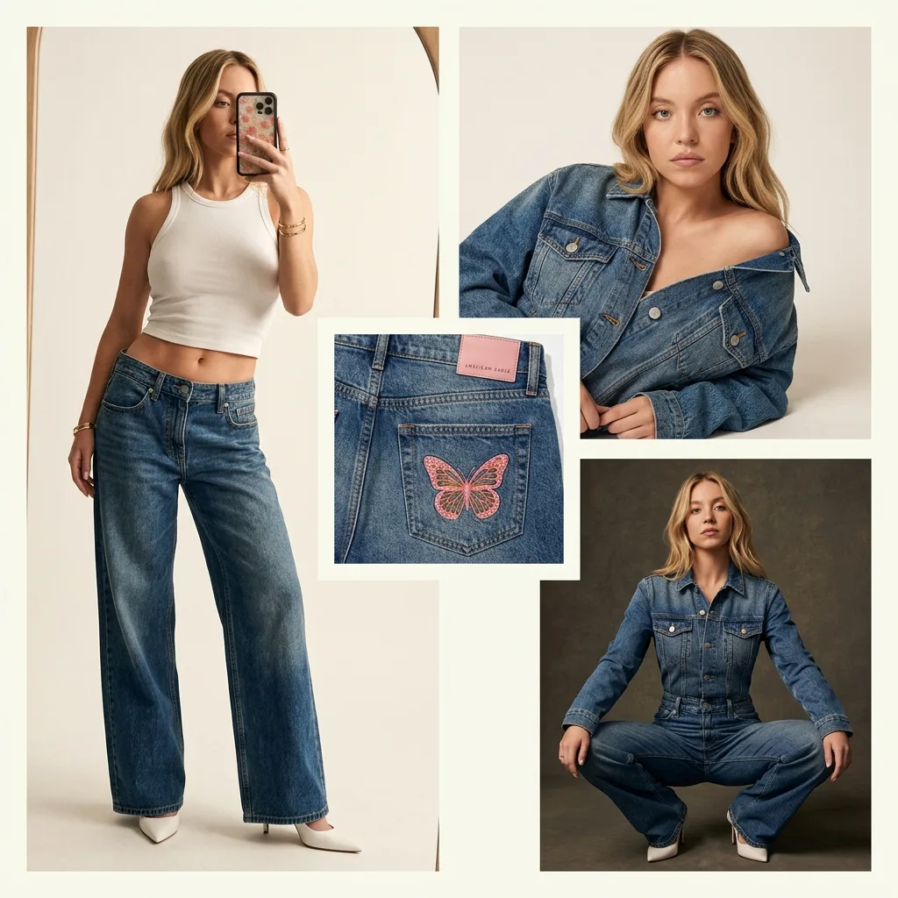

# File metadata

[← Back to the collection](../../README.md) · Category: [Photography](../../gallery/photography.md) · Model: `Vinano Image Pro` · ID: `vn-00035`

<a href="https://vinano.ai?utm_source=github&utm_medium=readme&utm_campaign=awesome-image-video-prompts-updating&utm_content=prompt-page-image"></a>

<sub>Preview generated with <a href="https://vinano.ai?utm_source=github&utm_medium=readme&utm_campaign=awesome-image-video-prompts-updating&utm_content=prompt-page-caption">vinano.ai</a></sub>

## Prompt

```text
{
 "file_metadata": {
 "filename": "sydney_sweeney_ae_campaign_collage.jpg",
 "category": "High-End Fashion Photography",
 "project": "American Eagle Denim Collection 2024",
 "talent": "Sydney Sweeney"
 },
 "visual_composition": {
 "layout_type": "4-Panel Asymmetrical Collage",
 "color_palette": {
 "primary": "Indigo Blue (Denim Wash)",
 "secondary": "Creamy White (Top & Background)",
 "accent": "Dusty Rose / Blush Pink (Butterfly Detail)",
 "vibe": "Warm, Nostalgic, Y2K Grunge"
 },
 "lighting": "Soft diffused studio light warm highlight tones",
 "aesthetic_tags": ["Vintage Revival", "Baggy Silhouette", "Main Character Energy"]
 },
 "detailed_frame_analysis": {
 "panel_1_left": {
 "focus": "Full Body Silhouette",
 "pose": "Mirror selfie aesthetic a slight lean",
 "outfit_details": {
 "top": "White ribbed racerback crop tank",
 "bottom": "Extra wide-leg low-rise indigo jeans",
 "footwear": "White pointed-toe stilettos",
 "accessories": "Delicate gold bracelets and a floral-patterned phone case"
 }
 },
 "panel_2_top_right": {
 "focus": "Beauty & Expression",
 "pose": "Reclined, looking directly into the lens",
 "styling": "Oversized denim jacket draped off-the-shoulder",
 "hair": "Center-parted blonde waves natural volume",
 "makeup": "refined minimalist 'Clean Girl' look dewy skin"
 },
 "panel_3_bottom_center": {
 "focus": "Product Detail & Embroidery",
 "subject": "Denim back pocket",
 "features": ["Intricate pink and orange butterfly embroidery",
 "Pink leather brand patch American Eagle logo",
 "Contrast stitching on heavy-duty denim fabric"]
 },
 "panel_4_bottom_right": {
 "focus": "Style Statement",
 "pose": "Symmetrical crouched pose on a dark background",
 "outfit": "Full denim jumpsuit/set (Double Denim)",
 "mood": "Bold and confident"
 }
 },
 "garment_dna": {
 "fabric": "Non-stretch, premium weight cotton denim",
 "wash": "Medium indigo stone-wash vintage fading",
 "fit_profile": "Loose, oversized, baggy, and low-slung waist"
 },
 "marketing_tags": {
 "target_audience": "Gen-Z and Millennial Fashion Seekers",
 "trending_hashtags": ["
 "alt_text": "A fashion collage of Sydney Sweeney for American Eagle showcasing wide-leg jeans butterfly embroidery and a white crop top in various professional poses."
 }
}

Aim for an editorial, design-driven look with deliberate negative space.
```

## Try it on vinano.ai

1. Copy the prompt above.
2. Open **[vinano.ai](https://vinano.ai?utm_source=github&utm_medium=readme&utm_campaign=awesome-image-video-prompts-updating&utm_content=prompt-page-try)**, paste it into the image generator and pick a model.
3. Swap any placeholders (brand, product, city, person…) for your own details, then generate.

More prompts like this: [Photography gallery](../../gallery/photography.md) · [all categories](../../README.md#contents)
