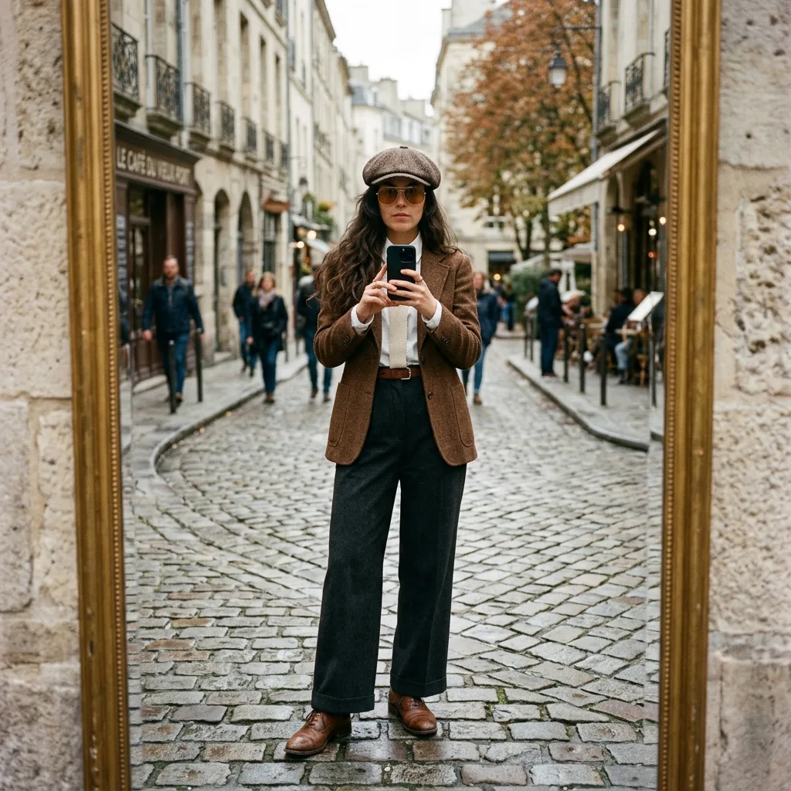

# Stylish woman taking a mirror selfie on a European

[← Back to the collection](../../README.md) · Category: [Photography](../../gallery/photography.md) · Model: `Vinano Image v2` · ID: `vn-00036`

<a href="https://vinano.ai?utm_source=github&utm_medium=readme&utm_campaign=awesome-image-video-prompts-updating&utm_content=prompt-page-image"></a>

<sub>Preview generated with <a href="https://vinano.ai?utm_source=github&utm_medium=readme&utm_campaign=awesome-image-video-prompts-updating&utm_content=prompt-page-caption">vinano.ai</a></sub>

## Prompt

```text
A stylish woman taking a mirror selfie on a European cobblestone street, wearing a brown tweed blazer, white shirt a cream tie, wide-leg dark trousers, and brown leather shoes, accessorized a brown newsboy cap and amber tinted aviator sunglasses, long dark wavy hair, holding a black smartphone in front of her face, vintage menswear inspired outfit, autumn color palette, cinematic street photography, shallow depth of field, soft natural light, background of old European buildings and pedestrians slightly blurred, high fashion editorial look, 35mm film style, realistic, high detail, muted tones, aesthetic composition. Maintain consistent colour harmony and crisp focus across the whole frame.
```

## Try it on vinano.ai

1. Copy the prompt above.
2. Open **[vinano.ai](https://vinano.ai?utm_source=github&utm_medium=readme&utm_campaign=awesome-image-video-prompts-updating&utm_content=prompt-page-try)**, paste it into the image generator and pick a model.
3. Swap any placeholders (brand, product, city, person…) for your own details, then generate.

More prompts like this: [Photography gallery](../../gallery/photography.md) · [all categories](../../README.md#contents)
