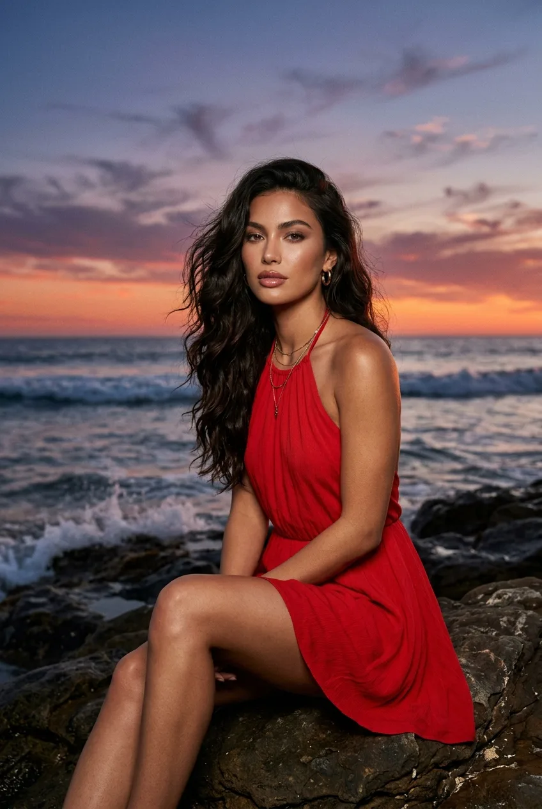

# Ultra-photoreal high-fashion editorial portrait at the seaside during sunset

[← Back to the collection](../../README.md) · Category: [Photography](../../gallery/photography.md) · Model: `Vinano Image Pro` · ID: `vn-00044`

<a href="https://vinano.ai?utm_source=github&utm_medium=readme&utm_campaign=awesome-image-video-prompts-updating&utm_content=prompt-page-image"></a>

<sub>Preview generated with <a href="https://vinano.ai?utm_source=github&utm_medium=readme&utm_campaign=awesome-image-video-prompts-updating&utm_content=prompt-page-caption">vinano.ai</a></sub>

## Prompt

```text
{
 "generation_request": {
 "meta_data": {
 "tool": "",
 "task_type": "photorealistic_single_image_editorial",
 "version": "v1.6_SUNSET_SEA_RED_DRESS_EDITORIAL",
 "priority": "highest"
 },
 "references": {
 "female_character_reference_image": "UPLOAD_FEMALE_REFERENCE (REQUIRED: IDENTITY + POSE INSPIRATION)"
 },
 "output_settings": {
 "aspect_ratio": "2:3",
 "orientation": "portrait",
 "resolution": "ultra_high_res",
 "render_style": "ultra_photoreal_high_fashion_editorial",
 "sharpness": "crisp_but_natural",
 "film_grain": "subtle_analog_film",
 "color_grade": "sunset_cinematic_warm_luxury"
 },
 "hard_constraints": ["ONE subject only (female).",
 "Perfect identity match to the uploaded reference (no face or body changes).",
 "No text, no logos, no watermarks.",
 "Perfect anatomy: hands, legs, proportions correct.",
 "Photoreal skin texture; no plastic or over-smoothed skin.",
 "No extra people, reflections, or background faces."],
 "creative_prompt": {
 "scene_summary": "Ultra-photoreal high-fashion editorial portrait at the seaside during sunset. The same woman as the reference poses confidently on dark coastal rocks by the ocean. She wears a striking red halter-neck mini dress soft flowing fabric and elegant movement. Her posture is poised and feminine, seated slightly angled toward the camera legs bent naturally.\n\nHair: long, glossy dark waves worn down, softly shaped by the sea breeze. Makeup: luminous editorial glam—defined brows, subtle contour, glowing skin, soft smoky eyes, glossy nude-rose lips. Expression: confident, calm, magnetic, direct eye contact the camera.\n\nBackground: open sea gentle waves, distant horizon line, dramatic sunset sky in gradients of deep orange, pink, purple, and blue scattered clouds. Lighting: cinematic dusk lighting subtle fill flash on the subject to balance exposure; natural rim light from the sunset outlining hair and shoulders. Skin tones warm and realistic.\n\nCamera: 85mm editorial portrait lens look, shallow depth of field; subject tack sharp while ocean and clouds fall off softly. Mood: sensual, powerful, timeless, luxury fashion campaign energy—editorial, cinematic, and iconic."
 },
 "negative_prompt": ["any text, logo, watermark",
 "identity drift",
 "extra people",
 "distorted anatomy",
 "extra limbs or fingers",
 "cartoon, anime, CGI look",
 "plastic or over-smoothed skin",
 "harsh flash blowout",
 "low resolution",
 "overly saturated colors",
 "cheap styling or artificial fabric look"]
 }
}

Maintain consistent colour harmony and crisp focus across the whole frame.
```

## Try it on vinano.ai

1. Copy the prompt above.
2. Open **[vinano.ai](https://vinano.ai?utm_source=github&utm_medium=readme&utm_campaign=awesome-image-video-prompts-updating&utm_content=prompt-page-try)**, paste it into the image generator and pick a model.
3. Swap any placeholders (brand, product, city, person…) for your own details, then generate.

More prompts like this: [Photography gallery](../../gallery/photography.md) · [all categories](../../README.md#contents)
