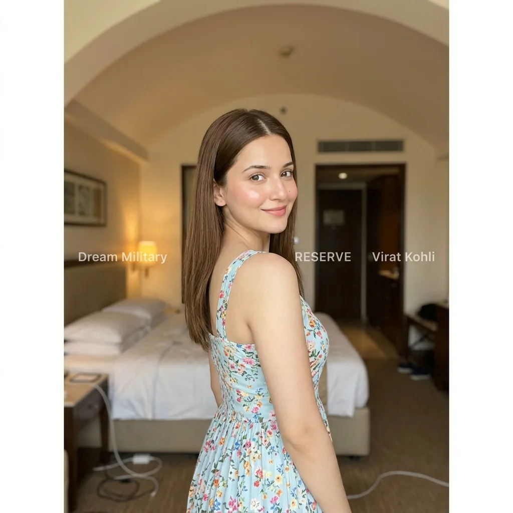

# Teenager to young adult

[← Back to the collection](../../README.md) · Category: [Photography](../../gallery/photography.md) · Model: `Vinano Image v2` · ID: `vn-00048`

<a href="https://vinano.ai?utm_source=github&utm_medium=readme&utm_campaign=awesome-image-video-prompts-updating&utm_content=prompt-page-image"></a>

<sub>Preview generated with <a href="https://vinano.ai?utm_source=github&utm_medium=readme&utm_campaign=awesome-image-video-prompts-updating&utm_content=prompt-page-caption">vinano.ai</a></sub>

## Prompt

```text
Gemini 🍌
{
 "image_type": "photographic portrait",
 "orientation": "vertical",
 "framing": "medium shot",
 "composition": {
 "pose": "standing, torso angled away from camera head turned back over shoulder",
 "gesture": "arms relaxed, shoulders slightly raised creating a soft curve",
 "body_language": "playful, gentle confidence, approachable",
 "asymmetry": "dynamic asymmetry created by over-the-shoulder pose",
 "negative_space": "moderate negative space above head and around subject within interior setting"
 },
 "subject": {
 "count": 1,
 "gender_presentation": "female",
 "age_appearance": "teenager to young adult",
 "expression": "soft smile, relaxed facial muscles",
 "gaze": "direct eye contact camera",
 "hair": {
 "color": "medium to dark brown",
 "length": "long",
 "style": "straight, center-parted, tucked behind ears, smooth texture"
 },
 "skin": {
 "tone": "light",
 "texture": "smooth, natural, lightly retouched"
 }
 },
 "wardrobe_and_accessories": {
 "dress": {
 "type": "sleeveless floral dress",
 "base_color": "light blue",
 "pattern": "multicolor floral print",
 "fit": "fitted bodice gathered skirt",
 "fabric_appearance": "lightweight, soft, slightly matte"
 },
 "accessories": {
 "visible_jewelry": "none prominent",
 "hair_accessories": "none"
 }
 },
 "background": {
 "type": "interior room",
 "setting": "hotel or bedroom",
 "elements": ["bed white linens",
 "side tables",
 "lamp",
 "arched ceiling detail",
 "visible cables on floor"],
 "depth": "background moderately in focus, secondary to subject"
 },
 "lighting": {
 "style": "natural ambient indoor lighting",
 "direction": "soft frontal and side light",
 "contrast": "low",
 "shadows": "very soft, minimal shadowing on face and body",
 "highlights": "gentle highlights on cheeks, eyes, and hair",
 "lighting_quality": "warm, diffused"
 },
 "color_and_tone": {
 "color_mode": "color",
 "white_balance": "warm",
 "palette": "soft pastels and warm neutrals",
 "contrast_curve": "smooth low contrast",
 "mood": "warm, romantic, candid"
 },
 "camera_and_technical_traits": {
 "camera_distance": "close to medium",
 "lens_appearance": "wide to standard smartphone lens",
 "depth_of_field": "deep, subject and background mostly in focus",
 "sharpness": "high overall clarity",
 "grain": "minimal"
 },
 "artistic_style": {
 "genre": "lifestyle portrait",
 "aesthetic": "candid, feminine, casual elegance",
 "influences": "social media portraiture, lifestyle photography",
 "retouching_style": "light skin smoothing, natural color enhancement"
 },
 "overall_impression": {
 "tone": "friendly, youthful, charming",
 "visual_focus": "face and over-the-shoulder pose",
 "use_case": "social media content, lifestyle reference, casual portrait inspiration"
 },

 "trending_text_overlay": ["Dream Military",
 "RESERVE",
 "Virat Kohli"]
}

Keep edges clean and the overall composition balanced for a polished, gallery-ready result.
```

## Try it on vinano.ai

1. Copy the prompt above.
2. Open **[vinano.ai](https://vinano.ai?utm_source=github&utm_medium=readme&utm_campaign=awesome-image-video-prompts-updating&utm_content=prompt-page-try)**, paste it into the image generator and pick a model.
3. Swap any placeholders (brand, product, city, person…) for your own details, then generate.

More prompts like this: [Photography gallery](../../gallery/photography.md) · [all categories](../../README.md#contents)
