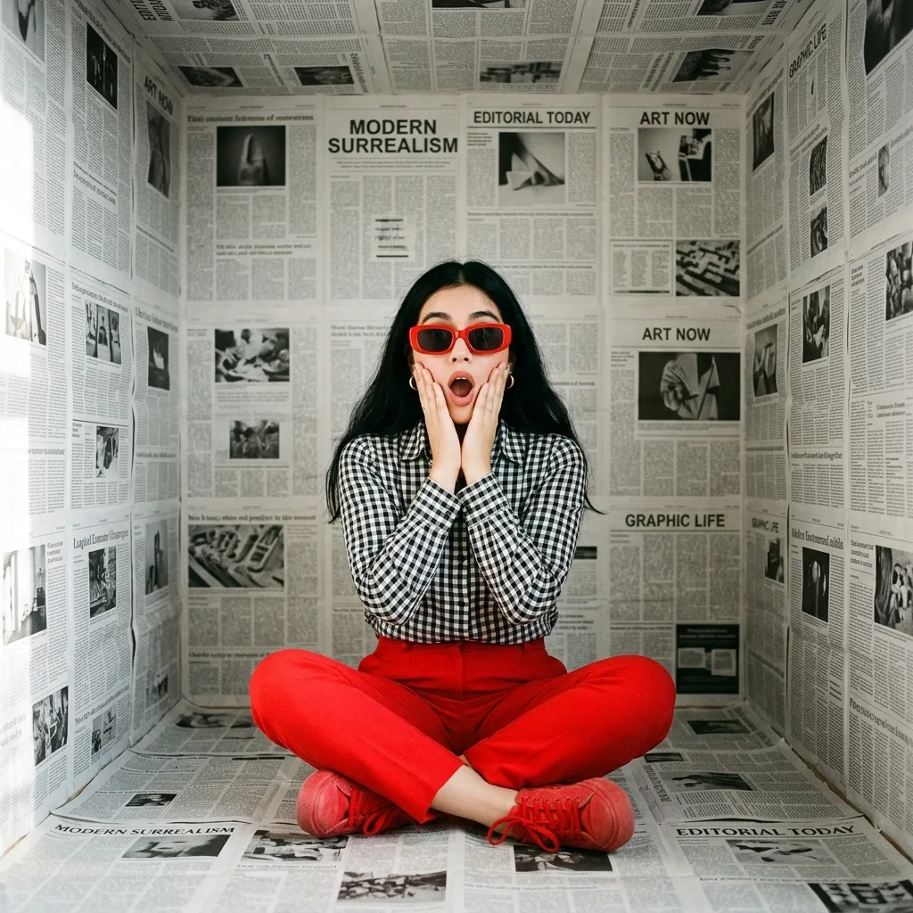

# Monochrome newspaper textures creating a graphic, immersive backdrop

[← Back to the collection](../../README.md) · Category: [Photography](../../gallery/photography.md) · Model: `Vinano Image v2` · ID: `vn-00049`

<a href="https://vinano.ai?utm_source=github&utm_medium=readme&utm_campaign=awesome-image-video-prompts-updating&utm_content=prompt-page-image"></a>

<sub>Preview generated with <a href="https://vinano.ai?utm_source=github&utm_medium=readme&utm_campaign=awesome-image-video-prompts-updating&utm_content=prompt-page-caption">vinano.ai</a></sub>

## Prompt

```text
{
 "Objective": "Create a stylized fashion portrait bold color contrast and a modern surreal editorial aesthetic",
 "PersonaDetails": {
 "Subject": {
 "Type": "Young woman",
 "Pose": "Sitting cross-legged",
 "Expression": "Dramatic surprise, hands holding cheeks, mouth slightly open",
 "Hair": "Long black hair framing the face",
 "Accessories": "Bold red sunglasses"
 }
 },
 "Wardrobe": {
 "Top": "Black-and-white checkered shirt",
 "Bottom": "Red pants",
 "Footwear": "Red sneakers",
 "ColorTheme": "Vibrant red contrasted against monochrome surroundings"
 },
 "SceneDescription": {
 "Environment": "Small enclosed room",
 "SurfaceTreatment": {
 "Walls": "Covered entirely in newspaper pages",
 "Floor": "Covered entirely in newspaper pages",
 "Ceiling": "Covered entirely in newspaper pages"
 },
 "Concept": "Monochrome newspaper textures creating a graphic, immersive backdrop"
 },
 "Composition": {
 "Framing": "Centered, symmetrical composition",
 "CameraAngle": "Straight-on",
 "Balance": "Strong geometric and visual symmetry",
 "Focus": "Sharp focus across subject and environment"
 },
 "LightingAndColor": {
 "Lighting": "Soft studio lighting",
 "ShadowQuality": "Clean, controlled shadows",
 "Contrast": "High contrast between black-and-white newspapers and red clothing",
 "ColorPalette": ["Black",
 "White",
 "Vibrant red"]
 },
 "ArtDirection": {
 "Style": "Editorial fashion photography",
 "Aesthetic": "Modern surrealism",
 "DetailLevel": "Crisp details high realism",
 "VisualImpact": "Graphic, bold, eye-catching"
 },
 "PhotographyStyle": {
 "Genre": "High-fashion editorial portrait",
 "ImageQuality": "Ultra-high resolution, 8K clarity",
 "Finish": "Clean, sharp, magazine-ready"
 },
 "Mood": {
 "Tone": "Playful shock, surreal curiosity",
 "Energy": "Bold, expressive, contemporary"
 },
 "NegativePrompt": ["uneven lighting",
 "blurred details",
 "busy color palette",
 "low contrast",
 "casual snapshot",
 "cartoon style",
 "vintage look"],
 "ResponseFormat": {
 "Type": "Single image",
 "Orientation": "Portrait",
 "AspectRatio": "2:3"
 }
}

Emphasise material texture and natural light so the final frame feels tactile and premium.
```

## Try it on vinano.ai

1. Copy the prompt above.
2. Open **[vinano.ai](https://vinano.ai?utm_source=github&utm_medium=readme&utm_campaign=awesome-image-video-prompts-updating&utm_content=prompt-page-try)**, paste it into the image generator and pick a model.
3. Swap any placeholders (brand, product, city, person…) for your own details, then generate.

More prompts like this: [Photography gallery](../../gallery/photography.md) · [all categories](../../README.md#contents)
