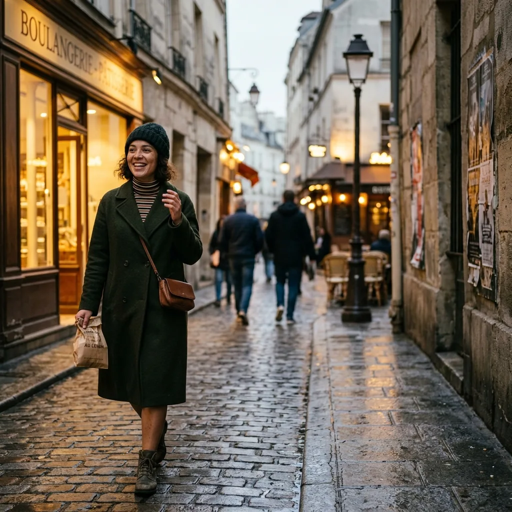

# AGE GENDER wearing CLOTHING , caught mid-action

[← Back to the collection](../../README.md) · Category: [Photography](../../gallery/photography.md) · Model: `Vinano Image v2` · ID: `vn-00051`

<a href="https://vinano.ai?utm_source=github&utm_medium=readme&utm_campaign=awesome-image-video-prompts-updating&utm_content=prompt-page-image"></a>

<sub>Preview generated with <a href="https://vinano.ai?utm_source=github&utm_medium=readme&utm_campaign=awesome-image-video-prompts-updating&utm_content=prompt-page-caption">vinano.ai</a></sub>

## Prompt

```text
{ "generation_request": { "meta_data": { "tool": "", "task_type": "photoreal_artistic_street_photography", "version": "v1.0_STREET_ART_REALISM_SER_EN", "priority": "highest" }, "output_settings": { "aspect_ratio": "4:5", "orientation": "portrait", "resolution_target": "ultra_high_res", "render_style": "ultra_photoreal_candid_film_still", "sharpness": "crisp_but_natural", "film_grain": "subtle_35mm", "color_grade": "restrained_cinematic_realism", "dynamic_range": "natural_not_hdr", "skin_rendering": "real_texture_no_retouch" }, "creative_prompt": { "scene_summary": "Candid artistic street photograph on location in [CITY/NEIGHBORHOOD]. A real, unposed moment that feels documentary and emotionally true.", "subject": "A [AGE] [GENDER] wearing [CLOTHING], caught mid-action: [MICRO-ACTION]. Natural facial expression, slight asymmetry preserved.", "camera": "35mm lens equivalent, eye-level, close but respectful distance, imperfect framing like a real street photographer, focus on the eyes, shallow-to-medium depth of field.", "lighting": "Motivated natural light from [SOURCE: shop window / street lamp / sunset / neon], deep but detailed shadows, no studio lighting.", "environment_details": "Street textures: worn posters, scratched metal, rain-speckled pavement, subtle reflections in glass, real urban clutter, no clean studio background.", "authenticity_markers": "Subtle motion blur on background only, slight halation on highlights, tiny film gate weave, realistic grain, no beauty retouch.", "mood": "[MOOD: melancholic / hopeful / tense / quiet joy], cinematic but believable." }, "negative_prompt": ["studio lighting", "beauty retouch", "plastic skin", "over-sharpened", "HDR", "AI glow", "perfect symmetry", "overly clean background", "fake bokeh shapes", "text", "logo", "watermark", "painterly", "cartoon"] } } Aim for an editorial, design-driven look with deliberate negative space.
```

## Try it on vinano.ai

1. Copy the prompt above.
2. Open **[vinano.ai](https://vinano.ai?utm_source=github&utm_medium=readme&utm_campaign=awesome-image-video-prompts-updating&utm_content=prompt-page-try)**, paste it into the image generator and pick a model.
3. Swap any placeholders (brand, product, city, person…) for your own details, then generate.

More prompts like this: [Photography gallery](../../gallery/photography.md) · [all categories](../../README.md#contents)
