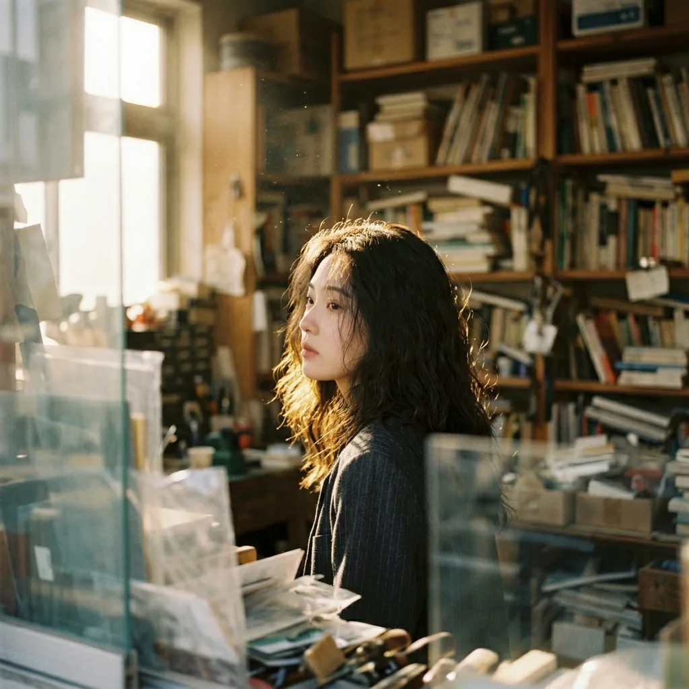

# Young East Asian woman, positioned in profile turning

[← Back to the collection](../../README.md) · Category: [Photography](../../gallery/photography.md) · Model: `Vinano Image v2` · ID: `vn-00055`

<a href="https://vinano.ai?utm_source=github&utm_medium=readme&utm_campaign=awesome-image-video-prompts-updating&utm_content=prompt-page-image"></a>

<sub>Preview generated with <a href="https://vinano.ai?utm_source=github&utm_medium=readme&utm_campaign=awesome-image-video-prompts-updating&utm_content=prompt-page-caption">vinano.ai</a></sub>

## Prompt

```text
{
 "subject": {
 "description": "Young East Asian woman, positioned in profile turning to look back at the viewer.",
 "pose": "Looking over shoulder, slight head tilt, body angled away from camera.",
 "expression": "Soft, neutral to slightly melancholic, contemplative gaze, lips slightly parted."
 },
 "clothing": {
 "upper_body": "Dark, structured jacket or blazer, possibly pinstriped or textured fabric.",
 "visibility": "Mostly obscured by shadow and foreground elements."
 },
 "hair": {
 "color": "Dark brown to black.",
 "style": "Long, loose, tousled waves, slightly messy texture.",
 "lighting_interaction": "Strongly backlit, creating a glowing halo effect on loose strands (rim lighting)."
 },
 "face": {
 "skin_tone": "Fair/pale warm undertones.",
 "features": "Soft facial structure, almond-shaped eyes, natural eyebrows.",
 "makeup": "Minimal, 'no-makeup' look, natural lip color."
 },
 "accessories": {
 "visible_items": "None clearly visible due to framing and lighting."
 },
 "environment": {
 "setting": "Cluttered interior space, resembling a workshop, storage room, or old bookstore.",
 "background_elements": "Wooden shelves stacked indistinct objects, papers, boxes, and plastic packaging.",
 "foreground_elements": "Blurred translucent objects (possibly glass, plastic sheets, or dust covers) creating layers and reflections."
 },
 "lighting": {
 "source": "Natural sunlight streaming through a window on the left.",
 "quality": "Golden hour, warm, diffuse but directional.",
 "effects": "Strong backlighting/rim lighting on hair, volumetric dust motes dancing in the light, lens flares, soft glare, dramatic contrast between light and shadow."
 },
 "camera": {
 "perspective": "Eye-level, shot through a foreground obstruction (glass or clutter).",
 "focus": "Shallow depth of field (bokeh), sharp focus on eyes/face, blurred background and foreground.",
 "lens_character": "Soft focus, film grain simulation, slight bloom effect."
 },
 "style": {
 "aesthetic": "Cinematic, atmospheric, nostalgic, slice-of-life, ethereal.",
 "mood": "Dreamy, intimate, quiet, sentimental.",
 "visual_reference": "Film photography, Japanese photobook style."
 }
}

Aim for an editorial, design-driven look with deliberate negative space.
```

## Try it on vinano.ai

1. Copy the prompt above.
2. Open **[vinano.ai](https://vinano.ai?utm_source=github&utm_medium=readme&utm_campaign=awesome-image-video-prompts-updating&utm_content=prompt-page-try)**, paste it into the image generator and pick a model.
3. Swap any placeholders (brand, product, city, person…) for your own details, then generate.

More prompts like this: [Photography gallery](../../gallery/photography.md) · [all categories](../../README.md#contents)
