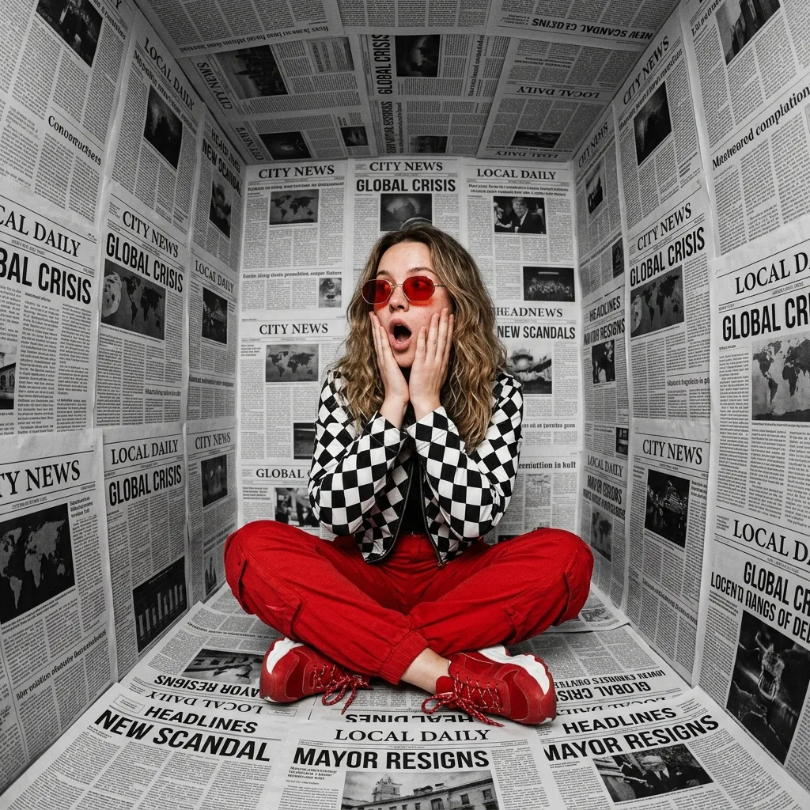

# Photo shot at eye level a 12mm ultra-wide lens

[← Back to the collection](../../README.md) · Category: [Photography](../../gallery/photography.md) · Model: `Vinano Image v2` · ID: `vn-00057`

<a href="https://vinano.ai?utm_source=github&utm_medium=readme&utm_campaign=awesome-image-video-prompts-updating&utm_content=prompt-page-image"></a>

<sub>Preview generated with <a href="https://vinano.ai?utm_source=github&utm_medium=readme&utm_campaign=awesome-image-video-prompts-updating&utm_content=prompt-page-caption">vinano.ai</a></sub>

## Prompt

```text
Hyper-realistic editorial photo shot at eye level a 12mm ultra-wide lens, full-frame camera, deep focus, and visible barrel distortion curved room edges. A small rectangular room fully covered in real newspaper pages—walls, floor, and ceiling—showing crisp text, ink bleed, and paper texture.
A woman sits cross-legged on the floor, hands pressed to her cheeks, mouth in a shocked “O.” Long wavy hair, natural skin texture visible pores and subtle freckles. She wears red octagonal sunglasses, a black-and-white checkered harlequin jacket, vibrant red cargo pants, and matching chunky sneakers.
Soft, diffuse frontal lighting, minimal shadows. Cinematic high-contrast color grade, mostly black and white red as the only saturated accent, ultra-detailed, true-to-life photorealistic fashion photography.

Preserve realistic proportions and depth for a confident, professional finish.
```

## Try it on vinano.ai

1. Copy the prompt above.
2. Open **[vinano.ai](https://vinano.ai?utm_source=github&utm_medium=readme&utm_campaign=awesome-image-video-prompts-updating&utm_content=prompt-page-try)**, paste it into the image generator and pick a model.
3. Swap any placeholders (brand, product, city, person…) for your own details, then generate.

More prompts like this: [Photography gallery](../../gallery/photography.md) · [all categories](../../README.md#contents)
