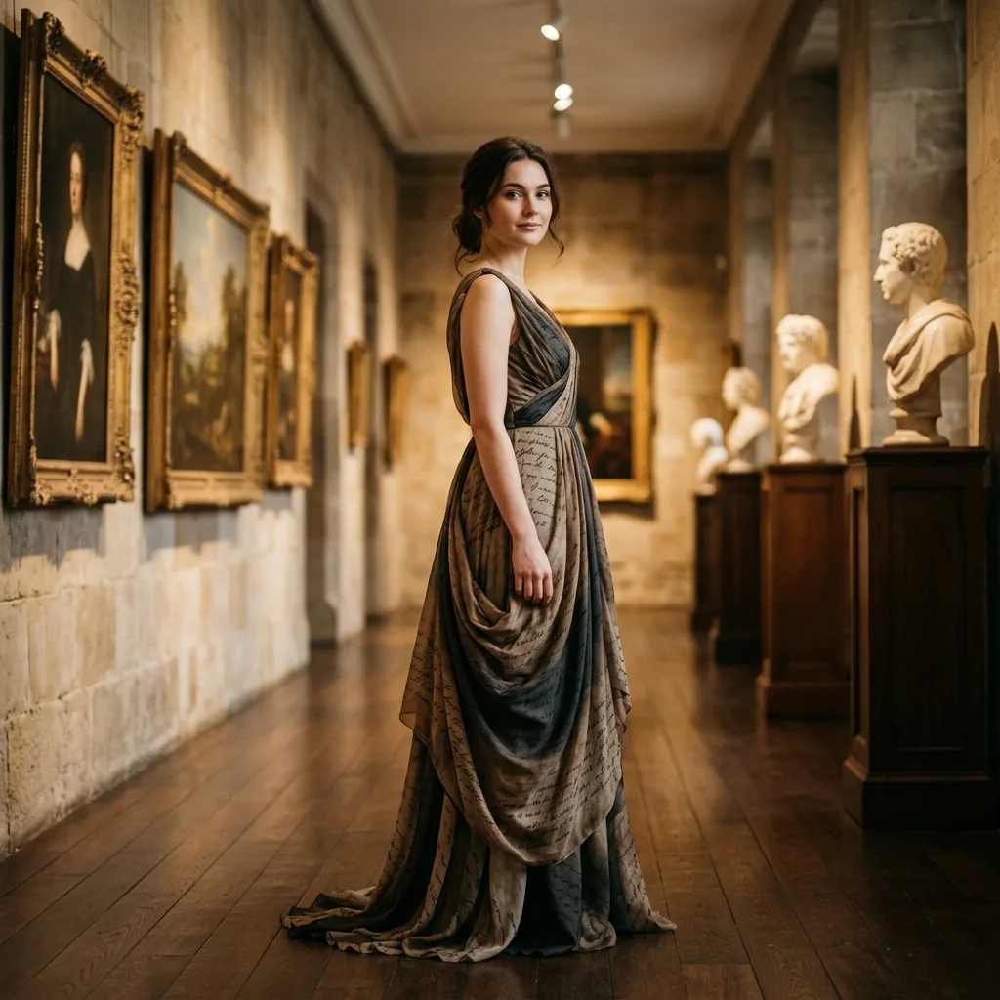

# Standing gracefully in three-quarter profile, body slightly turned, hands

[← Back to the collection](../../README.md) · Category: [Photography](../../gallery/photography.md) · Model: `Vinano Image Pro` · ID: `vn-00058`

<a href="https://vinano.ai?utm_source=github&utm_medium=readme&utm_campaign=awesome-image-video-prompts-updating&utm_content=prompt-page-image"></a>

<sub>Preview generated with <a href="https://vinano.ai?utm_source=github&utm_medium=readme&utm_campaign=awesome-image-video-prompts-updating&utm_content=prompt-page-caption">vinano.ai</a></sub>

## Prompt

```text
{
 "model": "",
 "scene": "Historic art gallery corridor classical sculptures and framed paintings",
 "subject": {
 "type": "Young woman",
 "pose": "Standing gracefully in three-quarter profile, body slightly turned, hands relaxed",
 "expression": "Soft, confident smile calm composure",
 "gaze": "Looking gently toward the camera",
 "emotion": "Elegance, quiet confidence, cultural presence"
 },
 "appearance": {
 "hair": {
 "color": "Dark brown",
 "style": "Pulled back neatly loose natural flow"
 },
 "skin": "Natural complexion, softly illuminated",
 "makeup": "Minimal, refined, classical"
 },
 "attire": {
 "dress": {
 "type": "Flowing couture-style gown",
 "design": "Layered fabric panels printed handwritten script",
 "colors": "Muted sepia, charcoal, parchment tones",
 "texture": "Soft, draped fabric subtle sheen"
 },
 "style_note": "Literary, artistic, museum-worthy fashion"
 },
 "environment": {
 "location": "Old stone-walled museum or gallery hall",
 "floor": "Polished wooden floorboards",
 "background_elements": ["Classical bust sculptures on pedestals",
 "Large framed paintings along stone walls"],
 "atmosphere": "Quiet, reverent, timeless"
 },
 "lighting": {
 "primary": "Warm gallery spotlights from above",
 "secondary": "Soft ambient lighting along the corridor",
 "effect": "Gentle highlights on fabric folds and face, deep background shadows"
 },
 "camera": {
 "angle": "Eye-level full-body portrait",
 "lens": "50mm cinematic portrait lens",
 "depth_of_field": "Shallow to moderate, subject crisp softly blurred background",
 "framing": "Vertical composition emphasizing height and elegance"
 },
 "color_palette": {
 "dominant": ["warm amber", "aged parchment brown"],
 "accents": ["deep charcoal", "golden highlights"]
 },
 "mood": "Timeless, cultured, graceful",
 "style": {
 "aesthetic": "Fine-art fashion photography",
 "inspiration": "Classical art, literature, museum couture",
 "realism": "true-to-life photorealistic",
 "texture": "Visible fabric grain, stone wall detail",
 "post_processing": "Warm cinematic grading, subtle vignette, gentle contrast"
 },
 "details": {
 "fabric_motion": "Soft drape pooling naturally on the floor",
 "background_depth": "Long corridor perspective enhancing grandeur",
 "motion": "Still, poised moment"
 },
 "themes": ["Art and identity",
 "Fashion as language",
 "Timeless beauty",
 "Human presence within history"],
 "quality": "Ultra-detailed, high dynamic range, professional cinematic fine-art portrait"
}

Keep edges clean and the overall composition balanced for a polished, gallery-ready result.
```

## Try it on vinano.ai

1. Copy the prompt above.
2. Open **[vinano.ai](https://vinano.ai?utm_source=github&utm_medium=readme&utm_campaign=awesome-image-video-prompts-updating&utm_content=prompt-page-try)**, paste it into the image generator and pick a model.
3. Swap any placeholders (brand, product, city, person…) for your own details, then generate.

More prompts like this: [Photography gallery](../../gallery/photography.md) · [all categories](../../README.md#contents)
