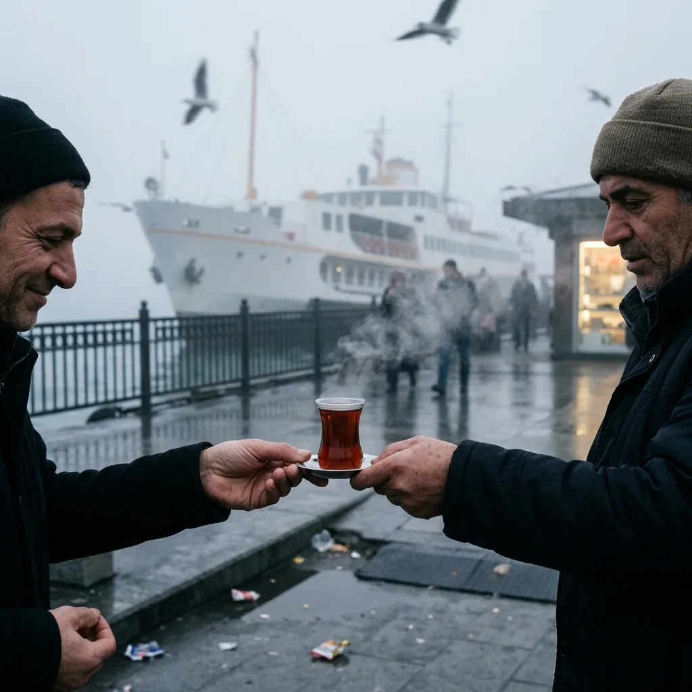

# 4:5 , orientation

[← Back to the collection](../../README.md) · Category: [Photography](../../gallery/photography.md) · Model: `Vinano Image v2` · ID: `vn-00059`

<a href="https://vinano.ai?utm_source=github&utm_medium=readme&utm_campaign=awesome-image-video-prompts-updating&utm_content=prompt-page-image"></a>

<sub>Preview generated with <a href="https://vinano.ai?utm_source=github&utm_medium=readme&utm_campaign=awesome-image-video-prompts-updating&utm_content=prompt-page-caption">vinano.ai</a></sub>

## Prompt

```text
{
 "output_settings": {
 "aspect_ratio": "4:5",
 "orientation": "portrait",
 "resolution_target": "ultra_high_res",
 "render_style": "ultra_photoreal_candid_street_film_still",
 "sharpness": "crisp_but_natural",
 "film_grain": "subtle_35mm",
 "color_grade": "restrained_cinematic_realism",
 "dynamic_range": "natural_not_hdr",
 "skin_rendering": "real_texture_no_retouch"
 },
 "global_rules": {
 "camera_language": "35mm lens equivalent, eye-level, imperfect framing, candid documentary feel, focus on eyes when a person is present",
 "authenticity_markers": "subtle halation on highlights, tiny film gate weave, slight background motion blur only, realistic street clutter, no studio look",
 "lighting_language": "motivated natural light only (shop window, street lamp, overcast daylight, sunset), deep but detailed shadows"
 },
 "negative_prompt": ["studio lighting",
 "beauty retouch",
 "plastic skin",
 "over-sharpened",
 "HDR",
 "AI glow",
 "perfect symmetry",
 "overly clean background",
 "fake bokeh",
 "text",
 "logo",
 "watermark",
 "cartoon",
 "painterly"]
}
{
 "scene_summary": "Early morning in Eminönü, ferry docks, soft fog and breath in cold air, documentary street realism.",
 "subject": "Tea vendor handing a steaming tea glass to a customer, candid moment.",
 "micro_action": "steam rising as fingers touch the glass, tiny smile",
 "environment_details": "ferry silhouette in mist, seagulls blurred in background, wet railings, puddles",
 "lighting": "soft morning light diffused by fog, highlights subtle halation"
}

Keep edges clean and the overall composition balanced for a polished, gallery-ready result.
```

## Try it on vinano.ai

1. Copy the prompt above.
2. Open **[vinano.ai](https://vinano.ai?utm_source=github&utm_medium=readme&utm_campaign=awesome-image-video-prompts-updating&utm_content=prompt-page-try)**, paste it into the image generator and pick a model.
3. Swap any placeholders (brand, product, city, person…) for your own details, then generate.

More prompts like this: [Photography gallery](../../gallery/photography.md) · [all categories](../../README.md#contents)
