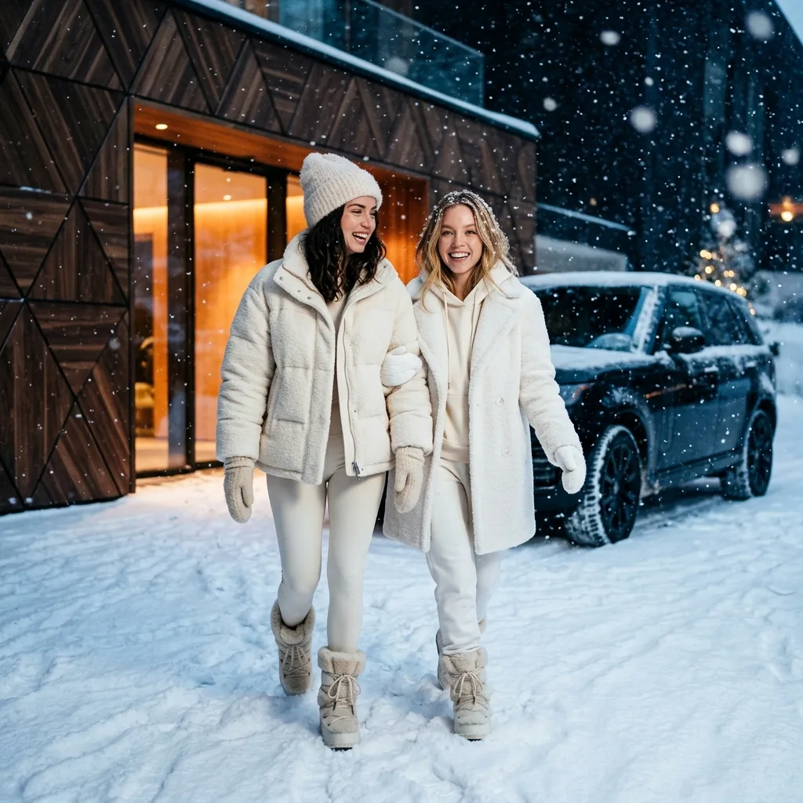

# Ana de Armas Sydney Sweeney Picture Gemini Prompt

[← Back to the collection](../../README.md) · Category: [Photography](../../gallery/photography.md) · Model: `Vinano Image v2` · ID: `vn-00060`

<a href="https://vinano.ai?utm_source=github&utm_medium=readme&utm_campaign=awesome-image-video-prompts-updating&utm_content=prompt-page-image"></a>

<sub>Preview generated with <a href="https://vinano.ai?utm_source=github&utm_medium=readme&utm_campaign=awesome-image-video-prompts-updating&utm_content=prompt-page-caption">vinano.ai</a></sub>

## Prompt

```text
Ana de Armas
Sydney Sweeney Picture

Gemini

Prompt:
{
 "image_generation_request": {
 "aspect_ratio": "3:4",
 "style": "Cinematic Fashion Photography",
 "quality": "8K / Ultra-High Detail",
 "subject": {
 "identity": "Young adult woman, Shakira-inspired likeness",
 "pose": {
 "description": "Dynamic balletic stance, spontaneous and joyful",
 "position": "Balancing on one leg, other leg bent and lifted high, body slightly tilted",
 "arms": "One arm raised catching snowflakes open palm, other arm following the flow of movement"
 },
 "expression": {
 "mood": "Genuinely happy and lively",
 "features": "Wide natural smile, slightly parted lips, eyes sparkling emotion, cheeks flushed from cold"
 },
 "physical_details": {
 "skin": "Realistic texture, fine pores, subtle asymmetry, soft highlights, no plastic smoothing",
 "hair": "Long dark hair flowing from beanie, damp strands clinging to cheeks/forehead from melting snow"
 }
 },
 "apparel": {
 "theme": "Monochrome creamy-white winter look",
 "layers": [{
 "item": "Oversized puffer jacket",
 "details": "Thick creamy-white, fluffy texture, visible stitching, realistic down volume and compression folds"
 },
 {
 "item": "Cropped hoodie",
 "details": "Creamy-white soft cotton, gentle wrinkles, worn underneath jacket"
 },
 {
 "item": "High-waisted leggings",
 "details": "Matte stretch fabric, creamy-white, subtle tension at knees and hips"
 }],
 "accessories": [{
 "item": "Knit beanie",
 "details": "Extra-fluffy, visible yarn texture, creamy-white"
 },
 {
 "item": "Mittens",
 "details": "Long creamy-white fluffy fibers, catching falling snowflakes"
 }],
 "footwear": {
 "style": "Moon-boot inspired lace-up winter boots",
 "details": "White fur-lined, realistic rubber soles, snow buildup around the edges"
 }
 },
 "environment": {
 "setting": "Nighttime exterior of a modern luxury building",
 "architecture": "Sharp geometric wood triangular patterns",
 "props": "Black luxury SUV parked nearby, partially covered in frost and snow",
 "ground": "Thick uneven snow blanket visible footprints and compression points",
 "weather": "Heavy dense snowfall, large snowflakes frozen in mid-motion slight blur"
 },
 "lighting_and_atmosphere": {
 "primary_lighting": "Cold blue-white ambient winter light",
 "secondary_lighting": "Warm orange glow from building interior/windows",
 "visual_effects": ["Cinematic color separation",
 "Soft bokeh highlights in background",
 "Shallow depth of field",
 "Reflections softened by frost"]
 },
 "technical_specs": {
 "camera": "Full-frame DSLR/Mirrorless",
 "lens": "50mm–85mm prime lens aesthetic",
 "optics": "Natural perspective, high dynamic range (HDR), realistic exposure",
 "post_processing": "Authentic textures, no over-sharpening, cinematic realism"
 }
 }

Render with rich micro-detail while keeping the layout uncluttered and intentional.
```

## Try it on vinano.ai

1. Copy the prompt above.
2. Open **[vinano.ai](https://vinano.ai?utm_source=github&utm_medium=readme&utm_campaign=awesome-image-video-prompts-updating&utm_content=prompt-page-try)**, paste it into the image generator and pick a model.
3. Swap any placeholders (brand, product, city, person…) for your own details, then generate.

More prompts like this: [Photography gallery](../../gallery/photography.md) · [all categories](../../README.md#contents)
