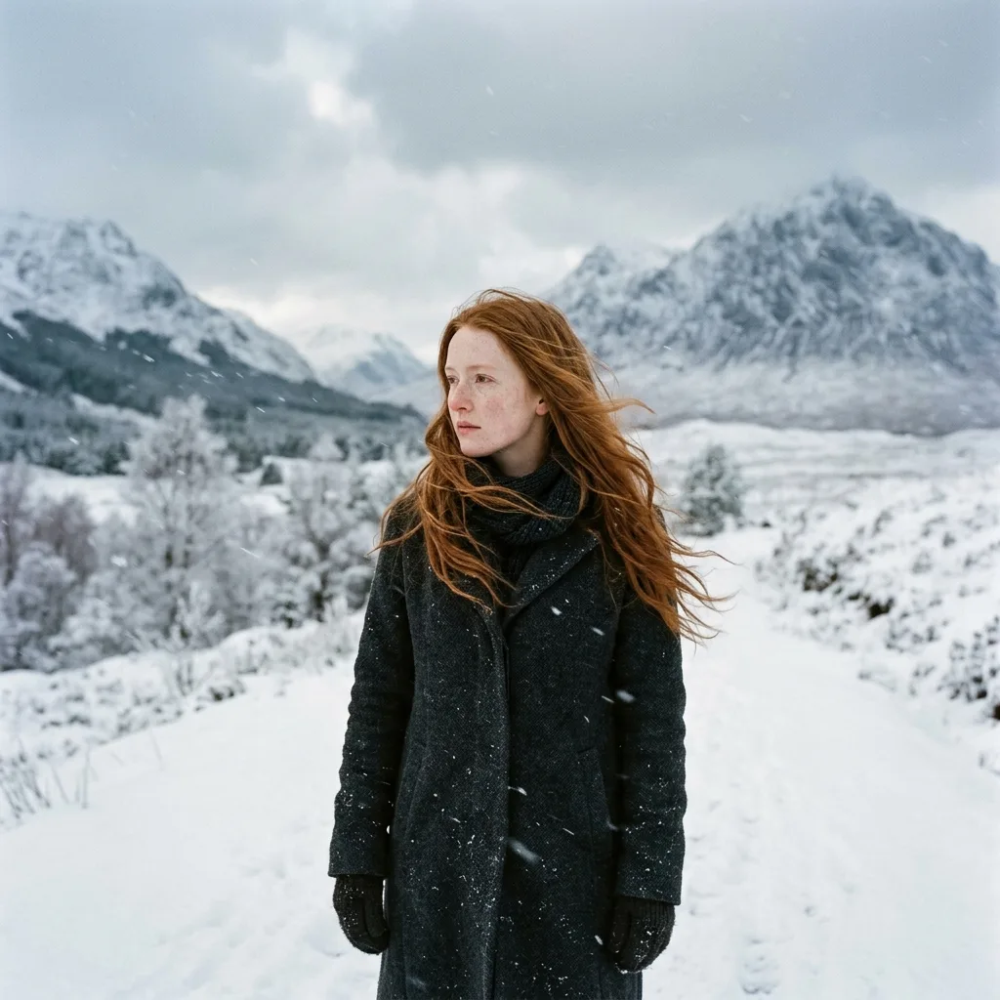

# Poetic cinematic portrait of a young woman standing alone

[← Back to the collection](../../README.md) · Category: [Photography](../../gallery/photography.md) · Model: `Vinano Image v2` · ID: `vn-00061`

<a href="https://vinano.ai?utm_source=github&utm_medium=readme&utm_campaign=awesome-image-video-prompts-updating&utm_content=prompt-page-image"></a>

<sub>Preview generated with <a href="https://vinano.ai?utm_source=github&utm_medium=readme&utm_campaign=awesome-image-video-prompts-updating&utm_content=prompt-page-caption">vinano.ai</a></sub>

## Prompt

```text
A poetic cinematic portrait of a young woman standing alone in a vast snowy landscape, surrounded by distant frost-covered mountains. Her long auburn hair is caught mid-motion by strong winter wind, strands flowing naturally across her face. She wears a dark wool coat, minimal makeup, pale freckled skin, and a quiet, introspective expression. Soft snowfall drifts through the air. Muted natural color palette cold greys, soft whites, and warm copper hair tones. Shallow depth of field, natural diffused daylight, overcast sky, fine film grain, subtle motion blur in hair and snow, cinematic realism, emotional storytelling, editorial photography, 85mm lens look, ultra-detailed, moody atmosphere, high realism, 8k quality, 4:5 image ratio Maintain consistent colour harmony and crisp focus across the whole frame.
```

## Try it on vinano.ai

1. Copy the prompt above.
2. Open **[vinano.ai](https://vinano.ai?utm_source=github&utm_medium=readme&utm_campaign=awesome-image-video-prompts-updating&utm_content=prompt-page-try)**, paste it into the image generator and pick a model.
3. Swap any placeholders (brand, product, city, person…) for your own details, then generate.

More prompts like this: [Photography gallery](../../gallery/photography.md) · [all categories](../../README.md#contents)
