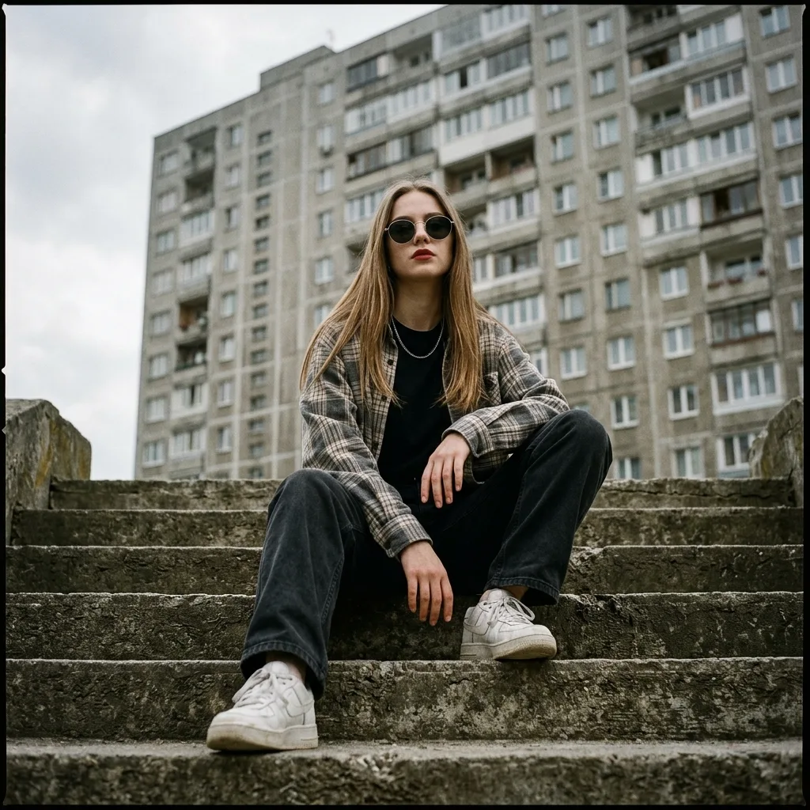

# Young woman sitting casually on outdoor concrete stairs, posing

[← Back to the collection](../../README.md) · Category: [Photography](../../gallery/photography.md) · Model: `Vinano Image Pro` · ID: `vn-00063`

<a href="https://vinano.ai?utm_source=github&utm_medium=readme&utm_campaign=awesome-image-video-prompts-updating&utm_content=prompt-page-image"></a>

<sub>Preview generated with <a href="https://vinano.ai?utm_source=github&utm_medium=readme&utm_campaign=awesome-image-video-prompts-updating&utm_content=prompt-page-caption">vinano.ai</a></sub>

## Prompt

```text
{
 "subject": "Young woman sitting casually on outdoor concrete stairs, posing a cool, confident demeanor.",
 "clothing": "Oversized grey and beige plaid flannel shirt worn open, plain black crew-neck t-shirt underneath, loose-fitting dark trousers, chunky white sneakers.",
 "hair": "Long, straight light brown hair a middle part, falling naturally over the shoulders.",
 "face": "Neutral, poised expression defined red lips, eyes concealed behind sunglasses.",
 "accessories": "Round dark sunglasses thin metal frames, simple silver chain necklace.",
 "environment": "Urban setting a tall, grey concrete apartment block featuring a grid of windows in the background, weathered concrete steps in the foreground.",
 "lighting": "Soft, diffuse natural daylight indicative of an overcast sky, creating even illumination without harsh shadows.",
 "camera": "Low-angle shot looking up at the subject, emphasizing the height of the background building, sharp focus on the subject a slightly softened background.",
 "style": "Urban streetwear photography, 90s grunge aesthetic, moody and atmospheric, cinematic vertical composition."
}

Preserve realistic proportions and depth for a confident, professional finish.
```

## Try it on vinano.ai

1. Copy the prompt above.
2. Open **[vinano.ai](https://vinano.ai?utm_source=github&utm_medium=readme&utm_campaign=awesome-image-video-prompts-updating&utm_content=prompt-page-try)**, paste it into the image generator and pick a model.
3. Swap any placeholders (brand, product, city, person…) for your own details, then generate.

More prompts like this: [Photography gallery](../../gallery/photography.md) · [all categories](../../README.md#contents)
