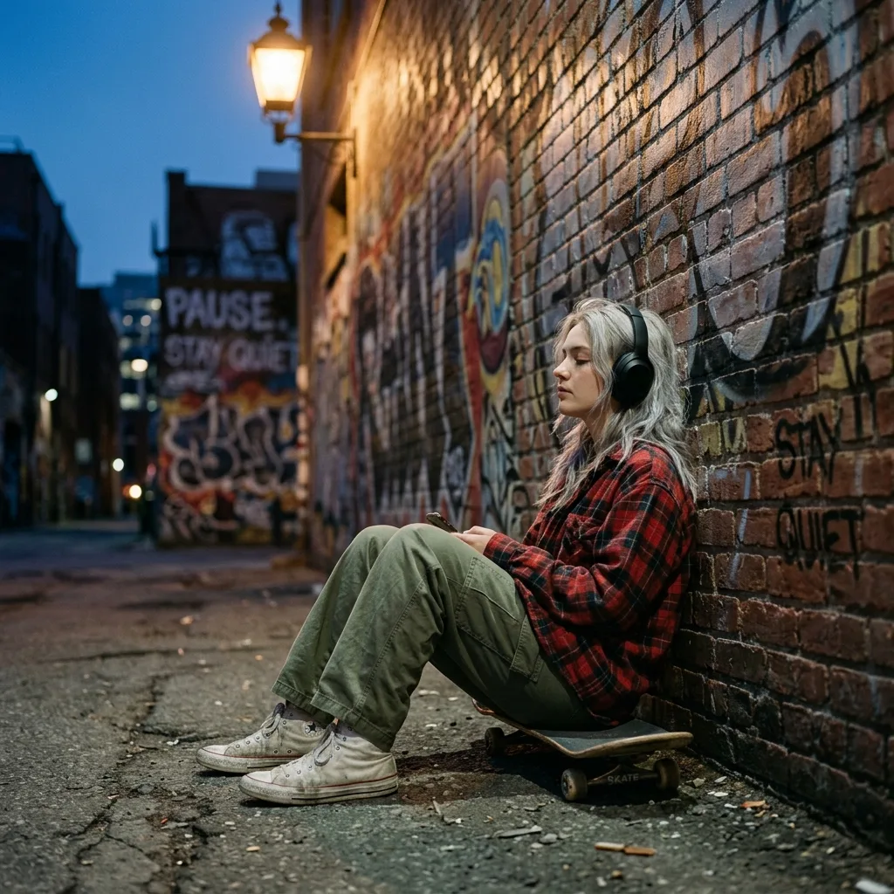

# Sitting on a skateboard knees bent, back resting against

[← Back to the collection](../../README.md) · Category: [Photography](../../gallery/photography.md) · Model: `Vinano Image v2` · ID: `vn-00066`

<a href="https://vinano.ai?utm_source=github&utm_medium=readme&utm_campaign=awesome-image-video-prompts-updating&utm_content=prompt-page-image"></a>

<sub>Preview generated with <a href="https://vinano.ai?utm_source=github&utm_medium=readme&utm_campaign=awesome-image-video-prompts-updating&utm_content=prompt-page-caption">vinano.ai</a></sub>

## Prompt

```text
{
 "model": "",
 "scene": "Urban street corner at dusk beside a brick wall covered in graffiti",
 "subject": {
 "type": "Young woman",
 "pose": "Sitting on a skateboard knees bent, back resting against a brick wall",
 "expression": "Calm, introspective, slightly distant",
 "gaze": "Eyes gently closed or lowered, absorbed in music",
 "emotion": "Stillness, reflection, quiet detachment"
 },
 "appearance": {
 "hair": {
 "color": "Silver-blonde",
 "style": "Loose, slightly tousled"
 },
 "accessories": "Over-ear black headphones",
 "skin": "Natural tone soft evening light"
 },
 "attire": {
 "top": "Oversized plaid flannel shirt",
 "bottoms": "Loose cargo pants",
 "footwear": "Worn white sneakers",
 "style_note": "Relaxed streetwear, functional and unstyled"
 },
 "environment": {
 "location": "City alley or side street",
 "background": "Brick wall faded graffiti art",
 "props": ["Skateboard leaning against the wall",
 "Street lamp mounted above"],
 "atmosphere": "Urban, quiet, end-of-day calm"
 },
 "lighting": {
 "primary": "Warm street lamp light",
 "secondary": "Soft natural twilight",
 "effect": "Golden highlights on brick texture, gentle shadows"
 },
 "camera": {
 "angle": "Low-angle three-quarter view",
 "lens": "35mm cinematic lens",
 "depth_of_field": "Moderate, subject in focus softly blurred background",
 "framing": "Vertical composition emphasizing street depth and wall lines"
 },
 "color_palette": {
 "dominant": ["warm brick red", "muted olive", "soft amber"],
 "accents": ["cool gray", "faded graffiti tones"]
 },
 "mood": "Urban, introspective, grounded",
 "style": {
 "aesthetic": "Cinematic street photography",
 "realism": "true-to-life photorealistic",
 "texture": "Rough brick, worn asphalt, fabric folds",
 "post_processing": "Warm highlights slightly muted saturation"
 },
 "details": {
 "ground": "Rough asphalt small debris",
 "board": "Scuffed skateboard deck showing use",
 "motion": "Still frame, no action or blur"
 },
 "themes": ["Urban solitude",
 "Music as escape",
 "Youth and pause",
 "Belonging without noise"],
 "quality": "Ultra-detailed, high dynamic range, professional cinematic street portrait"
}

Aim for an editorial, design-driven look with deliberate negative space.
```

## Try it on vinano.ai

1. Copy the prompt above.
2. Open **[vinano.ai](https://vinano.ai?utm_source=github&utm_medium=readme&utm_campaign=awesome-image-video-prompts-updating&utm_content=prompt-page-try)**, paste it into the image generator and pick a model.
3. Swap any placeholders (brand, product, city, person…) for your own details, then generate.

More prompts like this: [Photography gallery](../../gallery/photography.md) · [all categories](../../README.md#contents)
