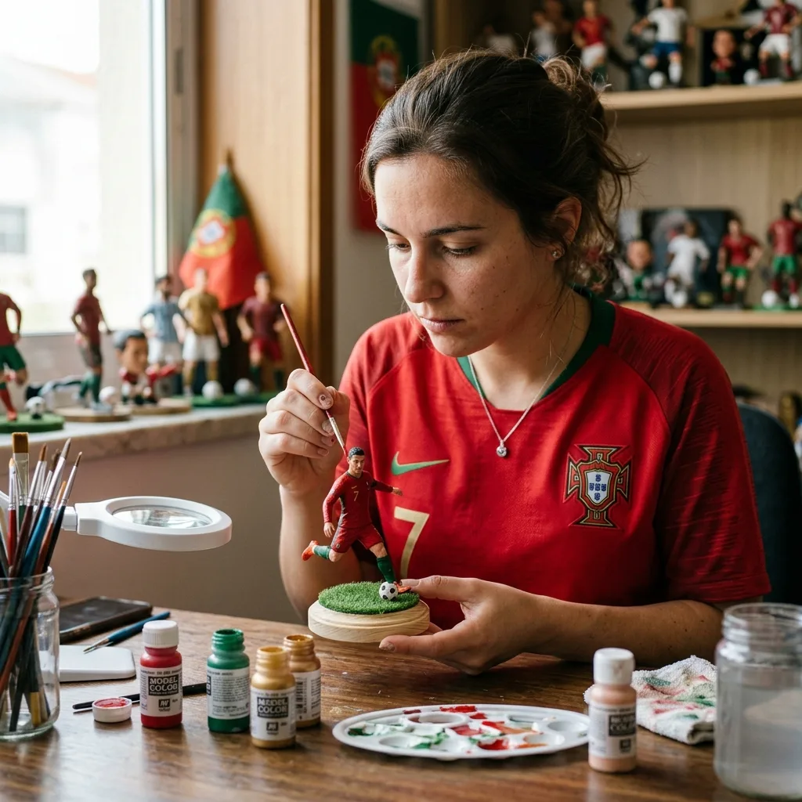

# Scene of a woman carefully painting a miniature football

[← Back to the collection](../../README.md) · Category: [Photography](../../gallery/photography.md) · Model: `Vinano Image v2` · ID: `vn-00068`

<a href="https://vinano.ai?utm_source=github&utm_medium=readme&utm_campaign=awesome-image-video-prompts-updating&utm_content=prompt-page-image"></a>

<sub>Preview generated with <a href="https://vinano.ai?utm_source=github&utm_medium=readme&utm_campaign=awesome-image-video-prompts-updating&utm_content=prompt-page-caption">vinano.ai</a></sub>

## Prompt

```text
A hyper-realistic cinematic scene of a woman carefully painting a miniature football figurine of Cristiano Ronaldo in a Portugal national team jersey. The tiny footballer is frozen mid-dribble the ball at his feet, standing on a round grass base placed on a wooden desk. The woman wears a matching red Portugal jersey and focuses intently while holding a fine paintbrush near the figure’s face. Soft natural window light creates warm highlights and gentle shadows, shallow depth of field a blurred shelf of collectibles in the background. Ultra-detailed textures on fabric, skin, and paint strokes, true-to-life photorealistic scale illusion, cinematic storytelling composition, premium studio realism, 50mm lens look, high-end editorial mood Emphasise material texture and natural light so the final frame feels tactile and premium.
```

## Try it on vinano.ai

1. Copy the prompt above.
2. Open **[vinano.ai](https://vinano.ai?utm_source=github&utm_medium=readme&utm_campaign=awesome-image-video-prompts-updating&utm_content=prompt-page-try)**, paste it into the image generator and pick a model.
3. Swap any placeholders (brand, product, city, person…) for your own details, then generate.

More prompts like this: [Photography gallery](../../gallery/photography.md) · [all categories](../../README.md#contents)
