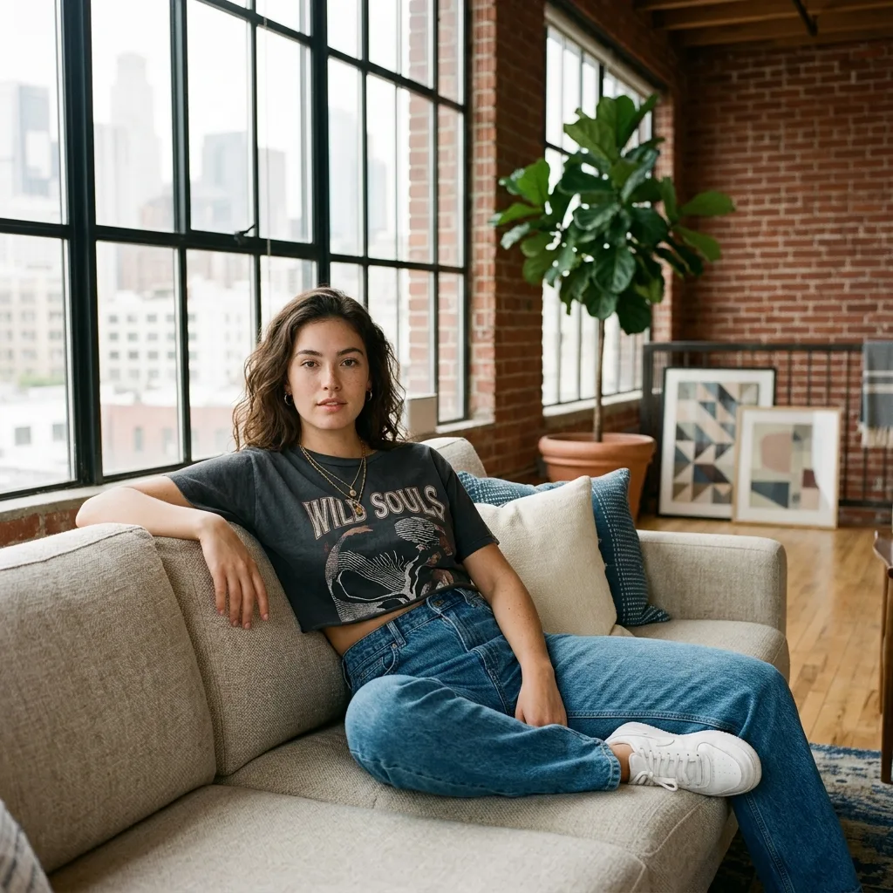

# Reclining casually on a fabric sofa, one arm resting

[← Back to the collection](../../README.md) · Category: [Photography](../../gallery/photography.md) · Model: `Vinano Image v2` · ID: `vn-00069`

<a href="https://vinano.ai?utm_source=github&utm_medium=readme&utm_campaign=awesome-image-video-prompts-updating&utm_content=prompt-page-image"></a>

<sub>Preview generated with <a href="https://vinano.ai?utm_source=github&utm_medium=readme&utm_campaign=awesome-image-video-prompts-updating&utm_content=prompt-page-caption">vinano.ai</a></sub>

## Prompt

```text
{
 "model": "",
 "scene": "Modern loft living room large industrial windows",
 "subject": {
 "type": "Young woman",
 "pose": "Reclining casually on a fabric sofa, one arm resting along the backrest, legs relaxed",
 "expression": "Calm, self-assured, quietly confident",
 "gaze": "Direct eye contact the camera",
 "emotion": "Ease, confidence, natural presence"
 },
 "appearance": {
 "hair": {
 "color": "Dark brown",
 "style": "Loose, long waves natural volume"
 },
 "skin": "Natural complexion subtle freckles and realistic texture",
 "makeup": "Minimal, clean, natural tones"
 },
 "attire": {
 "top": "Vintage-style cropped graphic t-shirt",
 "bottoms": "High-waisted relaxed-fit blue jeans",
 "footwear": "White casual sneakers",
 "accessories": ["Layered gold necklaces"],
 "style_note": "Effortless modern street-lifestyle fashion"
 },
 "environment": {
 "location": "Urban loft apartment",
 "background": ["Exposed brick walls",
 "Large black-framed windows",
 "City skyline softly visible outside",
 "Indoor potted plant",
 "Abstract framed artwork leaning against walls"],
 "atmosphere": "Airy, contemporary, lived-in"
 },
 "lighting": {
 "primary": "Soft natural daylight from large windows",
 "effect": "Balanced illumination gentle facial shadows",
 "contrast": "Low to moderate, natural realism"
 },
 "camera": {
 "angle": "Eye-level lifestyle portrait",
 "lens": "35mm lifestyle lens",
 "depth_of_field": "Moderate, subject in focus softly blurred background",
 "framing": "Horizontal composition, relaxed editorial framing"
 },
 "color_palette": {
 "dominant": ["neutral beige", "denim blue"],
 "accents": ["warm skin tones", "muted green", "soft brick red"]
 },
 "mood": "Relaxed, confident, contemporary",
 "style": {
 "aesthetic": "Lifestyle editorial photography",
 "realism": "true-to-life photorealistic",
 "texture": "Visible denim grain, fabric upholstery detail",
 "post_processing": "Natural color grading, subtle warmth, no heavy filters"
 },
 "details": {
 "sofa": "Light neutral fabric couch soft texture",
 "windows": "Tall industrial-style windows diffused city light",
 "motion": "Still, candid moment"
 },
 "themes": ["Modern femininity",
 "Comfort and confidence",
 "Everyday luxury",
 "Authentic presence"],
 "quality": "Ultra-detailed, high dynamic range, professional lifestyle photography"
}

Maintain consistent colour harmony and crisp focus across the whole frame.
```

## Try it on vinano.ai

1. Copy the prompt above.
2. Open **[vinano.ai](https://vinano.ai?utm_source=github&utm_medium=readme&utm_campaign=awesome-image-video-prompts-updating&utm_content=prompt-page-try)**, paste it into the image generator and pick a model.
3. Swap any placeholders (brand, product, city, person…) for your own details, then generate.

More prompts like this: [Photography gallery](../../gallery/photography.md) · [all categories](../../README.md#contents)
