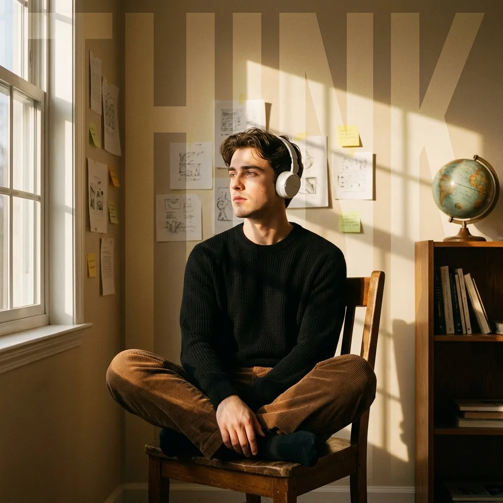

# Portrait of a young man in the uploaded image

[← Back to the collection](../../README.md) · Category: [Photography](../../gallery/photography.md) · Model: `Vinano Image Pro` · ID: `vn-00071`

<a href="https://vinano.ai?utm_source=github&utm_medium=readme&utm_campaign=awesome-image-video-prompts-updating&utm_content=prompt-page-image"></a>

<sub>Preview generated with <a href="https://vinano.ai?utm_source=github&utm_medium=readme&utm_campaign=awesome-image-video-prompts-updating&utm_content=prompt-page-caption">vinano.ai</a></sub>

## Prompt

```text
A cinematic portrait of a young man in the uploaded image sitting cross-legged on a simple wooden chair, wearing white over-ear headphones and gazing thoughtfully toward the light. He is wearing black sweater and brown trousers. He is in a cozy study room; the background features a beige wall cluttered taped papers and sticky notes, a wooden bookshelf and a globe visible on the right. Warm, golden-hour sunlight streams in from the left, casting distinct, sharp grid-like window shadows across the subject and the back wall. A large, semi-transparent, faded typography overlay of the word "THINK" blends vertically into the scene behind him. The atmosphere is moody, nostalgic, and warm, a soft film grain texture. Keep edges clean and the overall composition balanced for a polished, gallery-ready result.
```

## Try it on vinano.ai

1. Copy the prompt above.
2. Open **[vinano.ai](https://vinano.ai?utm_source=github&utm_medium=readme&utm_campaign=awesome-image-video-prompts-updating&utm_content=prompt-page-try)**, paste it into the image generator and pick a model.
3. Swap any placeholders (brand, product, city, person…) for your own details, then generate.

More prompts like this: [Photography gallery](../../gallery/photography.md) · [all categories](../../README.md#contents)
