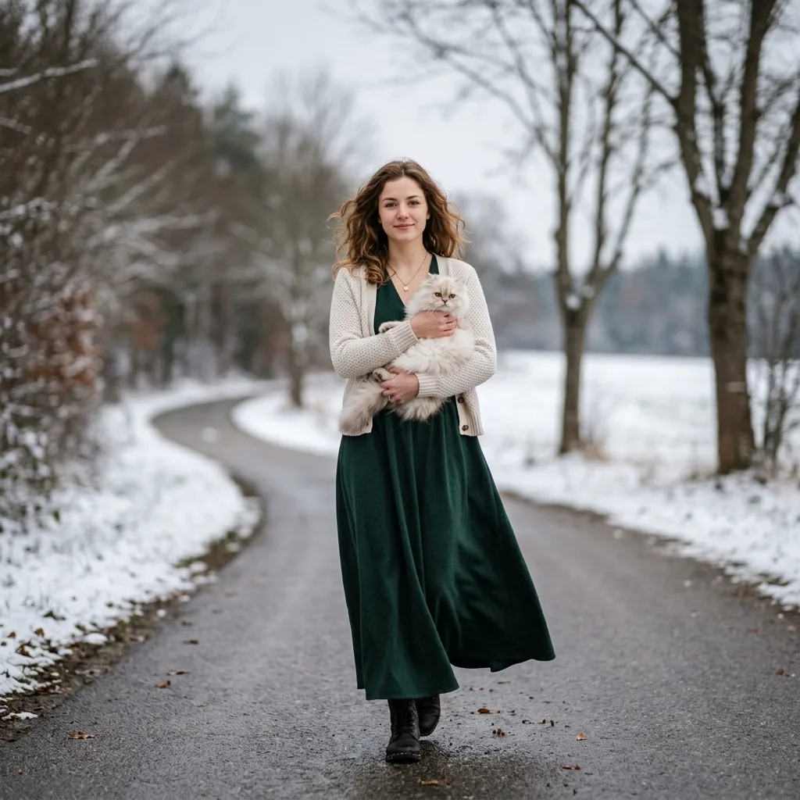

# Portrait of a young woman in her early 20s

[← Back to the collection](../../README.md) · Category: [Photography](../../gallery/photography.md) · Model: `Vinano Image v2` · ID: `vn-00072`

<a href="https://vinano.ai?utm_source=github&utm_medium=readme&utm_campaign=awesome-image-video-prompts-updating&utm_content=prompt-page-image"></a>

<sub>Preview generated with <a href="https://vinano.ai?utm_source=github&utm_medium=readme&utm_campaign=awesome-image-video-prompts-updating&utm_content=prompt-page-caption">vinano.ai</a></sub>

## Prompt

```text
portrait of a young woman in her early 20s walking calmly on a beautiful road, holding a small Persian cat gently in her arms, candid natural pose, elegant flowing dress, soft graceful expression, winter cloudy day, cinematic atmosphere, good lighting fully focused on her, shallow depth of field, background softly blurred, realistic textures, detailed skin, high-resolution, natural colors, soft diffused light, subtle bokeh, professional photography, 85mm lens look

--style realistic --quality high --ar 3:4 --v 6

Maintain consistent colour harmony and crisp focus across the whole frame.
```

## Try it on vinano.ai

1. Copy the prompt above.
2. Open **[vinano.ai](https://vinano.ai?utm_source=github&utm_medium=readme&utm_campaign=awesome-image-video-prompts-updating&utm_content=prompt-page-try)**, paste it into the image generator and pick a model.
3. Swap any placeholders (brand, product, city, person…) for your own details, then generate.

More prompts like this: [Photography gallery](../../gallery/photography.md) · [all categories](../../README.md#contents)
