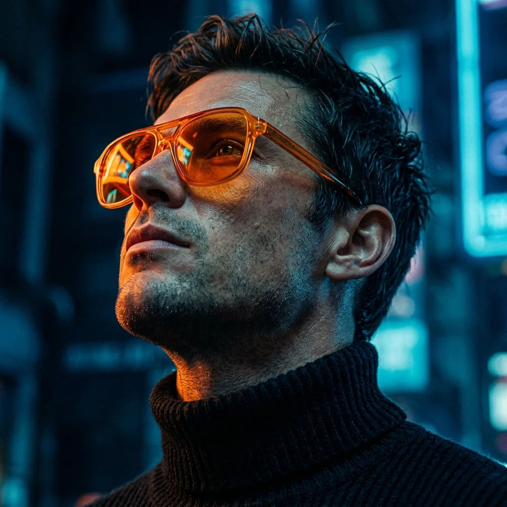

# Man, likely in his early thirties facial proportions, structure

[← Back to the collection](../../README.md) · Category: [Photography](../../gallery/photography.md) · Model: `Vinano Image v2` · ID: `vn-00075`

<a href="https://vinano.ai?utm_source=github&utm_medium=readme&utm_campaign=awesome-image-video-prompts-updating&utm_content=prompt-page-image"></a>

<sub>Preview generated with <a href="https://vinano.ai?utm_source=github&utm_medium=readme&utm_campaign=awesome-image-video-prompts-updating&utm_content=prompt-page-caption">vinano.ai</a></sub>

## Prompt

```text
A man, likely in his early thirties facial proportions, structure, and overall appearance inspired by the reference, captured in full sharp detail and natural skin texture,
hyper-detailed, cinematic close-up profile portrait, vertical orientation, extreme low-angle (worm's-eye view), focusing on the face from the neck up. The man gazes upward a serious, intense expression. He has dark, short, slightly tousled hair, catching subtle highlights. His facial features are sharply defined, a strong jawline and natural stubble. Skin texture is realistic, showing pores, subtle imperfections, and natural subsurface scattering.
Clothing & Accessories:
He wears a high-collared, dark turtleneck that absorbs light, creating a strong contrast against the illuminated face. He has large, round, retro-futuristic sunglasses thick, transparent or light-colored frames and intensely bright orange lenses. The sunglasses reflect the ambient and primary lighting naturally.
Lighting & Color:
Extreme, high-contrast neon lighting complementary color scheme. Primary light is intense, warm orange/amber emanating from the sunglasses direction, illuminating the nose bridge, cheekbones, and frame edges. Secondary ambient light is cool cyan-blue, providing deep backlight and shadow fill. Shadows are deep indigo and ultramarine, producing strong chiaroscuro, the subject’s face partially obscured by cool shadows but punctuated warm orange highlights. Volumetric light subtly interacts hair and glasses for realism.
Composition & Perspective:
Low-angle close-up emphasizing upward gaze, strong jawline, and facial structure. Solid cyan-blue background ensures the subject stands out, crisp composition and dramatic silhouette. Shallow depth of field isolates the face and sunglasses.
Artistic Style & Mood:
Hyper-realistic, cinematic, true-to-life photorealistic editorial portrait cyberpunk, neo-noir, and 80s synthwave aesthetic. Mood is intense, mysterious, and high-fashion.
Technical Details:
Ultra-high resolution, 8K, sharp focus on facial features and sunglasses, realistic skin rendering quality, natural subsurface scattering, realistic fabric texture, volumetric and rim lighting, cinematic color grading.
Negative Prompts:
cartoon, painting, sketch, 3D render, CGI, plastic skin, blurry, low quality, feminine traits, excessive makeup, watermark, text, unrealistic exaggeration.

Preserve realistic proportions and depth for a confident, professional finish.
```

## Try it on vinano.ai

1. Copy the prompt above.
2. Open **[vinano.ai](https://vinano.ai?utm_source=github&utm_medium=readme&utm_campaign=awesome-image-video-prompts-updating&utm_content=prompt-page-try)**, paste it into the image generator and pick a model.
3. Swap any placeholders (brand, product, city, person…) for your own details, then generate.

More prompts like this: [Photography gallery](../../gallery/photography.md) · [all categories](../../README.md#contents)
