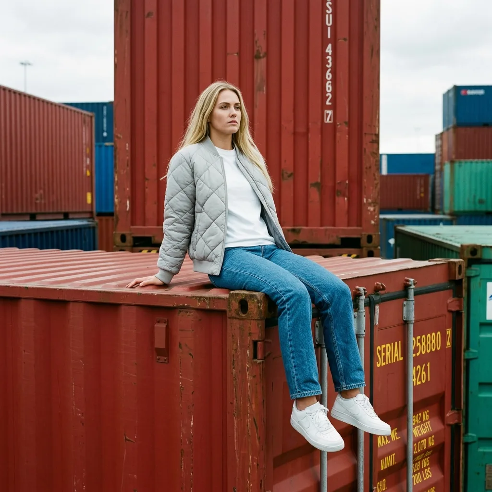

# Young western woman, fit build, serious expression, looking away

[← Back to the collection](../../README.md) · Category: [Photography](../../gallery/photography.md) · Model: `Vinano Image Pro` · ID: `vn-00076`

<a href="https://vinano.ai?utm_source=github&utm_medium=readme&utm_campaign=awesome-image-video-prompts-updating&utm_content=prompt-page-image"></a>

<sub>Preview generated with <a href="https://vinano.ai?utm_source=github&utm_medium=readme&utm_campaign=awesome-image-video-prompts-updating&utm_content=prompt-page-caption">vinano.ai</a></sub>

## Prompt

```text
Use the same face from the reference image without changing facial features

{
 "image_description": "A high-angle, low-perspective full-body portrait of a young western woman blonde hair sitting on the edge of a red industrial shipping container.",
 "subject": {
 "person": "Young western woman, fit build, serious expression, looking away from the camera toward the horizon.",
 "hair_style": "long blonde",
 "clothing": {
 "jacket": "Light grey quilted puffer bomber jacket a diamond pattern.",
 "undershirt": "Plain crisp white crew-neck t-shirt.",
 "pants": "Classic medium-wash blue denim jeans, straight fit.",
 "footwear": "Clean, bright white leather low-top sneakers."
 },
 "pose": "Sitting relaxed on the edge of a metal container, legs dangling, leaning slightly back on his right hand."
 },
 "setting": {
 "location": "Industrial shipping yard or port.",
 "background_elements": ["Stacked corrugated red metal shipping containers.",
 "A vertical red container behind the subject creates a strong leading line.",
 "Yellow stencil lettering visible on the container beneath the subject."],
 "atmosphere": "Urban, gritty yet clean, modern streetwear aesthetic."
 },
 "composition_and_lighting": {
 "camera_angle": "Low angle looking up, creating a sense of scale and height.",
 "lighting": "Natural, diffused daylight; soft shadows; overcast sky providing even illumination.",
 "color_palette": ["Primary: Bold industrial red",
 "Secondary: Denim blue, light grey, and crisp white",
 "Background: Muted grey/white sky"],
 "lens_effects": "Deep depth of field sharp focus on the subject and the immediate container texture."
 },
 "technical_tags": "Street photography, architectural lines, hyper-realistic, 8k resolution, filmic, cinematic lighting, industrial fashion shoot."
}

Preserve realistic proportions and depth for a confident, professional finish.
```

## Try it on vinano.ai

1. Copy the prompt above.
2. Open **[vinano.ai](https://vinano.ai?utm_source=github&utm_medium=readme&utm_campaign=awesome-image-video-prompts-updating&utm_content=prompt-page-try)**, paste it into the image generator and pick a model.
3. Swap any placeholders (brand, product, city, person…) for your own details, then generate.

More prompts like this: [Photography gallery](../../gallery/photography.md) · [all categories](../../README.md#contents)
