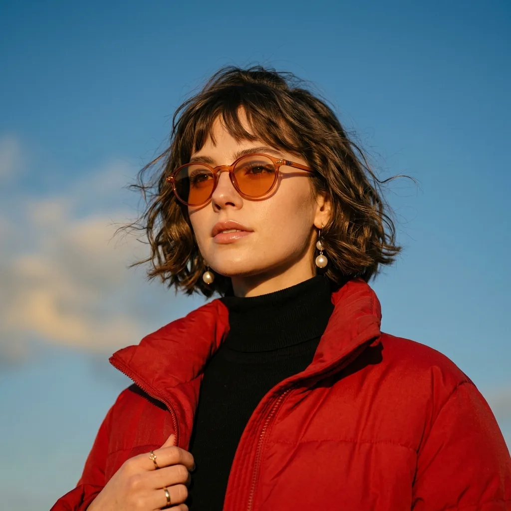

# Fashion portrait of a young woman a short wavy

[← Back to the collection](../../README.md) · Category: [Photography](../../gallery/photography.md) · Model: `Vinano Image v2` · ID: `vn-00077`

<a href="https://vinano.ai?utm_source=github&utm_medium=readme&utm_campaign=awesome-image-video-prompts-updating&utm_content=prompt-page-image"></a>

<sub>Preview generated with <a href="https://vinano.ai?utm_source=github&utm_medium=readme&utm_campaign=awesome-image-video-prompts-updating&utm_content=prompt-page-caption">vinano.ai</a></sub>

## Prompt

```text
A cinematic fashion portrait of a young woman a short wavy bob haircut and wispy bangs, wearing round orange-tinted sunglasses, pearl drop earrings, a black turtleneck and a bold red puffer jacket, soft glossy lips, natural makeup, wind gently moving her hair, photographed from a low angle, shallow depth of field, ultra realistic, 85mm lens, f1.8, warm golden hour sunlight, clean blue sky background, editorial fashion photography, high detail skin texture, soft shadows, cinematic color grading, Vogue style, ultra sharp focus, professional studio quality Preserve realistic proportions and depth for a confident, professional finish.
```

## Try it on vinano.ai

1. Copy the prompt above.
2. Open **[vinano.ai](https://vinano.ai?utm_source=github&utm_medium=readme&utm_campaign=awesome-image-video-prompts-updating&utm_content=prompt-page-try)**, paste it into the image generator and pick a model.
3. Swap any placeholders (brand, product, city, person…) for your own details, then generate.

More prompts like this: [Photography gallery](../../gallery/photography.md) · [all categories](../../README.md#contents)
